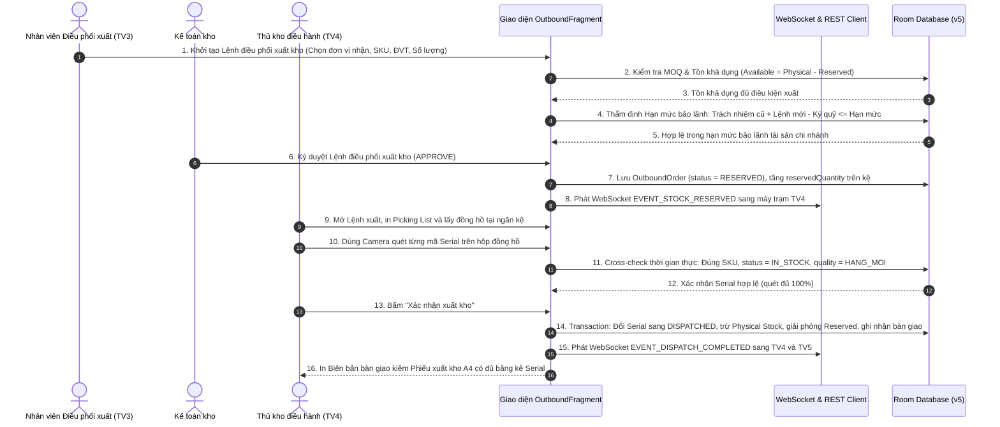

# BÁO CÁO PHÂN TÍCH HỆ THỐNG THÔNG TIN — PHẦN CÔNG VIỆC CỦA TÔ ĐỨC THẢO
> **Học phần:** Phân Tích Hệ Thống Thông Tin & Lập Trình Mạng | **Khoa:** Công Nghệ Thông Tin — Đại học Kiến trúc Đà Nẵng (DAU)  
> **Giảng viên hướng dẫn:** TS. Đặng Hùng Vĩ  
> **Đề tài chung của nhóm:** Hệ Thống Quản Lý Kho Chứa Đồng Hồ Cao Cấp (ChronoVault WMS)  
> **Sinh viên thực hiện:** Tô Đức Thảo (Thành viên 3 / Operations Staff)  
> **Phân hệ chuyên trách:** Phân hệ 3: Quản lý Đơn vị Tiếp nhận & Tác nghiệp Điều phối Xuất kho (Outbound Fulfillment Hub)  
> **Nhóm thực hiện:** 5 AE Siêu Nhân (Bình, Quân, Thảo, Tâm, Tú)

---

> [!IMPORTANT]
> ### XÁC LẬP TÔN CHỈ THIẾT KẾ ĐỀ TÀI: KHO CHỨA ĐỒNG HỒ THUẦN TÚY (CHỈ CÓ NHẬP VÀ XUẤT, KHÔNG MUA HAY BÁN)
> **Hệ thống ChronoVault WMS thuần túy là Hệ thống Quản trị Kho Tổng Lưu Trữ & Điều Phối (Central Storage & Logistics Hub)**, vận hành theo chu trình khép kín:  
> **NHẬP HÀNG VÀO (Inbound) $\rightarrow$ LƯU TRỮ TRÊN NGĂN KỆ (Storage/Bin) $\rightarrow$ ĐIỀU PHỐI XUẤT HÀNG (Outbound Dispatch)**  
> 
> **HỆ THỐNG HOÀN TOÀN KHÔNG PHẢI LÀ PHẦN MỀM MUA BÁN HAY BÁN HÀNG:**
> 1. **Kho không có hoạt động mua bán**: Không bán lẻ (Retail B2C), không bán sỉ thương mại, không có quầy thu ngân POS, không chào giá, không tiếp thị hay chốt sale.
> 2. **Hai nhiệm vụ cốt lõi duy nhất**:
>    - **Nhập hàng vào (Inbound)**: Tiếp nhận các lô hàng đồng hồ từ đơn vị sản xuất/giao hàng đưa vào kho lưu trữ, kiểm định chất lượng, gắn mã Serial và quy đổi Thùng $\rightarrow$ Chiếc.
>    - **Xuất hàng ra (Outbound)**: Tiếp nhận Lệnh điều phối xuất kho chuyển hàng đến các chi nhánh/showroom trưng bày hoặc xuất bảo hành/tiêu hủy, kiểm soát hạn mức bảo lãnh trách nhiệm tài sản, khóa giữ chỗ chống xuất âm kho và quét Camera đối soát 100% Serial.
> 3. **Bản chất các trường giá trị trong CSDL**: Mọi chỉ số tiền tệ (như `unitPrice`, `totalAmount`) thuần túy là **"Giá trị định giá tài sản lưu kho theo bảo hiểm hàng xa xỉ" (Asset Inventory Valuation)** để xác định giá trị bảo hiểm khi lưu kho và vận chuyển, cũng như quy trách nhiệm bồi thường nếu làm mất mát, hư hỏng Serial đồng hồ; các trường `creditLimit`, `currentDebt` là **"Hạn mức bảo lãnh trách nhiệm lưu giữ tài sản" (Asset Custody Limit)** nhằm chống thất thoát tài sản của Tổng kho; và bảng `dealer_receipts` là **"Chứng từ xác nhận hoàn tất giao nhận & Giải phóng hạn mức bảo lãnh" (Asset Delivery Clearance Voucher)**. Hoàn toàn không phải là doanh thu hay tiền bán hàng.
> 4. **Phân hệ 3 của Tô Đức Thảo là "Trung tâm Điều phối & Tác nghiệp Xuất kho" (Outbound Fulfillment & Dispatch Operations)**: Đảm nhận trọn vẹn quy trình xuất kho kỹ thuật từ khi nhận Lệnh điều phối, khóa giữ chỗ kệ hàng, quét Camera kiểm tra 100% Serial, đóng kiện niêm phong, đến lập Biên bản bàn giao xuất kho vật lý.

---

## 1. TỔNG QUAN ĐỀ TÀI & PHÂN HỆ PHỤ TRÁCH (GÓC NHÌN TV3: TÔ ĐỨC THẢO)

### 1.1. Tên đề tài chung của nhóm
**Hệ Thống Quản Lý Kho Chứa Đồng Hồ Cao Cấp (ChronoVault WMS)**

### 1.2. Phân hệ chuyên trách của Thành viên 3 (Tô Đức Thảo)
**Phân hệ 3: Quản Lý Đơn Vị Tiếp Nhận & Tác Nghiệp Điều Phối Xuất Kho (Outbound Fulfillment Hub)**

### 1.3. Phân tích 3 thành phần cấu thành phạm vi nghiệp vụ của TV3:
- **Loại hình / Hành động:** Quản trị Kho lưu trữ & Điều phối xuất hàng đa luồng (Warehouse Storage & Outbound Dispatching).
- **Chức năng chính:** Thẩm định hạn mức bảo lãnh trách nhiệm tài sản (Asset Custody Limit), Khóa giữ chỗ tồn kho chống xuất âm (Inventory Reservation Engine), Quét Camera đối soát 100% mã Serial khi đóng kiện xuất kho (Picking & Dispatch Scan), Xuất bảo hành hãng, Xuất tiêu hủy phế phẩm, và Quản lý đối soát bàn giao với các đơn vị tiếp nhận.
- **Đối tượng / Lĩnh vực:** Kho tổng lưu trữ và bảo quản các dòng đồng hồ xa xỉ giá trị cao (Rolex, Omega, Patek Philippe, Audemars Piguet, Cartier...).

### 1.4. Bảng 1.1: So sánh Cơ chế Vận hành Kho của ChronoVault WMS với các giải pháp thị trường:
| Tiêu chí so sánh | Phần mềm bán lẻ / POS (KiotViet, Sapo) | ERP Sản xuất (SAP B1, Oracle NetSuite) | ERP Quản trị (Odoo WMS) | **Hệ thống ChronoVault WMS (Đề tài - TV3)** |
|:---|:---|:---|:---|:---|
| **Bản chất hệ thống** | Bán lẻ / Thu ngân POS / Cửa hàng | Quản trị tài chính & Sản xuất | Hoạch định doanh nghiệp tổng thể | **Kho chứa chuyên dụng: Nhập kho - Lưu kho kệ - Xuất kho điều phối** |
| **Bản chất nghiệp vụ xuất** | Bán lẻ cho khách tiêu dùng qua quầy | Xuất kho nguyên vật liệu / Sản xuất | Xuất kho bán hàng chung | **Xử lý Lệnh điều phối xuất kho cho đơn vị nhận, xuất bảo hành hãng, xuất hủy** |
| **Cơ chế Khóa giữ chỗ (Reservation)** | Không có (dễ xuất âm / tranh chấp hàng) | Hỗ trợ qua module MRP phức tạp | Có module Reservation | **Khóa tự động cấp SKU ngay khi Lệnh xuất được duyệt (RESERVED), phát WebSocket tức thì** |
| **Kiểm soát Hạn mức xuất** | Nhắc nợ đơn giản tại quầy thu ngân | Thẩm định tín dụng đa cấp | Cảnh báo hạn mức | **Khóa chặn tự động không cho duyệt xuất nếu vượt hạn mức bảo lãnh tài sản chi nhánh** |
| **Quét Serial xuất kho** | Nhập tay hoặc quét ngẫu nhiên | Quét mã Barcode tích hợp | Quét mã Barcode | **Camera quét đối soát chéo 100% Serial: đúng SKU, trạng thái IN_STOCK, chặn xuất nhầm hàng lỗi** |
| **Quy đổi ĐVT xuất kho** | Chỉ nhân chia số lượng giản đơn | Hỗ trợ UoM đa cấp | Hỗ trợ UoM | **Lên lệnh xuất theo Thùng/Chiếc, tự động quy đổi và kiểm tra định mức xuất tối thiểu (MOQ)** |
| **Nền tảng vận hành** | Web App / POS Desktop | Desktop Client nặng nề | Web App | **Android Studio Native (Kotlin MVVM), nhân viên kho cầm điện thoại quét mã trực tiếp tại kệ** |

---

## 2. ĐẶC TẢ YÊU CẦU CHỨC NĂNG (PHÂN HỆ 3 - TÔ ĐỨC THẢO)

| Mã YC | Tên yêu cầu | Mô tả chi tiết luồng xử lý kho | Ưu tiên | Nguồn |
|:---:|:---|:---|:---:|:---|
| **FR-06** | Quản lý Hồ sơ Đơn vị Tiếp nhận Hàng | Khai báo và quản lý danh bạ các chi nhánh/showroom tiếp nhận hàng xuất từ kho tổng: Mã đơn vị, Tên chi nhánh, MST, Người đại diện, Địa chỉ kho nhận, Phân hạng ưu tiên điều phối (Hạng 1, Hạng 2, Hạng 3), Hệ số phân bổ tài sản. | **Cao** | Kế toán kho / Quản lý đơn vị nhận |
| **FR-07** | Kiểm soát Hạn mức Bảo lãnh Tài sản | Thiết lập Hạn mức bảo lãnh trách nhiệm tài sản tối đa (Asset Custody Limit từ 1 - 3 tỷ VNĐ) cho chi nhánh nhận hàng. Tự động kiểm tra: Nếu `Giá trị tài sản đang giữ + Lệnh mới - Ký quỹ > Hạn mức` thì hệ thống khóa chặn quyền duyệt lệnh xuất kho để phòng ngừa rủi ro thất thoát tài sản tổng kho. | **Cao** | Kế toán kho / Quản trị hệ thống |
| **FR-08** | Tiếp nhận Lệnh Điều Phối & Khóa Giữ Chỗ | Tiếp nhận Lệnh điều phối xuất kho theo Thùng hoặc Chiếc lẻ, tự động quy đổi số lượng chiếc, kiểm tra định mức xuất tối thiểu (MOQ ≥ 5-10 chiếc), kiểm tra Tồn khả dụng thời gian thực (`Available = Physical - Reserved`). Khi duyệt lệnh, hệ thống chuyển sang trạng thái `RESERVED`, tăng `reservedQuantity` để chống xuất âm kho. | **Cao** | Nhân viên điều phối / Thủ kho |
| **FR-09** | Quét Camera Serial Đóng Kiện Thực Xuất | Nhân viên xuất kho dùng Camera đọc mã Serial trên từng hộp đồng hồ lấy từ kệ kho. Kiểm tra chéo: Đúng SKU của lệnh, Trạng thái `IN_STOCK`, Chất lượng hàng mới `HANG_MOI` (chặn xuất nhầm hàng lỗi DEFECTIVE, hàng mẫu DISPLAY). Quét đủ 100% mới cho phép bấm "Xác nhận xuất kho", chuyển Serial sang `DISPATCHED` và trừ tồn vật lý. | **Cao** | Nhân viên xuất kho / Thủ kho |
| **FR-10** | Quản lý Xuất Bảo Hành, Hủy & Tiếp Nhận Hoàn Trả | Lập phiếu xuất chuyển bảo hành hãng; lập phiếu xuất tiêu hủy phế phẩm vỡ/hỏng; tiếp nhận sản phẩm chi nhánh gửi hoàn trả về kho (quét Serial đối soát lịch sử xuất kho, phân loại nhập lại Kho Mới hoặc Kho Lỗi C-01). Lập Phiếu xác nhận bàn giao hoàn tất để giải phóng hạn mức bảo lãnh. | **Trung bình** | Kế toán kho / Nhân viên xuất kho |

---

## 3. PHÂN TÍCH ĐỐI TƯỢNG & NHÓM CHỨC NĂNG PHÂN HỆ 3

### 3.1. Danh sách Đối tượng cốt lõi do Tô Đức Thảo thiết kế
| Mã ĐT | Tên đối tượng | Mô tả nghiệp vụ kho | Thuộc tính chính | Quan hệ với đối tượng khác |
|:---:|:---|:---|:---|:---|
| **ENT-06** | **Dealer (Đơn vị nhận hàng)** | Quản lý đơn vị/chi nhánh nhận hàng xuất từ kho tổng, hạn mức bảo lãnh tài sản và giá trị tài sản đang lưu giữ. | `dealerId`, `name`, `tier`, `discountPercent`, `creditLimit`, `currentDebt`, `phone`, `address`, `taxCode`, `status` | Tiếp nhận nhiều Lệnh xuất (1-N); Phát sinh nhiều Phiếu giải phóng bảo lãnh (1-N) |
| **ENT-07** | **OutboundOrder (Lệnh điều phối xuất)** | Lệnh yêu cầu xuất hàng từ kho tổng, quản lý khóa giữ chỗ tồn kho và tổng giá trị tài sản điều chuyển. | `orderCode`, `dealerId`, `dealerName`, `totalAmount`, `depositAmount`, `remainingDebt`, `status`, `createdDate` | Thuộc 1 Đơn vị nhận (N-1); Chứa nhiều Item (1-N); Sinh 1 Phiếu xuất kho (1-1) |
| **ENT-08** | **OrderItem (Chi tiết mặt hàng xuất)** | Chi tiết từng mẫu đồng hồ yêu cầu xuất kho, quy cách Thùng/Chiếc và số lượng chiếc quy đổi khóa giữ chỗ trên kệ. | `itemId`, `orderCode`, `productCode`, `unit`, `quantity`, `convertedQuantity`, `unitPrice`, `discountPercent`, `subtotal` | Thuộc 1 Lệnh xuất (N-1); Tham chiếu 1 Product (N-1) |
| **ENT-09** | **OutboundDispatch (Phiếu xuất bàn giao)** | Chứng từ xuất kho kiêm biên bản bàn giao niêm phong vận chuyển có giá trị pháp lý kho vận. | `dispatchCode`, `orderCode`, `dealerId`, `dispatchDate`, `totalCostPrice`, `shippingFee`, `status`, `dispatchedBy` | Thuộc 1 Lệnh xuất (1-1); Chứa danh sách Serial xuất (1-N) |
| **ENT-10** | **DealerReceipt (Phiếu giải phóng bảo lãnh)** | Chứng từ xác nhận chi nhánh đã nhận bàn giao an toàn hoặc nộp ký quỹ nhằm giải phóng hạn mức bảo lãnh lưu kho. | `receiptId`, `dealerId`, `dealerName`, `amount`, `paymentMethod`, `referenceDoc`, `date`, `note` | Thuộc 1 Đơn vị nhận (N-1); Giảm trừ giá trị tài sản đang giữ |
| **ENT-11** | **CustomerReturn (Phiếu nhận hoàn trả)** | Tiếp nhận sản phẩm hoàn trả về kho tổng, quét đối soát Serial nguồn gốc xuất và giải phóng trách nhiệm tài sản. | `returnId`, `dealerId`, `serialNumber`, `productCode`, `returnReason`, `targetWarehouse`, `refundAmount`, `status` | Thuộc 1 Đơn vị nhận (N-1); Liên kết 1 mã Serial (N-1) |

### 3.2. Vị trí Phân hệ 3 trong Hệ thống Quản trị Kho 5 Phân hệ:
- **MOD-01: Quản trị Hệ thống & Danh mục Master Data (Phan Bá Hải Bình phụ trách):** Quản lý cấu hình bảo mật, tài khoản, phân quyền 5 Roles, danh mục thông số kỹ thuật đồng hồ, quy đổi ĐVT 2 cấp.
- **MOD-02: Tiếp nhận Inbound & Phân bổ Giá vốn (Nguyễn Đắc Quân phụ trách):** Tiếp nhận hàng từ NSX/Hãng, quy đổi Thùng $\rightarrow$ Chiếc, nạp dải Serial vào kho, phân bổ chi phí giá vốn đích danh, lập phiếu chi NCC.
- **MOD-03: Quản lý Đơn vị Tiếp nhận & Điều phối Xuất kho Outbound (Tô Đức Thảo phụ trách):** Tiếp nhận và xử lý Lệnh xuất điều phối kho, kiểm soát hạn mức bảo lãnh trách nhiệm tài sản, cơ chế khóa giữ chỗ tồn kho (Reservation Engine), quét Camera mã Serial đóng kiện xuất kho 2 bước, xuất bảo hành/tiêu hủy và giải phóng hạn mức bảo lãnh.
- **MOD-04: Quản trị Lưu trữ Ngăn kệ & Kiểm kê Tồn kho (Võ Công Tâm phụ trách):** Quản lý tồn kho đa đơn vị, 3 kho chất lượng (Mới/Trưng bày/Lỗi), ma trận kệ tủ Bin K1/K2, kiểm kê thực tế và Sổ Thẻ kho.
- **MOD-05: Executive Dashboard & Hệ thống 9 Báo cáo Điều hành (Trần Công Tú phụ trách):** Thống kê KPI kho vận, giá trị luân chuyển hàng xuất nhập, cảnh báo tồn đọng và dòng tiền luân chuyển kho.

---

## 4. PHÂN TÍCH CHỨC NĂNG ĐẾN TẬN CÙNG (PHÂN HỆ 3)

### 4.1. Cấu trúc phân rã chức năng (Functional Decomposition Tree)
*(Được thiết kế chuẩn hóa theo nghiệp vụ Kho vận Xuất hàng - Outbound Logistics):*

```text
MOD-03: Quản Lý Đơn Vị Tiếp Nhận & Tác Nghiệp Điều Phối Xuất Kho (Tô Đức Thảo)
├── 4.1: Quản lý đơn vị/chi nhánh tiếp nhận hàng xuất kho
│    ├── 4.1.1: Quản lý hồ sơ đơn vị nhận hàng (MST, tên đơn vị, người đại diện, địa chỉ kho nhận)
│    ├── 4.1.2: Cấu hình hạn mức bảo lãnh tài sản xuất kho & Phân hạng ưu tiên điều phối
│    └── 4.1.3: Lập chứng từ xác nhận bàn giao hoàn tất & Giải phóng hạn mức bảo lãnh lưu kho
├── 4.2: Tiếp nhận & Tác nghiệp Lệnh điều phối xuất kho (Outbound Dispatch Fulfillment)
│    ├── 4.2.1: Khởi tạo Lệnh yêu cầu xuất kho (Chọn đơn vị nhận, Thùng/Chiếc, kiểm tra MOQ, kiểm tra tồn)
│    ├── 4.2.2: Thẩm định điều kiện xuất & Khóa giữ chỗ kệ hàng (Check hạn mức bảo lãnh, khóa RESERVED)
│    └── 4.2.3: Soạn hàng, Quét Camera Serial đóng kiện & Thực xuất kho (Picking list, Camera Serial, DISPATCHED)
├── 4.3: Tác nghiệp xuất kho phi thương mại (Xuất bảo hành hãng, Xuất thanh lý, Xuất tiêu hủy phế phẩm)
└── 4.4: Tiếp nhận hàng hoàn trả về kho từ chi nhánh (Quét Serial kiểm tra xuất xứ, phân loại Kho Mới/Lỗi)
```

---

### 4.2. Bảng Mô tả Module IPO: MOD-03-01 (Tiếp Nhận Lệnh Điều Phối Xuất & Khóa Giữ Chỗ Tồn Kho)
| Hạng mục | Nội dung chi tiết |
|:---|:---|
| **Input** | • Dữ liệu đầu vào: Mã đơn vị tiếp nhận, Danh sách mã SKU yêu cầu xuất, Đơn vị tính ('Thùng' hoặc 'Chiếc lẻ'), Số lượng xuất, Tiền ký quỹ bảo lãnh trách nhiệm (nếu có).<br>• Nguồn dữ liệu: Form `dialog_create_outbound_order.xml` / Web Client `tv3_xuat_kho.html`.<br>• Điều kiện tiên quyết: Đơn vị tiếp nhận ở trạng thái `ACTIVE`; SKU có Tồn khả dụng > 0; Người dùng đăng nhập hệ thống. |
| **Process** | 1. Hệ thống tự động quy đổi số lượng: `convertedQty = isBox ? qty * conversionRate : qty`.<br>2. Kiểm tra MOQ: Bắt buộc `convertedQty >= product.moq`.<br>3. Kiểm tra Tồn khả dụng: `availableQty = physicalStock - reservedQty`. Nếu `convertedQty > availableQty` $\rightarrow$ Từ chối và cảnh báo thiếu hàng trong kho.<br>4. Tính toán giá trị định giá tài sản điều chuyển theo bảng kê bảo hiểm lưu kho: `totalAmount = unitPrice * convertedQty`.<br>5. Thẩm định hạn mức bảo lãnh tài sản tự động: Tính `projectedDebt = currentDebt + (totalAmount - deposit)`. Nếu `projectedDebt > creditLimit` $\rightarrow$ Khóa nút Duyệt, hiển thị cảnh báo đỏ vượt hạn mức bảo lãnh tài sản của chi nhánh.<br>6. Nếu hợp lệ: Lưu `OutboundOrderEntity` với trạng thái `RESERVED`.<br>7. Tăng `reservedQuantity` trong Room DB và phát WebSocket `EVENT_STOCK_RESERVED` sang máy trạm Thủ kho TV4. |
| **Output** | • Bản ghi Lệnh điều phối xuất kho mới được lưu vào bảng `outbound_orders` với trạng thái `RESERVED`.<br>• Tồn giữ chỗ của SKU tăng lên; Tồn khả dụng giảm tương ứng (chống xuất âm kho).<br>• Ghi vết Nhật ký kiểm toán Audit Log. |
| **Actor** | Nhân viên điều phối xuất kho (`OPERATIONS_STAFF`), Kế toán kho (`ACCOUNTANT`). |
| **Quyền hạn** | Nhân viên kho lên lệnh nháp; Kế toán thẩm định bảo lãnh và ký duyệt giữ chỗ; Chủ kho duyệt ngoại lệ vượt trần bảo lãnh. |
| **Luồng dữ liệu liên quan** | Ghi vào bảng `outbound_orders`, cập nhật bảng `tong_hop_ton_kho`, ghi vào bảng `audit_logs`. |
| **Ràng buộc** | Tuyệt đối không duyệt lệnh vượt quá Tồn khả dụng; Không cho phép duyệt vượt hạn mức bảo lãnh tài sản nếu chưa có phê duyệt ngoại lệ. |

---

### 4.3. Bảng Mô tả Module IPO: MOD-03-02 (Soạn Hàng, Quét Serial Camera & Thực Xuất Kho)
| Hạng mục | Nội dung chi tiết |
|:---|:---|
| **Input** | • Dữ liệu đầu vào: Mã Lệnh điều phối xuất kho đã duyệt (`RESERVED`), Danh sách mã Serial quét trực tiếp từ hiện vật trên kệ kho.<br>• Phiếu soạn hàng thông minh (Smart Picking List): Hệ thống tự động trích xuất kèm **Tọa độ vị trí ngăn kệ 5 cấp (`currentLocation`: Khu vực $\rightarrow$ Kệ $\rightarrow$ Dãy $\rightarrow$ Tầng $\rightarrow$ Ngăn Bin hoặc Két sắt)** và **Giá vốn đích danh (`unitCost`)** của từng Serial theo lô xuất chỉ định (FIFO).<br>• Nguồn dữ liệu: Camera quét mã vạch (Google ML Kit / ZXing) hoặc máy quét mã vạch cầm tay.<br>• Điều kiện tiên quyết: Lệnh điều phối xuất kho đang ở trạng thái `RESERVED`. |
| **Process** | 1. Hệ thống tự động sinh **Phiếu soạn hàng (Smart Picking List)**: Liệt kê đích danh các mã Serial cần xuất theo thứ tự FIFO (nhập trước xuất trước) kèm theo chính xác vị trí ngăn kệ (`currentLocation`) và giá vốn đích danh của từng chiếc.<br>2. Thủ kho căn cứ lộ trình trên Picking List đi đến đúng tọa độ ngăn kệ (ví dụ: Kệ `K1-A02-B03` hoặc Két `VIP-02`) để rút khay lấy đồng hồ về bàn đóng gói.<br>3. Nhân viên xuất kho dùng Camera quét mã Serial laser trên từng hộp đồng hồ.<br>4. Kiểm tra đối khớp chéo thời gian thực (Real-time Cross-check):<br>   - Đúng `productCode` của Lệnh xuất.<br>   - **Đúng mã Serial nằm trong danh sách chỉ định của Lệnh xuất**: Nếu nhân viên lấy nhầm chiếc của lô khác (dù cùng loại Rolex nhưng khác giá vốn/khác ngày nhập) $\rightarrow$ Ứng dụng lập tức rung cảnh báo, phát âm thanh lỗi và hiển thị cảnh báo đỏ từ chối nhận diện.<br>   - Trạng thái bắt buộc là `IN_STOCK` và chất lượng hàng mới `HANG_MOI` (ngăn chặn tuyệt đối nếu là hàng trầy xước `DEFECTIVE` hoặc hàng mẫu `DISPLAY`).<br>5. Kiểm tra chống quét trùng lặp mã Serial trong cùng kiện hàng đóng xuất.<br>6. Khi số lượng Serial quét đủ 100%: Mở nút "Xác nhận xuất kho".<br>7. Cập nhật đồng thời trong 1 Room Database Transaction: Đổi trạng thái Serial sang `DISPATCHED`, cập nhật `dealerName`, trừ tồn kho vật lý của SKU, giải phóng tồn giữ chỗ, ghi nhận giá trị tài sản đang bàn giao cho chi nhánh và ghi dòng Sổ Thẻ kho (-). |
| **Output** | • Lệnh xuất kho chuyển sang trạng thái `COMPLETED`.<br>• Xuất file và in "Biên bản bàn giao kiêm Phiếu xuất kho" chuẩn A4 có đầy đủ bảng kê Serial định danh, vị trí xuất phát từ ngăn kệ nào và đơn vị tiếp nhận.<br>• Phát WebSocket `EVENT_DISPATCH_COMPLETED` sang TV4 (Thủ kho) và TV5 (Kế toán). |
| **Actor** | Nhân viên xuất kho (`OPERATIONS_STAFF`), Thủ kho (`WAREHOUSE_MANAGER`). |
| **Quyền hạn** | Nhân viên kho quét Serial và đóng kiện; Thủ kho ký xác nhận niêm phong vật lý và bàn giao cho đơn vị vận chuyển. |
| **Luồng dữ liệu liên quan** | Cập nhật bảng `serials`, `products`, `dealers`, `outbound_orders`, ghi Sổ Thẻ kho `stock_cards`. |
| **Ràng buộc** | Bắt buộc quét đúng 100% mã Serial trong Picking List; Nghiêm cấm xuất hàng lỗi kỹ thuật hoặc sai lô giá vốn. |

---

### 4.4. Bảng Mô tả Module IPO: MOD-03-03 (Tác Nghiệp Xuất Kho Phi Thương Mại: Bảo Hành & Tiêu Hủy)
| Hạng mục | Nội dung chi tiết |
|:---|:---|
| **Input** | • Dữ liệu đầu vào: Danh sách mã Serial hàng lỗi kỹ thuật (`DEFECTIVE`) hoặc hàng mẫu (`DISPLAY`), Mục đích xuất ('BAO_HANH_HANG', 'TIEU_HUY'), Biên bản thẩm định kỹ thuật đính kèm.<br>• Nguồn dữ liệu: Form lập phiếu xuất khác `dialog_other_dispatch.xml`.<br>• Điều kiện tiên quyết: Các mã Serial bắt buộc đang nằm trong Kho Hàng Lỗi hoặc Kho Trưng Bày tại TV4. |
| **Process** | 1. Chọn mục đích xuất: Xuất gửi Trung tâm bảo hành chính hãng hoặc Xuất tiêu hủy phế phẩm.<br>2. Chọn mã Serial từ danh sách hàng lỗi cách ly; hệ thống kiểm tra điều kiện xuất kho phi thương mại.<br>3. Kiểm tra thẩm quyền: Xuất tiêu hủy tài sản bắt buộc phải có phê duyệt từ Chủ kho (`STORE_OWNER`).<br>4. Khi được duyệt: Cập nhật trạng thái Serial sang `BAO_HANH` hoặc `DA_TIEU_HUY`.<br>5. Trừ tồn kho vật lý tương ứng tại Kho Lỗi (TV4); ghi dòng biến động vào Sổ Thẻ kho (-); không ghi tăng trách nhiệm chi nhánh. |
| **Output** | • Phiếu xuất khác (`XK-xxxx`) được lưu và chuyển trạng thái `COMPLETED`.<br>• Cập nhật giảm tồn kho lỗi tại TV4; ghi vết Audit Log; cập nhật Báo cáo cơ cấu xuất kho tại TV5. |
| **Actor** | Nhân viên xuất kho (`OPERATIONS_STAFF`), Thủ kho (`WAREHOUSE_MANAGER`), Chủ kho (`STORE_OWNER`). |
| **Ràng buộc** | Nghiêm cấm xuất tiêu hủy đồng hồ khi chưa có biên bản thẩm định kỹ thuật và chữ ký duyệt của Chủ kho. |

---

### 4.5. Bảng Mô tả Module IPO: MOD-03-04 (Tiếp Nhận Hàng Hoàn Trả Về Kho & Đối Soát Serial)
| Hạng mục | Nội dung chi tiết |
|:---|:---|
| **Input** | • Dữ liệu đầu vào: Mã đơn vị hoàn trả, Danh sách mã Serial đồng hồ gửi trả, Lý do hoàn trả, Đánh giá chất lượng thực tế.<br>• Nguồn dữ liệu: Màn hình tiếp nhận hoàn trả `dialog_customer_return.xml`.<br>• Điều kiện tiên quyết: Đồng hồ hoàn trả phải có lịch sử đã từng xuất kho cho chính đơn vị đó. |
| **Process** | 1. Quét mã Serial gửi trả: Hệ thống truy vấn bảng `serials` kiểm tra `status == 'DISPATCHED'` và `dealerName == @ten_don_vi`. Nếu không khớp $\rightarrow$ Từ chối tiếp nhận.<br>2. Đánh giá chất lượng phân loại: Nếu còn nguyên seal $\rightarrow$ Chỉ định nhập lại Kho Mới; nếu trầy xước/lỗi máy $\rightarrow$ Chỉ định nhập Kho Lỗi C-01.<br>3. Phê duyệt tiếp nhận: Hệ thống tự động chuyển Serial về trạng thái `TRONG_KHO`, tăng tồn kho tương ứng tại TV4, cấn trừ giảm giá trị tài sản đang giữ của chi nhánh và ghi nhận dòng phát sinh Thẻ kho (+). |
| **Output** | • Phiếu tiếp nhận hoàn trả (`TS-xxxx`) được duyệt thành công.<br>• Tồn kho TV4 tăng; trách nhiệm tài sản của chi nhánh giảm; khôi phục hạn mức bảo lãnh xuất hàng; ghi vết Audit Log. |
| **Actor** | Nhân viên xuất kho (`OPERATIONS_STAFF`), Thủ kho (`WAREHOUSE_MANAGER`), Kế toán kho (`ACCOUNTANT`). |
| **Ràng buộc** | Bắt buộc kiểm tra chéo nguồn gốc Serial trước khi cho phép nhập kho hoàn trả để chống gian lận hàng giả. |

---

## 5. LUỒNG DỮ LIỆU LIÊN QUAN ĐẾN ĐỐI TƯỢNG & CHỨC NĂNG

### 5.1. Ma trận CRUD (Phân hệ 3 - Điều phối & Xuất kho)
| Đối tượng \ Chức năng | Tạo (C) | Đọc (R) | Cập nhật (U) | Xóa (D) | Ghi chú quy tắc nghiệp vụ |
|:---|:---:|:---:|:---:|:---:|:---|
| **Dealer (Đơn vị nhận hàng)** | Kế toán, Admin | Tất cả các Actor | Kế toán, Chủ kho | Không xóa cứng (chỉ chuyển `LOCKED`) | Bảo toàn lịch sử bàn giao tài sản kho |
| **OutboundOrder (Lệnh điều phối)** | NV Kho, Kế toán | Tất cả các Actor | NV Kho, Kế toán (khi chưa xuất) | Cho phép Hủy lệnh (`CANCELLED`) | Hủy lệnh tự động giải phóng giữ chỗ trên kệ |
| **OutboundDispatch (Phiếu xuất bàn giao)** | NV Kho, Thủ kho | Tất cả các Actor | Thủ kho (khi đang đóng kiện) | Cấm xóa khi đã `COMPLETED` | Biên bản bàn giao có giá trị pháp lý kho vận |
| **SerialEntity (Serial sản phẩm)** | Phân hệ 2 (Nhập) | Tất cả các Actor | NV Kho (đổi sang `DISPATCHED`) | Cấm xóa | Lưu vết trọn đời vòng đời đồng hồ |
| **DealerReceipt (Phiếu giải phóng bảo lãnh)** | Kế toán | Tất cả các Actor | Kế toán (khi lập) | Cấm xóa sau khi đã duyệt | Chứng từ xác nhận hoàn tất giao nhận tài sản |
| **CustomerReturn (Phiếu nhận hoàn trả)** | NV Kho, Kế toán | Tất cả các Actor | Kế toán, Thủ kho | Cấm xóa sau khi duyệt | Tăng lại tồn kho phân hệ TV4 |

---

### 5.2. Sơ đồ Tuần tự Nghiệp vụ Xuất kho (Sequence Diagram):
*(Quy trình phối hợp liên tác nhân từ Tiếp nhận Lệnh điều phối đến Quét Serial đóng kiện hoàn tất)*



---

### 5.3. Mô tả các Luồng dữ liệu chính & Giao thức Lập Trình Mạng:
- **DF-04 (Khởi tạo Lệnh điều phối xuất kho & Thẩm định bảo lãnh):**  
  `Đơn vị tiếp nhận` $\rightarrow$ `NV Điều phối` $\rightarrow$ `dialog_create_outbound_order` $\rightarrow$ Kiểm tra `DealerDao.getDealerById()` $\rightarrow$ Thẩm định hạn mức bảo lãnh $\rightarrow$ Ghi vào `outbound_orders`.
- **DF-05 (Khóa Giữ Chỗ Tồn Kho & Broadcast Socket mạng):**  
  `Kế toán duyệt lệnh` $\rightarrow$ Chuyển trạng thái `RESERVED` $\rightarrow$ Tăng `reservedQuantity` trong CSDL $\rightarrow$ Phát WebSocket `EVENT_STOCK_RESERVED` sang máy trạm TV4 (Thủ kho).
- **DF-06 (Quét Camera Serial Đóng Kiện & Hoàn Tất Xuất Kho):**  
  `NV Xuất kho quét Camera` $\rightarrow$ `SerialDao.getSerialByNumber()` $\rightarrow$ Đối soát hợp lệ $\rightarrow$ Chuyển Serial sang `DISPATCHED` $\rightarrow$ Trừ tồn vật lý trong `ProductDao` $\rightarrow$ Cập nhật trách nhiệm trong `DealerDao` $\rightarrow$ Phát Socket `EVENT_DISPATCH_COMPLETED` sang TV4 và TV5.
- **DF-07 (Lập Phiếu Giải Phóng Bảo Lãnh & Mở Rộng Hạn Mức Điều Phối):**  
  `Chi nhánh gửi biên bản xác nhận nhận hàng an toàn` $\rightarrow$ `Kế toán lập Phiếu giải phóng` $\rightarrow$ Lưu `DealerReceiptEntity` $\rightarrow$ Giảm `currentDebt` của chi nhánh $\rightarrow$ Tự động mở rộng hạn mức khả dụng để kho tiếp tục điều phối xuất hàng.
- **Khía cạnh Lập Trình Mạng (Network Communication):**
  - **REST API Client:** Gọi các Endpoint `POST /api/v1/outbound/orders`, `POST /api/v1/outbound/dispatch`, `POST /api/v1/dealers/receipts`.
  - **WebSocket Real-time Client:** Lắng nghe và phát các sự kiện thời gian thực giữa các máy trạm Android trong mạng LAN nội bộ kho.
  - **Định dạng dữ liệu:** Chuẩn JSON Payload (RFC 8259).
  - **Bảo mật mạng:** Xác thực qua HTTP Header `Authorization: Bearer <JWT_TOKEN>`.

---

## 6. THIẾT KẾ CƠ SỞ DỮ LIỆU CỐT LÕI (ROOM DATABASE v5 & PHYSICAL SCHEMA)

### 6.1. Danh sách 5 bảng Phân hệ 3 do Tô Đức Thảo phụ trách
1. `dealers`: Quản lý hồ sơ đơn vị tiếp nhận hàng, phân hạng ưu tiên điều phối, hạn mức bảo lãnh tài sản và giá trị tài sản đang lưu giữ.
2. `outbound_orders`: Quản lý các Lệnh yêu cầu xuất kho điều phối, tổng giá trị định giá tài sản, tiền ký quỹ và trạng thái khóa giữ chỗ trên kệ.
3. `order_items`: Chi tiết từng mã SKU, quy cách Thùng/Chiếc và số lượng quy đổi khóa tồn kho.
4. `outbound_dispatches`: Chứng từ xuất kho đóng gói bàn giao, chi phí vận chuyển logistics và người duyệt.
5. `dispatch_serials`: Bảng kê đích danh các mã Serial đã quét đóng thùng bàn giao cho đơn vị tiếp nhận.
6. `dealer_receipts`: Chứng từ xác nhận hoàn tất giao nhận & giải phóng hạn mức bảo lãnh lưu kho.

---

### 6.2. Chi tiết thuộc tính 5 bảng dữ liệu vật lý của Phân hệ 3:

#### Bảng 1: `dealers` (Hồ sơ Đơn vị tiếp nhận & Hạn mức bảo lãnh tài sản)
| Tên cột | Kiểu dữ liệu | Null | Default | Mô tả nghiệp vụ kho | Ràng buộc |
|:---|:---|:---:|:---:|:---|:---|
| `dealerId` | VARCHAR(50) | No | Không | Mã định danh đơn vị tiếp nhận (VD: DL-GALLE) | **PRIMARY KEY** |
| `name` | VARCHAR(255) | No | Không | Tên chi nhánh / Kho tiếp nhận hàng xuất | NOT NULL |
| `tier` | VARCHAR(20) | No | 'BRONZE' | Phân hạng ưu tiên điều phối (VIP, SILVER, BRONZE) | CHECK in ('VIP', 'SILVER', 'BRONZE') |
| `discountPercent`| DOUBLE | No | 0.20 | Hệ số phân bổ ưu tiên điều chuyển tài sản | 0.0 <= discountPercent <= 0.50 |
| `creditLimit` | DOUBLE | No | 500000000.0| Hạn mức bảo lãnh trách nhiệm tài sản tối đa (VNĐ) | creditLimit >= 0 |
| `currentDebt` | DOUBLE | No | 0.0 | Giá trị tài sản đang lưu giữ chưa hoàn tất bàn giao | currentDebt >= 0 |
| `phone` | VARCHAR(30) | No | Không | Số điện thoại liên hệ nhận hàng | NOT NULL |
| `address` | VARCHAR(255) | No | Không | Địa chỉ kho nhận hàng thực tế | NOT NULL |
| `taxCode` | VARCHAR(20) | No | Không | Mã số doanh nghiệp / Mã chi nhánh | UNIQUE, NOT NULL |
| `status` | VARCHAR(20) | No | 'ACTIVE' | Trạng thái tiếp nhận điều phối của đơn vị | CHECK in ('ACTIVE', 'LOCKED', 'SUSPENDED') |

#### Bảng 2: `outbound_orders` (Lệnh điều phối xuất kho & Khóa giữ chỗ)
| Tên cột | Kiểu dữ liệu | Null | Default | Mô tả nghiệp vụ kho | Ràng buộc |
|:---|:---|:---:|:---:|:---|:---|
| `orderCode` | VARCHAR(50) | No | Không | Mã Lệnh điều phối xuất kho (VD: DS-2026-001) | **PRIMARY KEY** |
| `dealerId` | VARCHAR(50) | No | Không | Mã đơn vị tiếp nhận hàng xuất | **FOREIGN KEY -> dealers(dealerId)** |
| `dealerName` | VARCHAR(255) | No | Không | Tên đơn vị nhận tại thời điểm lên lệnh | NOT NULL |
| `productCode` | VARCHAR(50) | No | Không | Mã SKU sản phẩm đồng hồ yêu cầu xuất | **FOREIGN KEY -> products(productCode)** |
| `productName` | VARCHAR(255) | No | Không | Tên mẫu đồng hồ yêu cầu xuất | NOT NULL |
| `unit` | VARCHAR(20) | No | 'PIECE' | Đơn vị tính lúc yêu cầu xuất | CHECK in ('PIECE', 'BOX') |
| `quantity` | INT | No | 1 | Số lượng yêu cầu theo ĐVT | quantity > 0 |
| `convertedQuantity`| INT | No | 1 | Số lượng chiếc quy đổi (khóa giữ chỗ trên kệ) | **convertedQuantity >= moq** |
| `unitPrice` | DOUBLE | No | 0.0 | Giá trị định giá bảo hiểm của 1 chiếc lẻ (VNĐ) | unitPrice >= 0 |
| `discountPercent`| DOUBLE | No | 0.0 | Hệ số điều chuyển phân bổ nội bộ | discountPercent >= 0 |
| `totalAmount` | DOUBLE | No | 0.0 | Tổng giá trị định giá tài sản của lô hàng xuất (VNĐ) | totalAmount >= 0 |
| `depositAmount`| DOUBLE | No | 0.0 | Giá trị ký quỹ bảo lãnh lưu chuyển (VNĐ) | depositAmount >= 0 |
| `remainingDebt`| DOUBLE | No | 0.0 | Giá trị trách nhiệm bảo lãnh tài sản phát sinh | remainingDebt >= 0 |
| `status` | VARCHAR(20) | No | 'RESERVED' | Trạng thái lệnh xuất kho | CHECK in ('PENDING', 'RESERVED', 'COMPLETED', 'CANCELLED') |
| `createdDate` | VARCHAR(50) | No | Không | Ngày giờ lập lệnh xuất | NOT NULL |
| `dispatchedSerials`| TEXT | Yes | '' | Danh sách các mã Serial đã quét đóng thùng | Ngăn cách bởi dấu phẩy |

#### Bảng 3: `outbound_dispatches` (Phiếu xuất kho kiêm Biên bản bàn giao)
| Tên cột | Kiểu dữ liệu | Null | Default | Mô tả nghiệp vụ kho | Ràng buộc |
|:---|:---|:---:|:---:|:---|:---|
| `dispatchCode` | VARCHAR(50) | No | Không | Mã phiếu xuất kho bàn giao (VD: PX-2026-001) | **PRIMARY KEY** |
| `orderCode` | VARCHAR(50) | Yes | NULL | Mã Lệnh điều phối xuất liên kết | **FOREIGN KEY -> outbound_orders(orderCode)** |
| `dealerId` | VARCHAR(50) | Yes | NULL | Mã đơn vị tiếp nhận hàng | **FOREIGN KEY -> dealers(dealerId)** |
| `dispatchType` | VARCHAR(30) | No | 'XUAT_DOI_TAC' | Mục đích xuất ('XUAT_DOI_TAC', 'BAO_HANH', 'TIEU_HUY') | CHECK in ('XUAT_DOI_TAC', 'BAO_HANH', 'TIEU_HUY') |
| `dispatchDate` | VARCHAR(50) | No | Không | Ngày giờ quét xuất và niêm phong bàn giao | NOT NULL |
| `totalCostPrice`| DOUBLE | No | 0.0 | Tổng giá vốn đích danh của các Serial xuất | totalCostPrice >= 0 |
| `shippingFee` | DOUBLE | No | 0.0 | Cước phí vận chuyển bảo đảm giá trị cao | shippingFee >= 0 |
| `shippingPayer`| VARCHAR(20) | No | 'BEN_NHAN' | Bên chịu cước phí vận chuyển | CHECK in ('BEN_NHAN', 'KHO_TONG') |
| `status` | VARCHAR(20) | No | 'COMPLETED' | Trạng thái phiếu xuất kho bàn giao | CHECK in ('PACKING', 'COMPLETED', 'CANCELLED') |
| `dispatchedBy` | VARCHAR(50) | No | Không | Nhân viên thực hiện quét xuất | NOT NULL |

#### Bảng 4: `dispatch_serials` (Bảng kê chi tiết Serial đã quét xuất kho)
| Tên cột | Kiểu dữ liệu | Null | Default | Mô tả nghiệp vụ kho | Ràng buộc |
|:---|:---|:---:|:---:|:---|:---|
| `id` | INT | No | Tự tăng | Khóa chính tự tăng | **PRIMARY KEY AUTOINCREMENT** |
| `dispatchCode` | VARCHAR(50) | No | Không | Mã phiếu xuất kho bàn giao | **FOREIGN KEY -> outbound_dispatches(dispatchCode)** |
| `serialNumber` | VARCHAR(100) | No | Không | Mã Serial định danh chiếc đồng hồ được xuất | **FOREIGN KEY -> serials(serialNumber)** |
| `unitCostPrice`| DOUBLE | No | 0.0 | Giá vốn đích danh tại thời điểm xuất (VNĐ) | unitCostPrice >= 0 |
| `dispatchedPrice`| DOUBLE | No | 0.0 | Giá trị định giá bảo hiểm của chiếc đồng hồ | dispatchedPrice >= 0 |

#### Bảng 5: `dealer_receipts` (Phiếu xác nhận bàn giao & Giải phóng bảo lãnh)
| Tên cột | Kiểu dữ liệu | Null | Default | Mô tả nghiệp vụ kho | Ràng buộc |
|:---|:---|:---:|:---:|:---|:---|
| `receiptId` | VARCHAR(50) | No | Không | Mã chứng từ giải phóng bảo lãnh (VD: PT-2026-001) | **PRIMARY KEY** |
| `dealerId` | VARCHAR(50) | No | Không | Mã đơn vị tiếp nhận hoàn tất đối soát | **FOREIGN KEY -> dealers(dealerId)** |
| `dealerName` | VARCHAR(255) | No | Không | Tên đơn vị tiếp nhận bàn giao | NOT NULL |
| `amount` | DOUBLE | No | 0.0 | Giá trị tài sản đã bàn giao an toàn được giải phóng | **amount > 0** |
| `paymentMethod`| VARCHAR(30) | No | 'CHUYEN_KHOAN'| Phương thức xác thực (Biên bản bàn giao / UNC) | CHECK in ('CHUYEN_KHOAN', 'TIEN_MAT') |
| `referenceDoc` | VARCHAR(100) | No | Không | Số chứng từ tham chiếu (Biên bản bàn giao / Mã UNC) | NOT NULL |
| `date` | VARCHAR(50) | No | Không | Ngày giờ xác nhận hoàn tất thủ tục bàn giao | NOT NULL |
| `note` | VARCHAR(255) | Yes | '' | Ghi chú giải phóng bảo lãnh xuất kho | Có thể để trống |

---

### 6.3. Sơ đồ Mối quan hệ Cơ sở dữ liệu Phân hệ 3 (ERD Relationships):
```text
• [dealers]            1 ──── N  [outbound_orders]     (Một đơn vị nhận tiếp nhận nhiều lệnh xuất)
• [dealers]            1 ──── N  [dealer_receipts]     (Một đơn vị có nhiều chứng từ giải phóng bảo lãnh)
• [outbound_orders]    1 ──── 1  [outbound_dispatches] (Một lệnh xuất kho hoàn tất sinh một phiếu xuất bàn giao)
• [outbound_dispatches]1 ──── N  [dispatch_serials]    (Một phiếu xuất kho chứa danh sách nhiều Serial quét thực tế)
• [dispatch_serials]   N ──── 1  [serials]             (Mỗi dòng chi tiết xuất liên kết chính xác 1 mã Serial duy nhất)
• [products]           1 ──── N  [outbound_orders]     (Một mẫu đồng hồ được yêu cầu trong nhiều lệnh xuất)
• [users]              1 ──── N  [outbound_orders]     (Một nhân viên tạo và xử lý nhiều lệnh xuất kho)
• [users]              1 ──── N  [dealer_receipts]     (Một nhân viên kế toán lập nhiều chứng từ giải phóng)
```

---

## 7. KẾ HOẠCH & TIẾN ĐỘ THỰC HIỆN CỦA TÔ ĐỨC THẢO (TV3)

### 7.1. Phân định vai trò và trách nhiệm trong nhóm 5 thành viên
- **Phan Bá Hải Bình (TV1 - Trưởng nhóm):** Quản trị hệ thống, kiến trúc MVVM Core, Room DB v5, phân quyền RBAC 5 Roles, danh mục Luxury Horology.
- **Nguyễn Đắc Quân (TV2):** Tiếp nhận đồng hồ Inbound từ đơn vị sản xuất, quy đổi Thùng $\rightarrow$ Chiếc, nạp dải Serial và phân bổ giá vốn đích danh.
- **Tô Đức Thảo (TV3 - Tác giả báo cáo):** Nhân viên Điều phối & Tác nghiệp Xuất kho (`OPERATIONS_STAFF`) phụ trách phân hệ Quản lý đơn vị tiếp nhận, kiểm soát hạn mức bảo lãnh tài sản, cơ chế khóa giữ chỗ kệ (Reservation Engine), xuất kho 2 bước quét Camera Serial và giải phóng hạn mức bảo lãnh.
- **Võ Công Tâm (TV4):** Thủ kho điều hành quản lý tồn kho đa đơn vị, 3 kho chất lượng (Mới/Trưng bày/Lỗi), ma trận kệ tủ Bin K1/K2, kiểm kê và Sổ Thẻ kho.
- **Trần Công Tú (TV5):** Kế toán kho phụ trách Executive Dashboard KPI thời gian thực, MPAndroidChart giá trị xuất nhập 6 tháng, 9 báo cáo chuyên sâu và dòng tiền luân chuyển kho.

### 7.2. Kế hoạch 4 giai đoạn hoàn thành đồ án
- **Giai đoạn 1 (1.5 tuần):** Khảo sát bài toán điều phối kho chứa đồng hồ cao cấp, tiếp nhận kiến trúc Core MVVM và Room DB v5 từ Trưởng nhóm Phan Bá Hải Bình.
- **Giai đoạn 2 (2.5 tuần):** Phát triển độc lập phân hệ Điều phối Xuất kho & Đơn vị tiếp nhận trên nhánh Git `feature/tv3-outbound-dealer`.
- **Giai đoạn 3 (1.0 tuần):** Ghép nối code (Merge PR), kiểm thử chéo luồng dữ liệu liên phân hệ với TV4 (Tồn kho) và TV5 (Kế toán).
- **Giai đoạn 4 (1.0 tuần):** Hoàn thiện báo cáo chuyên đề cá nhân nộp Trưởng nhóm và chuẩn bị kịch bản Vấn đáp bảo vệ đồ án.

### 7.3. Bảng theo dõi tiến độ cá nhân của Tô Đức Thảo
| Khoảng thời gian | Nội dung công việc thực hiện | Kết quả bàn giao | Tiến độ |
|:---:|:---|:---|:---:|
| `01/10 - 08/10/2026` | Khảo sát bài toán điều phối kho chứa đồng hồ xa xỉ, phân tích rủi ro xuất âm kho và vượt hạn mức bảo lãnh tài sản. | Hoàn thành tài liệu phân tích nghiệp vụ Outbound Logistics. | **100%** |
| `09/10 - 18/10/2026` | Thiết kế CSDL Room DB: `DealerEntity`, `OutboundOrderEntity`, `DealerReceiptEntity` và các DAO tương ứng. | Hoàn thành và merge vào `ChronoVaultDatabase` Version 5. | **100%** |
| `19/10 - 28/10/2026` | Lập trình giao diện Android: `fragment_outbound_order.xml`, `dialog_create_outbound_order.xml`, `dialog_dispatch_order.xml`. | Xây dựng xong UI, ViewBinding và RecyclerView Adapters. | **100%** |
| `29/10 - 05/11/2026` | Lập trình Logic nghiệp vụ: Thuật toán Reservation Engine, Hạn mức bảo lãnh tài sản, quét camera đối soát Serial lúc đóng kiện. | Hoàn thành toàn bộ xử lý trong `OutboundOrderFragment.kt`. | **100%** |
| `06/11 - 10/11/2026` | Viết bộ Kịch bản kiểm thử (Test Cases), xây dựng Báo cáo chuyên đề cá nhân Word và Markdown, chuẩn bị vấn đáp bảo vệ. | Hoàn tất file `BaoCao_TV3_ToDucThao_DieuPhoi_XuatKho.docx`. | **100%** |

---

## PHỤ LỤC A: BẢNG KỊCH BẢN KIỂM THỬ (TEST CASES)

> **Bộ dữ liệu mẫu kiểm thử chuẩn hóa theo nghiệp vụ Kho vận:**  
> • Đơn vị tiếp nhận thử nghiệm: **Chi nhánh Galle Watch Việt Nam** (Mã: `DL-GALLE`, Hạng: VIP, Hạn mức bảo lãnh: **3.000.000.000 VNĐ**, Trách nhiệm tài sản đang giữ: **1.800.000.000 VNĐ**).  
> • Sản phẩm thử nghiệm: **Rolex Submariner Date 41mm** (Mã: `RLX-126610LN`, Định giá tài sản bảo hiểm: **350.000.000 VNĐ/chiếc**, Tồn kho vật lý trên kệ: 14 chiếc).

| Mã TC | Tên kịch bản kiểm thử | Dữ liệu đầu vào (Input) | Kết quả mong đợi & Thực tế | Trạng thái |
|:---:|:---|:---|:---|:---:|
| **TC-01** | Kiểm thử tạo Lệnh xuất vượt Hạn mức bảo lãnh tài sản | Chọn Galle Watch (Trách nhiệm hiện tại 1.8 tỷ, Hạn mức 3.0 tỷ). Yêu cầu xuất điều phối 5 chiếc Rolex Submariner (Định giá tài sản 350tr/c). Tổng giá trị lô hàng xuất: 1.75 tỷ. Hệ số điều chuyển: định giá bảo lãnh 1.3125 tỷ. Tiền ký quỹ: 0đ. Trách nhiệm dự kiến: 1.8 tỷ + 1.3125 tỷ = **3.112.500.000 VNĐ**. | Hệ thống phát hiện 3.112.500.000 > 3.000.000.000 VNĐ. Khóa nút Duyệt lệnh xuất, hiển thị cảnh báo đỏ vượt hạn mức bảo lãnh tài sản chi nhánh 112.5 triệu VNĐ. | **PASS** |
| **TC-02** | Tạo Lệnh xuất hợp lệ & Khóa Giữ chỗ trên kệ (Reservation) | Chọn Galle Watch. Yêu cầu xuất điều phối 2 chiếc Rolex Submariner (Định giá 350tr/c). Tổng giá trị: 700tr. Giá trị bảo lãnh: 525tr. Ký quỹ bảo lãnh: 150tr. Trách nhiệm mới: 375tr. Dư bảo lãnh dự kiến: 1.8 tỷ + 375tr = **2.175.000.000 VNĐ** (≤ 3.0 tỷ). | Duyệt Lệnh xuất thành công mã DS-2026-001 (RESERVED). Tồn giữ chỗ tăng thêm 2. Tồn khả dụng giảm từ 14 xuống 12 chiếc. Phát WebSocket `EVENT_STOCK_RESERVED` sang TV4. | **PASS** |
| **TC-03** | Chặn quét trùng lặp mã Serial lúc đóng kiện xuất kho | Tại lệnh DS-2026-001, dùng Camera quét Serial `RLX-SUB-2026-001` lần thứ 1 (hợp lệ). Cố tình quét tiếp mã `RLX-SUB-2026-001` lần thứ 2 vào cùng kiện hàng đóng xuất. | Ứng dụng rung cảnh báo, phát âm thanh lỗi và hiển thị thông báo: *"Mã Serial RLX-SUB-2026-001 đã được quét rồi!"*. Không cho phép nạp trùng lặp mã Serial. | **PASS** |
| **TC-04** | Chặn Serial sai SKU hoặc Hàng lỗi kỹ thuật | Tại lệnh DS-2026-001 (Rolex), cố tình quét mã Serial của đồng hồ Omega (`OMG-SPEED-2026-001`) hoặc quét mã Serial có trạng thái `DEFECTIVE` (kho lỗi cách ly). | Ứng dụng từ chối nhận diện, báo lỗi: *"Serial không khớp với mã SKU của Lệnh xuất hoặc đang ở trạng thái lỗi kỹ thuật cách ly"*. Chặn hoàn toàn việc xuất nhầm hàng. | **PASS** |
| **TC-05** | Xác nhận đối soát bàn giao & Giải phóng Hạn mức bảo lãnh | Chi nhánh Galle Watch gửi Biên bản xác nhận nhận hàng an toàn kèm ký quỹ 200.000.000 VNĐ (Mã chứng từ: `UNC-VCB-88391`). Trách nhiệm tài sản ban đầu: 1.800.000.000 VNĐ. | Tạo chứng từ PT-2026-001. Giá trị tài sản đang giữ của Galle Watch giảm từ 1.8 tỷ xuống còn 1.6 tỷ VNĐ. Hạn mức bảo lãnh xuất hàng khả dụng tăng thêm 200 triệu để tiếp tục điều phối. | **PASS** |
| **TC-06** | Chặn quét nhầm Serial khác lô nhập / sai giá vốn / sai vị trí kệ | Lệnh DS-2026-001 chỉ định xuất chiếc Rolex Lô 1 (Serial: `RLX-SUB-2026-001`, Giá vốn 285tr tại Kệ `K1-A02-B03`). Nhân viên đến nhầm Két `VIP-02` lấy chiếc Rolex Lô 2 (Serial: `RLX-SUB-2026-002`, Giá vốn 295tr) và dùng Camera quét vào kiện đóng xuất. | Ứng dụng rung cảnh báo đỏ, phát âm thanh lỗi và hiển thị thông báo: *"Serial RLX-SUB-2026-002 thuộc Lô 2 (Giá vốn 295tr tại Két VIP-02), không khớp với danh sách Lô cần xuất trong Picking List!"*. Chặn hoàn toàn việc xuất sai lô và sai giá vốn. | **PASS** |

---

## PHỤ LỤC B: BỘ CÂU HỎI VẤN ĐÁP BẢO VỆ ĐỒ ÁN TRƯỚC HỘI ĐỒNG

* **Câu hỏi 1:** *"Đề tài này là Hệ Thống Quản Lý Kho (WMS), vậy phân hệ của em đóng vai trò gì và tại sao khẳng định kho không có mua bán?"*  
  👉 **Trả lời:** *"Thưa thầy/cô, hệ thống ChronoVault WMS của nhóm em thuần túy là Kho Tổng Lưu Trữ & Điều Phối (Warehouse Storage Hub), hoàn toàn không có hoạt động mua bán, không có quầy thu ngân POS và không có nhân viên kinh doanh bán hàng. Nhiệm vụ của kho chỉ gồm hai đầu mối khép kín: Nhập hàng vào (Inbound) và Xuất hàng ra (Outbound). Phân hệ của em phụ trách đầu ra: Trung tâm Điều phối & Tác nghiệp Xuất kho (Outbound Fulfillment). Khi các chi nhánh, showroom hoặc trung tâm bảo hành gửi Yêu cầu xuất hàng, nhiệm vụ của em là: (1) Thẩm định Hạn mức bảo lãnh trách nhiệm tài sản của đơn vị nhận để tránh thất thoát tài sản tổng kho; (2) Khóa giữ chỗ tồn kho (Inventory Reservation Engine) ngay trên kệ để ngăn chặn triệt để tình trạng xuất âm kho; (3) Soạn hàng và dùng Camera quét đối soát 100% Serial để đảm bảo xuất đúng mẫu mã, đúng chất lượng hàng mới nguyên seal, chặn hàng lỗi; (4) Đóng kiện niêm phong và in Phiếu xuất kho kiêm Biên bản bàn giao hàng hóa A4. Toàn bộ là tác nghiệp kho vận kỹ thuật phục vụ lưu thông và bảo quản tài sản, tuyệt đối không phải là nghiệp vụ bán hàng."*

* **Câu hỏi 2:** *"Nếu kho không mua bán, tại sao trong CSDL lại có các trường giá trị (totalAmount), hạn mức (creditLimit) và phiếu thu (dealer_receipts)?"*  
  👉 **Trả lời:** *"Thưa thầy/cô, đây là đặc thù bắt buộc của ngành Quản lý Kho Đồng Hồ Xa Xỉ (Luxury Horology Warehouse): (1) Mỗi chiếc đồng hồ Rolex, Patek Philippe có giá trị từ vài trăm triệu đến hàng tỷ đồng. Do đó, các trường unitPrice hay totalAmount trong hệ thống thuần túy là 'Giá trị định giá tài sản lưu kho theo bảo hiểm' (Asset Valuation) để xác định giá trị bảo hiểm hàng hóa khi lưu kho và vận chuyển, cũng như quy trách nhiệm bồi thường nếu làm mất mát hoặc trầy xước; (2) Trường creditLimit và currentDebt là 'Hạn mức bảo lãnh trách nhiệm giữ tài sản' (Asset Custody Limit): Một chi nhánh đang giữ 1.8 tỷ đồng giá trị hàng hóa chưa đối soát hoàn tất bàn giao thì không được phép tiếp nhận thêm quá hạn mức bảo lãnh 3.0 tỷ, nhằm kiểm soát rủi ro tài sản cho Tổng kho; (3) Bảng dealer_receipts là 'Biên bản xác nhận hoàn tất giao nhận & Giải phóng hạn mức bảo lãnh' (Asset Delivery Clearance Voucher): Khi chi nhánh nhận hàng an toàn vào tủ két, chứng từ này giải phóng số dư trách nhiệm tài sản để mở rộng hạn mức cho các đợt điều phối tiếp theo. Hoàn toàn không phải là tiền bán hàng hay doanh thu."*

* **Câu hỏi 3:** *"Cơ chế Giữ chỗ tồn kho (Inventory Reservation Engine) bảo vệ kho khỏi tình trạng Xuất âm kho như thế nào?"*  
  👉 **Trả lời:** *"Thưa thầy/cô, trong một kho chứa lớn, có nhiều nhân viên điều phối cùng làm việc đồng thời. Nếu kho chỉ còn 3 chiếc Rolex, khi 2 nhân viên cùng nhận 2 Lệnh xuất kho (mỗi lệnh 3 chiếc), nếu không có cơ chế giữ chỗ, cả 2 đều nhìn thấy tồn vật lý là 3 chiếc nên đều duyệt lệnh. Kết quả là xảy ra 'Xuất âm kho' — kho không có đủ hàng thực tế trên kệ để đóng kiện xuất giao. Với thuật toán Reservation của em, ngay khi Lệnh 1 được duyệt, Room DB lập tức tăng `reservedQuantity = 3`, làm cho Tồn khả dụng (`Available = Physical - Reserved`) tụt ngay về 0. Lệnh 2 khi kiểm tra tồn khả dụng sẽ bị hệ thống chặn lại ngay lập tức, triệt tiêu hoàn toàn rủi ro tranh chấp hàng xuất."*

* **Câu hỏi 4:** *"Làm sao đảm bảo nhân viên đóng gói không xuất nhầm chiếc đồng hồ đang bị lỗi kỹ thuật hoặc hàng trưng bày khỏi kho?"*  
  👉 **Trả lời:** *"Thưa thầy/cô, trong quá trình quét xuất kho bằng Camera, ứng dụng của em thực hiện truy vấn thời gian thực vào bảng `serials` trong Room Database. Tại đây, mỗi mã Serial đều gắn liền với 2 trường dữ liệu bắt buộc: `productCode` (phải khớp với Lệnh xuất) và `quality`/`status`. Nếu chiếc đồng hồ đang có trạng thái là `DEFECTIVE` (hàng trầy xước, hấp hơi ở kho lỗi C-01) hoặc `DISPLAY` (hàng mẫu mở hộp trưng bày), ứng dụng sẽ lập tức rung cảnh báo, phát âm thanh lỗi, viền đỏ màn hình và chặn hoàn toàn nút 'Xác nhận xuất kho', đảm bảo 100% sản phẩm rời khỏi kho là hàng mới nguyên seal."*

* **Câu hỏi 5:** *"Phân hệ của em đóng góp gì cho khía cạnh Lập Trình Mạng (Network Communication) của toàn đồ án?"*  
  👉 **Trả lời:** *"Thưa thầy/cô, phân hệ của em là trung tâm trao đổi thông điệp mạng thời gian thực: (1) Khi em duyệt Lệnh điều phối xuất kho và khóa giữ chỗ, ứng dụng phát thông điệp WebSocket `EVENT_STOCK_RESERVED` giúp màn hình của Thủ kho (TV4) lập tức cập nhật giảm tồn khả dụng mà không cần tải lại; (2) Khi em quét xuất kho hoàn tất, thông điệp `EVENT_DISPATCH_COMPLETED` được truyền sang phân hệ TV4 (để trừ tồn kho vật lý) và phân hệ Kế toán TV5 (để ghi nhận biến động giá trị tài sản lưu kho); (3) Khi em lập Phiếu giải phóng bảo lãnh bàn giao, dữ liệu được đồng bộ trực tiếp sang Báo cáo luân chuyển của Kế toán. Toàn bộ các gói tin đều có định dạng chuẩn JSON và xác thực bảo mật JWT Bearer Token."*

* **Câu hỏi 6:** *"Nếu muốn xuất kho một lô đồng hồ mà giá vốn mỗi chiếc khác nhau, làm sao phân hệ của em biết vị trí của từng chiếc ở đâu để lấy đúng và tránh bị nhầm lẫn hoặc xuất sai lô hàng?"*  
  👉 **Trả lời:** *"Thưa thầy/cô, hệ thống giải quyết bài toán này qua 3 chốt chặn kỹ thuật chặt chẽ:*  
  *1. **Quản trị tọa độ vị trí 5 cấp (`currentLocation`):** Mỗi chiếc đồng hồ khi nhập kho đều được phân hệ TV4 gán một tọa độ lưu trữ cụ thể trong bảng `serials` (Khu vực $\rightarrow$ Dãy kệ $\rightarrow$ Tầng $\rightarrow$ Ngăn Bin hoặc Két sắt an toàn).*  
  *2. **Sinh Phiếu soạn hàng thông minh (Smart Picking List):** Khi Lệnh xuất được duyệt giữ chỗ, phân hệ của em tự động sinh Picking List chỉ định đích danh mã Serial cần xuất theo thứ tự FIFO (hoặc theo lô chỉ định) kèm theo chính xác **tọa độ ngăn kệ** và **giá vốn đích danh** của từng chiếc, giúp nhân viên đi thẳng đến đúng ngăn kệ rút hàng mà không cần tìm kiếm.*  
  *3. **Camera quét đối soát 100% tại bàn đóng gói (Chốt chặn chống sai sót):** Khi mang đồng hồ về bàn đóng gói, nhân viên bắt buộc phải quét mã Serial bằng Camera điện thoại. Dù hộp bên ngoài giống hệt nhau, nhưng nếu nhân viên lấy nhầm chiếc của lô khác (khác giá vốn) hoặc nhầm hàng trưng bày/lỗi, ứng dụng sẽ rung cảnh báo, phát âm thanh lỗi và khóa chặn nút xuất kho ngay lập tức, đảm bảo 100% xuất đúng chiếc, đúng giá vốn và đúng vị trí."*
