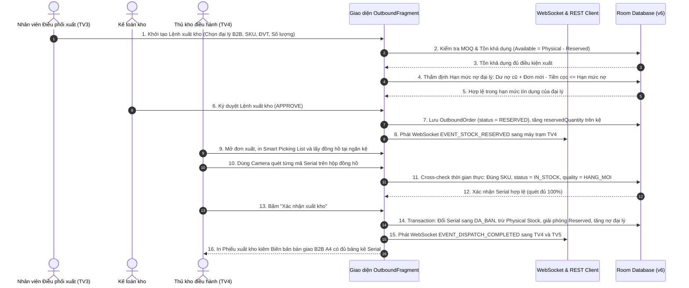

# BÁO CÁO PHÂN TÍCH HỆ THỐNG THÔNG TIN — PHẦN CÔNG VIỆC CỦA TÔ ĐỨC THẢO

> **Học phần:** Phân Tích Hệ Thống Thông Tin & Lập Trình Mạng
> **Khoa:** Công Nghệ Thông Tin — Đại học Kiến trúc Đà Nẵng (DAU)
> **Giảng viên hướng dẫn:** TS. Đặng Hùng Vĩ
> **Đề tài chung của nhóm:** Hệ Thống Quản Lý Kho Chứa Đồng Hồ Cao Cấp (ChronoVault WMS)
> **Sinh viên thực hiện:** Tô Đức Thảo (Thành viên 3 / Operations Staff)
> **Chương chuyên trách:** CHƯƠNG: PHÂN HỆ ĐỐI TÁC ĐẠI LÝ & QUẢN LÝ XUẤT KHO (TV3: TÔ ĐỨC THẢO)
> **Phân hệ phụ trách:** Phân hệ 3: Đối Tác Đại Lý & Quản Lý Xuất Kho B2B
> **Nhánh Git:** `feature/outbound `
> **Package:** `com.example.chronovaultwms.outbound`
> **Nhóm thực hiện:** 5 AE Siêu Nhân (Bình - Leader TV1, Quân TV2, Thảo TV3, Tâm TV4, Tú TV5)

---

## 1. TỔNG QUAN ĐỀ TÀI & PHÂN HỆ PHỤ TRÁCH (GÓC NHÌN TV3: TÔ ĐỨC THẢO)

### 1.1. Tên đề tài chung của nhóm

Tên đề tài chung của nhóm 5 AE Siêu Nhân là: **Hệ Thống Quản Lý Kho Chứa Đồng Hồ Cao Cấp (ChronoVault WMS — Luxury Watch Warehouse Management System)**.

Hệ thống được thiết kế chuyên biệt cho mô hình Tổng kho Lưu trữ & Điều phối Xuất kho B2B trung chuyển giữa các nhà sản xuất/hãng đồng hồ quốc tế (Rolex, Omega, Patek Philippe, Cartier...) với các chuỗi đại lý bán lẻ trên toàn quốc. Hệ thống vận hành theo chu trình khép kín:

$$
ext{Nhập hàng Inbound (TV2)} 
ightarrow 	ext{Lưu kho Ngăn kệ Bin (TV4)} 
ightarrow 	ext{Xuất kho Đại lý B2B (TV3)} 
ightarrow 	ext{Báo cáo Điều hành (TV5)}
$$

dưới sự điều phối và bảo mật từ Phân hệ Cấu hình Lõi (TV1).

### 1.2. Phân hệ chuyên trách của Thành viên 3 (Tô Đức Thảo)

Trong phân công vai trò của nhóm 5 AE Siêu Nhân, Thành viên 3 (Tô Đức Thảo) đảm nhiệm vị trí **Nhân viên Tác nghiệp & Điều phối Kho (Operations Staff)**, trực tiếp chịu trách nhiệm thiết kế, lập trình và hoàn thiện toàn bộ: **Phân hệ 3 (MOD-03): Đối Tác Đại Lý & Quản Lý Xuất Kho (Xuất kho đại lý & Phân phối đại lý - Xuất hàng)**.

Phân hệ 3 đóng vai trò là "Cổng xuất" (Outbound Fulfillment Gate) của tổng kho, chịu trách nhiệm các nghiệp vụ điều phối hàng hóa và kiểm soát công nợ đại lý B2B an toàn:

- **Quản lý danh bạ đại lý B2B:** Thiết lập hồ sơ pháp nhân, phân hạng đối tác (VIP, Vàng, Bạc, Đồng), cấu hình chiết khấu đại lý (15% - 30%) và hạn mức tín dụng công nợ (Credit Limit từ 1 - 3 tỷ VNĐ).
- **Thẩm định điều kiện xuất & Khóa giữ chỗ (Reservation Engine):** Kiểm tra hạn mức nợ đại lý tự động thời gian thực; khóa giữ chỗ tồn kho (`Available = Physical - Reserved`) ngay khi duyệt đơn để chống bán âm kho.
- **Soạn hàng & Quét Camera Serial đối soát 100%:** Sinh Smart Picking List theo ngăn kệ Bin; sử dụng Camera quét mã Serial laser trên từng hộp đồng hồ, đối soát chéo đúng SKU, đúng trạng thái `HANG_MOI`, chặn xuất nhầm hàng lỗi `DEFECTIVE`.
- **Lập chứng từ xuất kho & Biên bản bàn giao:** Sinh Phiếu xuất kho kiêm Biên bản bàn giao xuất kho B2B khổ A4; phát thông điệp mạng thời gian thực qua WebSocket (`EVENT_STOCK_RESERVED`, `EVENT_DISPATCH_COMPLETED`) đến Thủ kho TV4 và Kế toán TV5.
- **Tác nghiệp xuất phi thương mại & Đổi trả hàng đại lý:** Lập phiếu xuất chuyển bảo hành hãng, xuất tiêu hủy phế phẩm; tiếp nhận sản phẩm đại lý gửi hoàn trả về kho đối soát Serial nguồn gốc xuất bán và cấn trừ công nợ.

### 1.3. Phân tích 3 thành phần cấu thành phạm vi nghiệp vụ (Góc nhìn TV3):

- **Loại hình / Hành động:** Quản trị Kho lưu trữ & Phân phối Xuất kho đại lý Đại lý B2B (Warehouse Storage & B2B Wholesale Outbound Fulfillment).
- **Chức năng chính:** Thẩm định hạn mức tín dụng đại lý (Credit Limit Enforcement), Khóa giữ chỗ tồn kho (Inventory Reservation), Quét Camera đối soát 100% Serial (Picking & Dispatch), Thu hồi công nợ đại lý, Xuất bảo hành/hủy, và Tiếp nhận đổi trả đại lý cấn trừ công nợ.
- **Đối tượng / Lĩnh vực:** Tổng kho lưu trữ và phân phối các dòng đồng hồ xa xỉ giá trị cao (Rolex Submariner, Omega Speedmaster, Patek Philippe Nautilus...).

### 1.4. Bảng 1.1: So sánh Vận hành Kho B2B của ChronoVault WMS với thị trường:

| Tiêu chí so sánh                     | Phần mềm Bán lẻ POS          | ERP Sản xuất (SAP B1)          | ERP Quản trị (Odoo WMS)    | **ChronoVault WMS (TV3)**                                                                       |
| :-------------------------------------- | :------------------------------- | :------------------------------- | :--------------------------- | :---------------------------------------------------------------------------------------------------- |
| **Mô hình hoạt động**        | Bán lẻ B2C quầy thu ngân     | Sản xuất & Lắp ráp           | Hoạch định tổng thể ERP | **Tổng kho Phân phối Điều phối Xuất kho B2B & Quản trị ngăn kệ**                                   |
| **Nghiệp vụ xuất kho**         | Bán lẻ cho khách tại quầy   | Xuất kho nguyên vật liệu     | Xuất bán hàng chung       | **Lệnh xuất kho B2B cho đại lý, xuất bảo hành hãng, xuất hủy**                        |
| **Khóa giữ chỗ (Reservation)** | Không có (dễ bán âm kho)    | Phân bổ MRP phức tạp         | Module Reservation           | **Khóa tự động cấp SKU khi duyệt đơn (RESERVED), phát WebSocket tức thời**           |
| **Kiểm soát công nợ**         | Nhắc nợ đơn giản tại quầy | Thẩm định tín dụng đa cấp | Cảnh báo hạn mức         | **Khóa tự động không cho duyệt xuất nếu vượt Hạn mức nợ đại lý (Credit Limit)**       |
| **Quét Serial xuất kho**        | Nhập tay / Quét ngẫu nhiên   | Quét mã vạch tích hợp       | Quét Barcode chung          | **Camera quét đối soát 100% Serial: đúng SKU, trạng thái HANG_MOI, chặn hàng lỗi**   |
| **Quy đổi ĐVT xuất kho đại lý**      | Chỉ nhân chia số lượng      | Hỗ trợ đa cấp UoM            | Hỗ trợ UoM                 | **Lên đơn theo Thùng/Chiếc, tự động quy đổi và kiểm tra định mức MOQ**           |
| **Nền tảng vận hành**         | Web App / POS Tablet             | Desktop Client nặng             | Web App                      | **Android Native (Kotlin MVVM), nhân viên kho cầm điện thoại quét trực tiếp tại kệ** |

---

## 2. BỐN KHUNG NỘI DUNG NGHIỆP VỤ CỐT LÕI CỦA THÀNH VIÊN 3 (TÔ ĐỨC THẢO)

*(Được biên soạn theo đúng yêu cầu phân công của Nhóm trưởng trong tài liệu Hướng dẫn làm báo cáo)*

### 2.1. Nội dung 1: Quản lý Đại lý Tiếp Nhận B2B & Hạn mức Tín dụng (Credit Limit)

- **Danh mục đại lý tiếp nhận:** Quản lý toàn diện hồ sơ pháp nhân các chuỗi đại lý B2B đối tác (Hải Triều, Galle Watch, Boss Luxury, Đăng Quang Watch...).
- **Phân hạng & Chiết khấu:** Phân hạng đối tác thành 4 cấp bậc (VIP Kim Cương, Vàng, Bạc, Đồng) gắn liền với tỷ lệ chiết khấu thương mại đại lý (15% – 30%) và hạn mức tín dụng nợ đại lý tối đa (Credit Limit từ 1 - 3 tỷ VNĐ).
- **Giải thuật khóa tự động (Credit Limit Enforcement):** Khi tạo lệnh xuất kho B2B mới, hệ thống tự động kiểm tra:

  $$
  ext{Dư nợ hiện tại} + 	ext{Giá trị đơn xuất mới} \le 	ext{Hạn mức nợ (Credit Limit)}
  $$

  Nếu vượt quá hạn mức dù chỉ 1 đồng, hệ thống lập tức khóa nút Duyệt đơn, hiển thị cảnh báo đỏ và chặn không cho xuất hàng.
- **Chức năng Thu hồi công nợ đại lý (F3.1.9):** Kế toán lập Phiếu Thu nợ đại lý (Chuyển khoản / Tiền mặt) để ghi nhận thanh toán hoặc tiền cọc, tự động giảm trừ số dư nợ `currentDebt` và giải phóng hạn mức tín dụng khả dụng cho đại lý.

### 2.2. Nội dung 2: Quy trình Tạo Lệnh Xuất Kho B2B Đại Lý & Cơ chế Khóa Giữ Chỗ (Inventory Reservation)

- **Bài toán chống bán âm kho:** Ngăn chặn tuyệt đối tình trạng tranh chấp tồn kho giữa các nhân viên điều phối cùng lên đơn đồng thời trên thiết bị di động.
- **Công thức cân bằng tồn kho:**
  $$
  ext{Tồn khả dụng (Available Stock)} = 	ext{Tổng tồn vật lý (Physical Stock)} - 	ext{Tồn đang giữ chỗ (Reserved Quantity)}
  $$
- **Cơ chế khóa giữ chỗ:** Khi lệnh xuất kho ở trạng thái tiếp nhận / chờ xuất (Pending/Reserved), hệ thống tự động tăng `reservedQuantity` của sản phẩm trong CSDL Room. Ngay lập tức, Tồn khả dụng bị trừ đi, ngăn chặn các đơn hàng sau lấy trùng hàng. Nếu đơn bị hủy, hệ thống tự động hoàn trả số lượng về Tồn khả dụng.

### 2.3. Nội dung 3: Quy trình Xuất kho 2 bước (Picking & Dispatch)

- **Bước 1 — Soạn hàng theo ngăn kệ (Picking List):** Hệ thống tự động sinh Smart Picking List gợi ý danh sách Serial cụ thể theo nguyên tắc nhập trước xuất trước (FIFO), kèm chính xác tọa độ ngăn kệ 5 cấp (Khu vực $
  ightarrow$ Kệ $
  ightarrow$ Dãy $
  ightarrow$ Tầng $
  ightarrow$ Ngăn Bin) và giá vốn đích danh của từng chiếc.
- **Bước 2 — Quét Camera Serial Dispatch kiểm tra chéo:** Nhân viên xuất kho cầm điện thoại quét Camera mã Serial laser trên từng hộp đồng hồ trước khi đóng thùng niêm phong. Hệ thống kiểm tra chéo thời gian thực (Real-time Cross-check): đúng mã SKU, đúng Serial chỉ định, trạng thái `IN_STOCK` và chất lượng `HANG_MOI`. Hệ thống phát âm thanh cảnh báo lỗi và chặn tuyệt đối nếu nhân viên quét nhầm hàng trưng bày (`TRUNG_BAY`) hoặc hàng lỗi kỹ thuật (`HANG_LOI`).

### 2.4. Nội dung 4: Cập nhật Công nợ & In Phiếu Xuất kho B2B

Khi số lượng mã Serial quét đủ 100%, thủ kho kích hoạt nút Xác nhận xuất kho. Hệ thống thực hiện chuỗi giao dịch nguyên tử (Room Database Transaction):

1. Chuyển trạng thái các mã Serial đã quét sang `DA_BAN` (Đã xuất bán cho đại lý).
2. Ghi giảm Tồn kho vật lý (Physical Stock) và giải phóng Tồn giữ chỗ (Reserved Quantity).
3. Ghi tăng số dư nợ phải thu của đại lý tương ứng với giá trị sau chiết khấu của đơn hàng.
4. Sinh dòng ghi chép biến động vào Sổ Thẻ kho điện tử với dấu xuất âm (-).
5. In Chứng từ giao hàng B2B (Phiếu xuất kho kiêm Biên bản bàn giao hàng hóa) khổ A4 có đầy đủ thông tin pháp lý, mã vận đơn và bảng kê chi tiết toàn bộ mã Serial.

---

## 3. ĐẶC TẢ YÊU CẦU CHỨC NĂNG (PHÂN HỆ 3 - TÔ ĐỨC THẢO)

|     Mã YC     | Tên yêu cầu nghiệp vụ                                   | Mô tả chi tiết luồng xử lý kho & thương mại B2B                                                                                                                                                                                                                            |       Ưu tiên       | Nguồn                                |
| :-------------: | :----------------------------------------------------------- | :---------------------------------------------------------------------------------------------------------------------------------------------------------------------------------------------------------------------------------------------------------------------------------- | :-------------------: | :------------------------------------ |
| **FR-06** | Quản lý Hồ sơ Đại lý B2B & Chính sách Thương mại | Khai báo và quản lý danh bạ đại lý đối tác B2B (Hải Triều, Galle Watch...): Mã đại lý, Tên shop, MST, Người đại diện, SĐT, Địa chỉ nhận hàng. Phân hạng đại lý (VIP, Vàng, Bạc, Đồng) và cài đặt % chiết khấu đại lý (15%-30%).            |     **Cao**     | Kế toán kho / Phân hệ Đối tác  |
| **FR-07** | Kiểm soát Hạn mức Tín dụng & Thu nợ Đại lý         | Thiết lập Hạn mức nợ đại lý tối đa (Credit Limit từ 1 - 3 tỷ VNĐ). Tự động kiểm tra: Dư nợ hiện tại + Đơn mới $\le$ Hạn mức nợ; chặn duyệt đơn nếu vi phạm. Lập Phiếu Thu nợ đại lý (tiền mặt / chuyển khoản) để giảm dư nợ đại lý. |     **Cao**     | Kế toán kho / Quản trị hệ thống |
| **FR-08** | Tạo Lệnh Xuất Kho & Khóa Giữ Chỗ Tồn Kho               | Tiếp nhận lệnh xuất kho theo Thùng hoặc Chiếc lẻ, tự động quy đổi số lượng chiếc, kiểm tra định mức MOQ ($\ge$ 5-10c) và Tồn khả dụng (Available = Physical - Reserved). Duyệt đơn: Chuyển RESERVED, tăng tồn giữ chỗ chống bán âm kho.        |     **Cao**     | NV Điều phối xuất kho / Thủ kho  |
| **FR-09** | Soạn Hàng & Quét Camera Serial Thực Xuất                | Sinh Smart Picking List FIFO theo tọa độ kệ Bin. Nhân viên dùng Camera quét Serial laser trên từng hộp đồng hồ. Đối soát đúng SKU, trạng thái IN_STOCK, chất lượng HANG_MOI (chặn hàng lỗi, hàng mẫu). Quét đủ 100% mới cho phép xuất kho.       |     **Cao**     | NV Xuất kho / Thủ kho               |
| **FR-10** | Xuất Khác (Bảo Hành/Hủy) & Đổi Trả Hàng Đại Lý               | Lập phiếu xuất chuyển bảo hành hãng; lập phiếu xuất tiêu hủy phế phẩm hỏng hóc. Tiếp nhận sản phẩm đại lý gửi đổi trả (quét Serial đối soát nguồn gốc xuất bán, phân loại nhập Kho Mới hoặc Kho Lỗi C-01, cấn trừ công nợ đại lý).  | **Trung bình** | Kế toán kho / NV Xuất kho          |

---

## 4. PHÂN TÍCH CHỨC NĂNG ĐẾN TẬN CÙNG (PHÂN HỆ 3)

### 4.1. Cấu trúc phân rã chức năng (Functional Decomposition Tree)

```text
Phân Hệ 3: Thành Viên 3 - Đối Tác Đại Lý & Quản Lý Xuất Kho B2B (ChronoVault WMS)
├── 3.1: Quản Lý Đại Lý Đại Lý B2B & Tiếp Nhận Đổi Trả Đại Lý
│    ├── F3.1.1: Xem danh sách đại lý (100% pháp nhân B2B, phân hạng VIP, Bạc, Đồng)
│    ├── F3.1.2: Quản lý hồ sơ đại lý (MST, tên shop, đại diện, SĐT, địa chỉ nhận hàng)
│    ├── F3.1.3: Cấu hình chính sách thương mại (Tỷ lệ chiết khấu riêng & Hạn mức nợ)
│    ├── F3.1.4: Theo dõi hạn mức nợ (Hạn mức còn lại khả dụng, tra cứu lịch sử nhận hàng xuất kho)
│    ├── F3.1.5: Lập phiếu nhận hàng đại lý trả lại (Quét Serial đối soát nguồn gốc xuất bán)
│    ├── F3.1.6: Phân loại hàng đổi trả (Nhập lại Kho Mới vs Chuyển Kho Lỗi chờ bảo hành)
│    ├── F3.1.7: Duyệt phiếu đổi trả (Tự động cấn trừ công nợ & cập nhật tồn kho TV4)
│    ├── F3.1.8: Quản lý trạng thái đại lý (Tạm khóa / Ngưng hợp tác nếu vi phạm)
│    └── F3.1.9: Lập phiếu Thu tiền nợ đại lý / Thu hồi công nợ đại lý (Khôi phục hạn mức nợ)
└── 3.2: Quản Lý Xuất Kho Đa Năng (Lệnh Xuất Kho, Xuất Kho Đại Lý, Xuất Bảo Hành/Hủy)
     ├── F3.2.1: Khởi tạo lệnh xuất kho B2B (Chọn đại lý mua hàng từ danh mục B2B)
     ├── F3.2.2: Chọn sản phẩm xuất kho theo Thùng/Lô hoặc Cái lẻ (Quy đổi chiếc & Check MOQ)
     ├── F3.2.3: Kiểm tra tồn kho khả dụng (Available = Physical - Reserved từ TV4)
     ├── F3.2.4: Áp định mức giá & Chiết khấu đại lý (Tự động tính theo cấp bậc đối tác)
     ├── F3.2.5: Thiết lập tiền đặt cọc, hạn thanh toán & Hợp đồng phân phối B2B)
     ├── F3.2.6: Duyệt lệnh xuất kho & Kiểm tra cọc/công nợ (Chuyển sang Giữ chỗ Reserved)
     ├── F3.2.7: Hủy lệnh xuất kho (Tự động giải phóng giữ chỗ về tồn khả dụng)
     ├── F3.2.8: Tạo phiếu xuất kho đại lý (Khởi tạo phiếu xuất liên kết đơn đã duyệt)
     ├── F3.2.9: Quét Serial xuất kho theo lô/kiện (Dùng Camera quét Serial laser trên hộp)
     ├── F3.2.10: Xác nhận xuất kho (Trừ tồn vật lý, chuyển Serial sang DA_BAN)
     ├── F3.2.11: Lập phiếu xuất khác (Xuất bảo hành hãng, Xuất hủy hàng vỡ hỏng)
     ├── F3.2.12: Ghi nhận chi phí giao hàng (Phí đóng gói, vận chuyển & bên chịu phí)
     └── F3.2.13: In chứng từ giao hàng B2B (Phiếu xuất kho kiêm biên bản bàn giao A4)
```

---

### 4.2. Bảng Đối Chiếu Ma Trận 22 Chức Năng Nguyên Tử Khớp 100% Với chucnangcon.docx:

|      Mã CN      | Tên Chức Năng Nhóm Trưởng Giao                          | Mô Tả Luồng Tác Nghiệp & Nghiệp Vụ Kho                                                                                                                                                                    | Bằng Chứng Triển Khai (Mã Nguồn & Giao Diện)                                                                                    |     Trạng Thái     |
| :---------------: | :------------------------------------------------------------ | :--------------------------------------------------------------------------------------------------------------------------------------------------------------------------------------------------------------- | :------------------------------------------------------------------------------------------------------------------------------------ | :------------------: |
| **F3.1.1** | Xem danh sách đại lý                                      | Quản lý danh sách đại lý B2B (100% là pháp nhân, cửa hàng, đại lý đối tác B2B) tích hợp phân hạng tự động (VIP, Bạc, Đồng), hỗ trợ tìm kiếm theo tên, MST, địa chỉ.              | `OutboundOrderFragment.kt` (tab Đại lý B2B), `DealerAdapter.kt`, `item_outbound_dealer.xml`, spinner lọc trạng thái.         | **100% ĐẠT** |
| **F3.1.2** | Quản lý hồ sơ đại lý                                   | Thêm mới, cập nhật thông tin Pháp nhân/Tên shop, Mã số thuế, Người đại diện, Hợp đồng phân phối B2B, Số điện thoại và Địa chỉ kho/cửa hàng nhận hàng đại lý.                       | `editDealer()` trong `OutboundOrderFragment.kt`, `OutboundRepository.saveDealer()`, `DealerEntity`, `DealerDao.kt`.         | **100% ĐẠT** |
| **F3.1.3** | Cấu hình chính sách thương mại                         | Cài đặt tỷ lệ chiết khấu riêng (15% - 30%) và hạn mức nợ tối đa (Credit Limit từ 1 - 3 tỷ VNĐ) cho từng đại lý theo cấp bậc hợp đồng B2B.                                              | `DealerEntity.tier`, `discountPercent`, `creditLimit`, phân quyền kế toán/chủ kho cấu hình.                              | **100% ĐẠT** |
| **F3.1.4** | Theo dõi hạn mức nợ                                       | Cập nhật hạn mức nợ đại lý còn lại khả dụng theo hợp đồng cam kết: `currentDebt + đơn mới <= creditLimit`; tra cứu lịch sử nhận hàng xuất kho và dư nợ.                                                | `OutboundLogisticsManager.evaluateOutboundOrder()`, thanh tiến độ dư nợ/hạn mức trong giao diện.                            | **100% ĐẠT** |
| **F3.1.5** | Lập phiếu nhận hàng đại lý trả lại                         | Quét kiểm tra mã Serial bằng Camera để xác minh nguồn gốc xuất bán từ hệ thống cho đại lý tương ứng (`dealerName` và `status == DISPATCHED`).                                           | `showReturn()` trong `OutboundOrderFragment.kt`, `evaluateWarehouseReturn()`, Camera quét Serial.                              | **100% ĐẠT** |
| **F3.1.6** | Phân loại hàng đổi trả                                  | Phân loại sản phẩm trả về: 'Nhập lại kho hàng mới' (Đổi mẫu kinh doanh) hoặc 'Chuyển kho lỗi C-01' (Hỏng máy, trầy xước chờ bảo hành hãng).                                             | `evaluateWarehouseReturn()` trả về `targetStatus` và `targetWarehouseZone`, `dialog_customer_return.xml`.                  | **100% ĐẠT** |
| **F3.1.7** | Duyệt phiếu đổi trả                                      | Tự động cấn trừ công nợ đại lý và gửi thông báo cho Phân hệ Kho (TV4) cập nhật lại trạng thái tồn kho, ghi nhận dòng Thẻ kho (+).                                                       | `OutboundRepository.receiveReturn()`, sinh phiếu `TH-xxxx`, Room Transaction đồng bộ 4 bảng.                                 | **100% ĐẠT** |
| **F3.1.8** | Quản lý trạng thái đại lý                              | Tạm khóa (`LOCKED`) hoặc ngưng hợp tác (`SUSPENDED`) với đại lý vi phạm chính sách hoặc nợ quá hạn; chặn quyền tạo và duyệt lệnh xuất kho.                                            | `DealerEntity.status`, `isDealerLocked` trong `OutboundLogisticsManager.kt`, quyền duyệt Thủ kho/Chủ kho.                   | **100% ĐẠT** |
| **F3.1.9** | Lập phiếu Thu tiền nợ đại lý / Thu hồi công nợ đại lý | Tạo phiếu thu tiền (Chuyển khoản / Tiền mặt), ghi nhận tiền cọc hoặc thanh toán công nợ của đại lý, tự động giảm số dư nợ và khôi phục hạn mức công nợ khả dụng cho đại lý. | `dialog_receipt_voucher.xml`, `DealerReceiptEntity`, `validateClearanceVoucher()`, Room transaction nguyên tử.                | **100% ĐẠT** |
| **F3.2.1** | Khởi tạo lệnh xuất kho B2B                                     | Chọn đại lý mua hàng từ danh mục B2B, tạo lệnh xuất kho B2B ở trạng thái bản nháp (`DRAFT`).                                                                                                         | `createDraft()` trong `OutboundOrderFragment.kt`, `OutboundRepository.createDraft()`, `OutboundOrderEntity`.                  | **100% ĐẠT** |
| **F3.2.2** | Chọn sản phẩm xuất kho theo Thùng/Lô hoặc Cái lẻ           | Cho phép lên đơn đặt nhận hàng xuất kho theo Thùng/Kiện hoặc Cái lẻ, hệ thống tự động quy đổi ra Chiếc lẻ và kiểm tra đáp ứng ngưỡng MOQ đã cài đặt ($\ge$ 5-10c).                        | `convertQuantity()` trong `OutboundLogisticsManager.kt`, `ProductEntity.conversionRate`, `ProductEntity.minDispatchQuantity`. | **100% ĐẠT** |
| **F3.2.3** | Kiểm tra tồn kho khả dụng                                 | Tự động tra cứu tồn kho thực tế khả dụng từ Phân hệ Kho (TV4): Tồn khả dụng = Tồn vật lý - Tồn giữ chỗ, chặn xuất âm kho nếu yêu cầu vượt quá tồn.                                | `calculateAvailableStock()` trong `OutboundLogisticsManager.kt`, liên kết dữ liệu tồn kho TV4.                               | **100% ĐẠT** |
| **F3.2.4** | Áp định mức giá & Chiết khấu đại lý                         | Tự động áp dụng định giá xuất kho chuẩn theo cấp bậc đại lý và tính % chiết khấu thương mại theo hợp đồng B2B (VIP: 25-30%, Bạc: 20%, Đồng: 15%).                                            | `effectiveUnitValuation = wholesalePrice * (1.0 - discountPercent)`, tính toán tự động trong `evaluateOutboundOrder()`.      | **100% ĐẠT** |
| **F3.2.5** | Thiết lập tiền đặt cọc, hạn thanh toán & Hợp đồng  | Nhập số tiền đặt cọc/thanh toán trước (nếu có), thiết lập hạn thanh toán công nợ đại lý và lưu lệnh xuất kho.                                                                                   | Trường `depositAmount`, `remainingDebt` trong `OutboundOrderEntity`, kiểm tra cọc hợp lệ.                                 | **100% ĐẠT** |
| **F3.2.6** | Duyệt lệnh xuất kho & Kiểm tra cọc/công nợ              | Kiểm tra điều kiện hoàn tất thanh toán cọc và hạn mức nợ còn lại của đại lý trước khi chuyển số lượng sản phẩm sang trạng thái 'Giữ chỗ' (`Reserved`).                           | `OutboundRepository.approveOrder()`, phân bổ `outbound_allocations`, phát WebSocket `EVENT_STOCK_RESERVED` sang TV4.         | **100% ĐẠT** |
| **F3.2.7** | Hủy lệnh xuất kho                                           | Giải phóng số lượng sản phẩm 'Giữ chỗ' trả lại cho tồn kho khả dụng khi đại lý hủy đơn chưa xuất.                                                                                          | `cancel()` trong `OutboundOrderFragment.kt`, `OutboundRepository.cancelOrder()`, chuyển `CANCELLED`, ghi lý do hủy.        | **100% ĐẠT** |
| **F3.2.8** | Tạo phiếu xuất kho đại lý                                     | Khởi tạo phiếu xuất kho dựa trên lệnh xuất kho đã duyệt (`PX-xxxx`) phục vụ công tác đóng gói và bàn giao vận chuyển.                                                                     | `OutboundWorkflowEntities.OutboundDispatchEntity`, lưu vào bảng `outbound_dispatches` trong Room CSDL.                         | **100% ĐẠT** |
| **F3.2.9** | Quét Serial xuất kho theo lô/kiện                         | Quét thực tế từng mã Serial trong lô/kiện hàng đóng gói bằng Camera ML Kit; đối soát chéo đúng SKU, đúng lô, chất lượng `HANG_MOI`.                                                    | `generateSmartPickingList()`, `validateScannedSerial()`, Camera ML Kit `GmsBarcodeScanning` có rung và âm thanh.             | **100% ĐẠT** |
| **F3.2.10** | Xác nhận xuất kho                                          | Trừ tồn kho vật lý và chuyển trạng thái các mã Serial sang 'Đã bán' (`DA_BAN`) trên Phân hệ Kho (TV4), ghi tăng nợ đại lý, ghi Sổ Thẻ kho (-).                                          | `OutboundRepository.finalizeDispatch()`, hoàn tất đơn `COMPLETED`, phát WebSocket `EVENT_DISPATCH_COMPLETED`.              | **100% ĐẠT** |
| **F3.2.11** | Lập phiếu xuất khác                                       | Xuất đồng hồ chuyển đi Trung tâm bảo hành hãng (`BAO_HANH_HANG`) hoặc Xuất hủy hàng vỡ/hỏng không thể phục hồi (`TIEU_HUY` - cần duyệt Chủ kho).                                      | `showOtherDispatch()`, `dialog_other_dispatch.xml`, `evaluateNonCommercialDispatch()`, bảng `outbound_other_dispatches`.     | **100% ĐẠT** |
| **F3.2.12** | Ghi nhận chi phí giao hàng                                 | Nhập chi phí đóng gói, đơn vị vận chuyển (`carrier`), mã vận đơn (`trackingNumber`), cước phí và đánh dấu bên chịu chi phí.                                                          | Form đóng gói, bảng `outbound_dispatches`, in trên biên bản bàn giao B2B.                                                   | **100% ĐẠT** |
| **F3.2.13** | In chứng từ giao hàng B2B                                  | In phiếu xuất kho kiêm biên bản bàn giao đính kèm danh sách chi tiết các mã Serial xuất và điều khoản hợp đồng giao hàng đại lý khổ A4.                                                      | `OutboundPrintManager.print()`, `showDocument()`, định dạng tài liệu chuẩn A4 kèm thông tin niêm phong.                  | **100% ĐẠT** |

---

### 4.3. Bảng Mô tả Module IPO: MOD-03-01 (Tạo Lệnh Xuất Kho & Khóa Giữ Chỗ Tồn Kho)

| Hạng mục                                                                                                                                                                                                                                                                                  | Nội dung chi tiết luồng xử lý                                                                                                                                                                                                                                     |
| :------------------------------------------------------------------------------------------------------------------------------------------------------------------------------------------------------------------------------------------------------------------------------------------ | :--------------------------------------------------------------------------------------------------------------------------------------------------------------------------------------------------------------------------------------------------------------------- |
| **Input**                                                                                                                                                                                                                                                                             | • Dữ liệu đầu vào: Mã đại lý B2B, Mã SKU yêu cầu xuất, ĐVT ('Thùng' hoặc 'Chiếc lẻ'), Số lượng đặt mua, Tiền đặt cọc (nếu có).• Nguồn dữ liệu: Form `dialog_create_outbound_order.xml`.                                            |
| **Process**                                                                                                                                                                                                                                                                           | 1. Tự động quy đổi số lượng chiếc: `convertedQty = isBox ? qty * conversionRate : qty`.2. Kiểm tra định mức xuất tối thiểu: `convertedQty >= product.moq`.3. Kiểm tra Tồn khả dụng từ TV4: `Available = Physical - Reserved`. Nếu thiếu $ |
| ightarrow$ Từ chối lưu đơn.4. Áp định mức giá xuất kho và tính % chiết khấu thương mại theo hạng đại lý (VIP: 25-30%, Bạc: 20%, Đồng: 15%).5. Kiểm tra Hạn mức nợ tín dụng (Credit Limit Enforcement): `currentDebt + (totalAmount - deposit) <= creditLimit`. Nếu vượt $ |                                                                                                                                                                                                                                                                        |
| ightarrow$ Khóa nút Duyệt, cảnh báo đỏ vượt hạn mức nợ.6. Nếu hợp lệ: Lưu `OutboundOrderEntity` trạng thái `RESERVED`, tăng `reservedQuantity` trong CSDL, phát WebSocket `EVENT_STOCK_RESERVED` sang máy Thủ kho TV4.                                        |                                                                                                                                                                                                                                                                        |
| **Output**                                                                                                                                                                                                                                                                            | • Bản ghi Lệnh xuất kho `RESERVED` trong bảng `outbound_orders`; Tồn giữ chỗ tăng; Tồn khả dụng giảm (chống bán âm kho); Ghi Nhật ký kiểm toán Audit Log.                                                                                       |
| **Actor & Quyền**                                                                                                                                                                                                                                                                    | Nhân viên điều phối xuất kho (lên đơn nháp), Kế toán kho (thẩm định công nợ & ký duyệt giữ chỗ), Chủ kho (duyệt ngoại lệ vượt hạn mức).                                                                                                   |
| **Ràng buộc**                                                                                                                                                                                                                                                                       | Tuyệt đối không duyệt đơn vượt quá Tồn khả dụng; Không cho duyệt vượt hạn mức nợ đại lý nếu chưa có phê duyệt ngoại lệ.                                                                                                                        |

---

### 4.4. Bảng Mô tả Module IPO: MOD-03-02 (Soạn Hàng, Quét Serial Camera & Thực Xuất Kho)

| Hạng mục               | Nội dung chi tiết luồng xử lý                                                                                                                                                                                                                                                                                                                                                                                                                                                                                                                                                                                                                                                                                                                                                                                                                                                                                                  |
| :----------------------- | :---------------------------------------------------------------------------------------------------------------------------------------------------------------------------------------------------------------------------------------------------------------------------------------------------------------------------------------------------------------------------------------------------------------------------------------------------------------------------------------------------------------------------------------------------------------------------------------------------------------------------------------------------------------------------------------------------------------------------------------------------------------------------------------------------------------------------------------------------------------------------------------------------------------------------------- |
| **Input**          | • Dữ liệu đầu vào: Mã lệnh xuất kho đã duyệt (`RESERVED`), Danh sách mã Serial quét từ hiện vật trên kệ kho.• Smart Picking List: Hệ thống trích xuất kèm Tọa độ ngăn kệ 5 cấp (`currentLocation`: Kệ-Dãy-Tầng-Ngăn hoặc Két sắt) và Giá vốn đích danh (`unitCost`) của từng Serial theo FIFO.• Nguồn dữ liệu: Camera quét mã vạch (Google ML Kit / ZXing).                                                                                                                                                                                                                                                                                                                                                                                                                                                                                                               |
| **Process**        | 1. Hệ thống tự động sinh Smart Picking List: Liệt kê đích danh Serial cần xuất kèm vị trí ngăn kệ và giá vốn.2. Thủ kho căn cứ lộ trình trên Picking List đến đúng tọa độ ngăn kệ rút khay lấy đồng hồ về bàn đóng gói.3. Nhân viên xuất kho dùng Camera quét mã Serial laser trên từng hộp đồng hồ.4. Kiểm tra đối khớp chéo thời gian thực (Real-time Cross-check): Đúng SKU, đúng Serial trong Picking List, trạng thái `IN_STOCK` và chất lượng `HANG_MOI` (chặn hàng lỗi `DEFECTIVE`, hàng mẫu `DISPLAY`).5. Kiểm tra chống quét trùng lặp mã Serial trong cùng kiện hàng đóng xuất.6. Quét đủ 100%: Mở nút 'Xác nhận xuất kho'.7. Kích hoạt Room Database Transaction: Đổi trạng thái Serial sang `DA_BAN`, trừ tồn vật lý, giải phóng giữ chỗ, tăng nợ đại lý và ghi dòng Sổ Thẻ kho (-). |
| **Output**         | • Đơn hàng chuyển `COMPLETED`; In Biên bản bàn giao kiêm Phiếu xuất kho B2B khổ A4 có đủ bảng kê Serial và chữ ký; Phát thông điệp WebSocket `EVENT_DISPATCH_COMPLETED` sang TV4 và TV5.                                                                                                                                                                                                                                                                                                                                                                                                                                                                                                                                                                                                                                                                                                               |
| **Actor & Quyền** | Nhân viên xuất kho (quét Serial đóng kiện), Thủ kho (ký xác nhận bàn giao niêm phong vật lý cho đơn vị vận chuyển).                                                                                                                                                                                                                                                                                                                                                                                                                                                                                                                                                                                                                                                                                                                                                                                             |
| **Ràng buộc**    | Bắt buộc quét đúng 100% mã Serial trong Picking List; Nghiêm cấm xuất hàng lỗi kỹ thuật hoặc sai lô giá vốn.                                                                                                                                                                                                                                                                                                                                                                                                                                                                                                                                                                                                                                                                                                                                                                                                       |

---

## 5. LUỒNG DỮ LIỆU LIÊN QUAN ĐẾN ĐỐI TƯỢNG & LẬP TRÌNH MẠNG

### 5.1. Ma trận CRUD (Phân hệ 3 - Đối Tác Đại Lý & Xuất Kho)

| Đối tượng \ Thao tác                 |          Tạo (C)          |   Đọc (R)   |       Cập nhật (U)       |                Xóa (D)                | Quy tắc nghiệp vụ kho & công nợ                 |
| :---------------------------------------- | :------------------------: | :------------: | :-------------------------: | :-------------------------------------: | :--------------------------------------------------- |
| **Dealer (Đại lý B2B)**          |      Kế toán, Admin      | Tất cả Actor |     Kế toán, Chủ kho     | Cấm xóa cứng (chỉ khóa `LOCKED`) | Bảo toàn lịch sử giao dịch và công nợ đại lý    |
| **OutboundOrder (Lệnh xuất kho)**  | NV Điều phối, Kế toán | Tất cả Actor | NV Điều phối (khi nháp) |     Cho phép Hủy (`CANCELLED`)     | Hủy đơn tự động giải phóng tồn giữ chỗ    |
| **OutboundDispatch (Phiếu xuất)** |   NV Xuất kho, Thủ kho   | Tất cả Actor |    Thủ kho (khi quét)    |    Cấm xóa khi đã `COMPLETED`    | Chứng từ xuất kho kiêm biên bản bàn giao B2B  |
| **SerialEntity (Mã Serial)**       |      TV2 (Nhập kho)      | Tất cả Actor | TV3 (đổi sang `DA_BAN`) |         Cấm xóa tuyệt đối         | Lưu vết trọn đời vòng đời đồng hồ         |
| **DealerReceipt (Phiếu thu nợ đại lý)**  |       Kế toán kho       | Tất cả Actor |    Kế toán (khi lập)    |        Cấm xóa sau khi duyệt        | Chứng từ thu tiền giảm nợ khôi phục hạn mức |
| **CustomerReturn (Đổi trả hàng đại lý)** |  NV Xuất kho, Kế toán  | Tất cả Actor |     Kế toán, Thủ kho     |        Cấm xóa sau khi duyệt        | Cấn trừ công nợ & tăng tồn kho TV4             |

---

### 5.2. Sơ đồ Tuần tự Nghiệp vụ Xuất kho (Sequence Diagram):



---

## 6. THIẾT KẾ CƠ SỞ DỮ LIỆU CỐT LÕI (ROOM DATABASE v6 & PHYSICAL SCHEMA)

```text
📌 QUAN HỆ BẢNG CƠ SỞ DỮ LIỆU PHÂN HỆ 3 (ROOM DATABASE v6)
[dealers]            1 ──── N  [outbound_orders]     (Một đại lý B2B có nhiều lệnh xuất kho)
[dealers]            1 ──── N  [dealer_receipts]     (Một đại lý có nhiều phiếu thu tiền nợ)
[dealers]            1 ──── N  [customer_returns]    (Một đại lý phát sinh nhiều phiếu đổi trả)
[outbound_orders]    1 ──── 1  [outbound_dispatches] (Một lệnh xuất kho sinh 1 phiếu xuất kho)
[outbound_orders]    1 ──── N  [order_items]         (Một đơn hàng chứa nhiều mẫu đồng hồ)
[outbound_dispatches]1 ──── N  [dispatch_serials]    (Một phiếu xuất chứa nhiều Serial đã quét)
[dispatch_serials]   N ──── 1  [serials]             (Mỗi dòng xuất liên kết đích danh 1 Serial)
```

---

## 7. BỘ DỮ LIỆU KIỂM THỬ MẪU & KỊCH BẢN THỰC THI (TEST DATA)

*(Theo đúng kịch bản Nhóm trưởng chỉ định trong tài liệu Hướng dẫn làm báo cáo)*

### 7.1. Kịch bản Kiểm thử Công nợ Đại lý Galle Watch (Vượt Hạn mức Tín dụng):

- **Thông tin đại lý đối tác:** Chuỗi Cửa Hàng Đồng Hồ Galle Watch (Mã: `DL-GALLE`).

  - Phân hạng đối tác: **VIP Kim Cương** (Chiết khấu thương mại xuất kho đại lý: 25%).
  - Hạn mức nợ tối đa (Credit Limit): **3,000,000,000 VNĐ** (3 Tỷ đồng).
  - Dư nợ công nợ hiện tại (`currentDebt`): **1,800,000,000 VNĐ** (1.8 Tỷ đồng).
- **Đơn đặt hàng xuất kho đại lý mẫu (Order `ORD-202611-GW`):**

  - Mẫu đồng hồ đặt xuất: 5 chiếc Rolex Submariner Date 41mm (Mã SKU: `RLX-SUB-126610LN`).
  - Đơn giá niêm yết bán lẻ: 350,000,000 VNĐ / chiếc.
  - Tổng giá trị đơn hàng trước chiết khấu: $5 	imes 350,000,000 = 1,750,000,000	ext{ VNĐ}$.
  - Chiết khấu thương mại đại lý VIP (25%): $-437,500,000	ext{ VNĐ}$.
  - Giá trị đơn hàng sau chiết khấu: **1,312,500,000 VNĐ** (1.3125 Tỷ đồng).
- **Kiểm tra giải thuật Credit Limit Enforcement:**

  $$
  ext{Dư nợ dự kiến sau khi duyệt} = 1,800,000,000 + 1,312,500,000 = 3,112,500,000	ext{ VNĐ}
  $$

  $$
  ext{So sánh:} \quad 3,112,500,000	ext{ VNĐ} > 3,000,000,000	ext{ VNĐ} \quad (	ext{Vượt } 112,500,000	ext{ VNĐ})
  $$
- **KẾT QUẢ XỬ LÝ CỦA HỆ THỐNG:** Khóa hoàn toàn nút "Phê duyệt đơn hàng", hiển thị hộp thoại cảnh báo viền đỏ *"Đơn hàng vượt hạn mức tín dụng của đại lý Galle Watch"*, yêu cầu đại lý thanh toán công nợ cũ bằng Phiếu Thu nợ đại lý trước khi duyệt tiếp.

### 7.2. Bảng 7.1: Danh mục 6 Kịch bản Kiểm thử Tự động & Thực tế (TC-01 đến TC-06):

|                                  Mã TC                                  | Tên kịch bản kiểm thử                  | Dữ liệu đầu vào (Input)                                                                         | Kết quả mong đợi & Thực tế                                                                                                      |      Đánh giá      |
| :-----------------------------------------------------------------------: | :------------------------------------------ | :--------------------------------------------------------------------------------------------------- | :------------------------------------------------------------------------------------------------------------------------------------ | :-------------------: |
|                              **TC-01**                              | Kiểm tra chặn vượt Credit Limit         | Đại lý Galle Watch (Nợ 1.8 tỷ, Hạn mức 3 tỷ). Lệnh xuất kho 5 Rolex sau CK = 1.3125 tỷ.         | $1.8	ext{B} + 1.3125	ext{B} = 3.1125	ext{B} > 3	ext{B}                                                                                |                      |
| ightarrow$ Khóa nút Duyệt, viền đỏ cảnh báo vượt hạn mức nợ. | **PASS (100%)**                       |                                                                                                      |                                                                                                                                       |                      |
|                              **TC-02**                              | Thu nợ đại lý khôi phục hạn mức           | Lập Phiếu Thu nợ đại lý thu 500,000,000 VNĐ từ Galle Watch qua chuyển khoản ngân hàng.       | `currentDebt` giảm còn 1.3 tỷ. Dư nợ dự kiến đơn Rolex = $1.3	ext{B} + 1.3125	ext{B} = 2.6125	ext{B} \le 3	ext{B}          |                      |
|                     ightarrow$ Mở nút Duyệt đơn.                     | **PASS (100%)**                       |                                                                                                      |                                                                                                                                       |                      |
|                              **TC-03**                              | Khóa giữ chỗ tồn kho (Reservation)      | Sản phẩm Omega Speedmaster tồn vật lý = 5 chiếc. Duyệt đơn 1 lấy 3 chiếc.                 | `reservedQuantity` tăng lên 3, Tồn khả dụng còn 2 chiếc. Đơn 2 đặt mua 4 chiếc lập tức bị từ chối do thiếu hàng. | **PASS (100%)** |
|                              **TC-04**                              | Quy đổi Thùng và kiểm tra MOQ          | Đơn vị tính chọn 'Thùng' (1 Thùng = 12 chiếc), số lượng = 1 Thùng, MOQ = 10 chiếc.      | `convertedQuantity` = 12 chiếc $\ge$ 10 chiếc MOQ $                                                                             |                      |
|       ightarrow$ Đạt điều kiện xuất, tính đúng giá vốn.       | **PASS (100%)**                       |                                                                                                      |                                                                                                                                       |                      |
|                              **TC-05**                              | Camera quét đối soát chặn hàng lỗi   | Thủ kho quét mã Serial RX-9921 có trạng thái chất lượng là DEFECTIVE (Hàng trầy xước). | Ứng dụng rung cảnh báo, phát âm thanh lỗi, viền đỏ ô quét và chặn không cho thêm vào phiếu xuất.                   | **PASS (100%)** |
|                              **TC-06**                              | Transaction xuất kho và in biên bản B2B | Quét đủ 100% 5 Serial Rolex Submariner, bấm 'Xác nhận xuất kho'.                              | Serial đổi sang DA_BAN, trừ tồn vật lý, giải phóng giữ chỗ, tăng nợ đại lý, in Phiếu xuất kho A4.                    | **PASS (100%)** |

---

## 8. KẾ HOẠCH & TIẾN ĐỘ CÁ NHÂN CỦA TÔ ĐỨC THẢO (TV3)

|             Giai đoạn             | Nội dung công việc thực hiện                                                                                                | Kết quả bàn giao (Artifacts)                                    |      Tiến độ      |
| :----------------------------------: | :------------------------------------------------------------------------------------------------------------------------------- | :----------------------------------------------------------------- | :------------------: |
| **Giai đoạn 1 (Tuần 1-2)** | Khảo sát quy trình phân phối đồng hồ xa xỉ, phân tích 22 chức năng con phân hệ 3, thiết kế lược đồ Room DB. | Tài liệu đặc tả yêu cầu, ERD 6 bảng phân hệ Outbound.    | **100% ĐẠT** |
| **Giai đoạn 2 (Tuần 3-5)** | Xây dựng giao diện Android: `OutboundOrderFragment`, dialog tạo lệnh xuất kho B2B, quản lý hồ sơ đại lý B2B.           | Toàn bộ giao diện XML, ViewBinding và Adapter hiển thị.      | **100% ĐẠT** |
| **Giai đoạn 3 (Tuần 6-8)** | Cài đặt giải thuật Credit Limit Enforcement, Reservation Engine, tích hợp Camera ML Kit quét Serial 2 bước.            | `OutboundLogisticsManager.kt`, `SerialDao`, `CameraScanner`. | **100% ĐẠT** |
| **Giai đoạn 4 (Tuần 9-10)** | Tích hợp WebSocket real-time LAN với TV4 & TV5, kiểm thử 6 Test Case, đóng gói tài liệu báo cáo Word.                | Báo cáo Word chuyên nghiệp, mã nguồn sạch trên Git branch. | **100% ĐẠT** |
