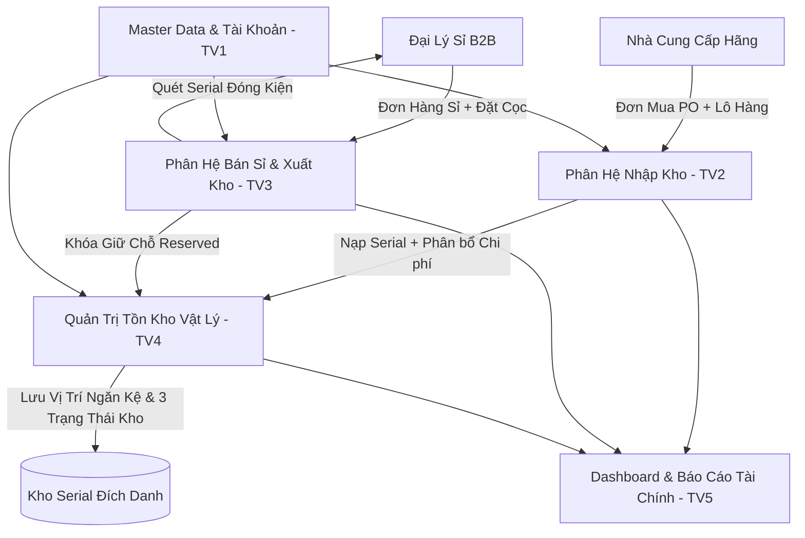
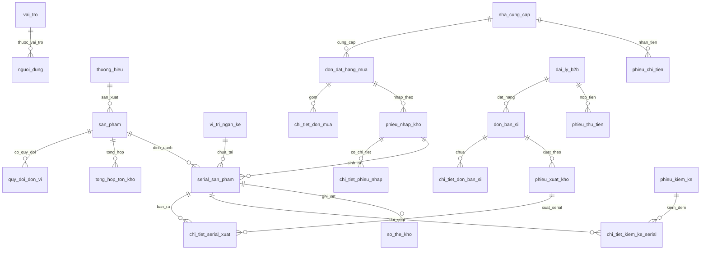
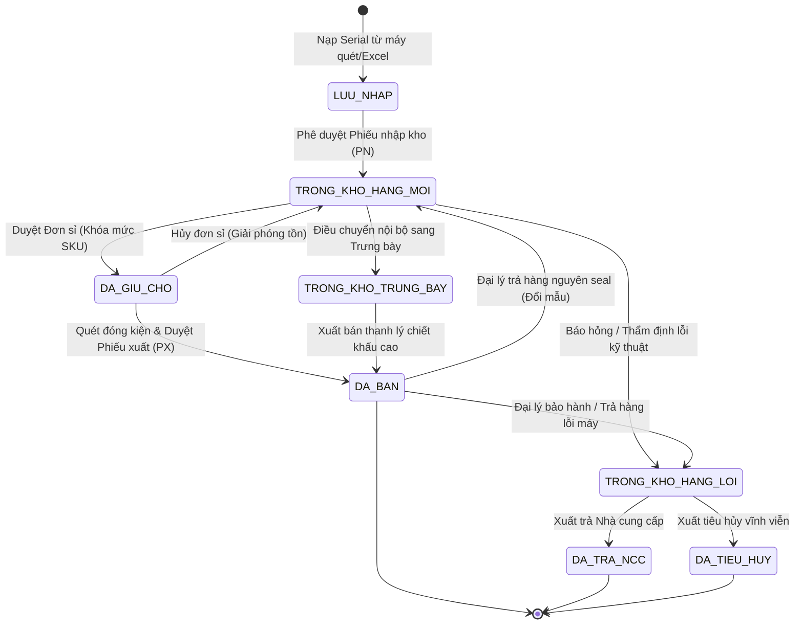

# BÁO CÁO PHÂN TÍCH VÀ THIẾT KẾ HỆ THỐNG
## HỆ THỐNG QUẢN LÝ KHO HÀNG HÓA CỬA HÀNG ĐỒNG HỒ (BÁN SỈ B2B)
**Tên thương mại:** ChronoVault B2B Wholesale WMS  
**Tài liệu nguồn:** phantichLTM.txt  
**Ngày lập báo cáo:** 28/10/2026 | **Phiên bản:** 2.0 Enterprise

---

## MỤC LỤC
1. [Tổng quan dự án & Bối cảnh nghiệp vụ](#1-tổng-quan-dự-án--bối-cảnh-nghiệp-vụ)
2. [Cây phân rã chức năng & Phân công trách nhiệm 5 thành viên](#2-cây-phân-rã-chức-năng--phân-công-trách-nhiệm-5-thành-viên)
3. [Thiết lập tham số ban đầu & Chính sách B2B](#3-thiết-lập-tham-số-ban-đầu--chính-sách-b2b)
4. [Đặc tả nhóm dữ liệu Vào (Inputs) & Ra (Outputs)](#4-đặc-tả-nhóm-dữ-liệu-vào-inputs--ra-outputs)
5. [Yêu cầu phi chức năng (Non-Functional Requirements)](#5-yêu-cầu-phi-chức-năng-non-functional-requirements)
6. [Ma trận phân quyền vai trò (RBAC Matrix)](#6-ma-trận-phân-quyền-vai-trò-rbac-matrix)
7. [Đặc tả các Use Case nghiệp vụ trọng tâm (Core Use Cases)](#7-đặc-tả-các-use-case-nghiệp-vụ-trọng-tâm-core-use-cases)
8. [Thiết kế Cơ sở dữ liệu quan hệ vật lý (Physical Schema - 23 Bảng 3NF)](#8-thiết-kế-cơ-sở-dữ-liệu-quan-hệ-vật-lý-physical-schema---23-bảng-3nf)
9. [Quy trình nghiệp vụ & Quy tắc toàn vẹn giao dịch](#9-quy-trình-nghiệp-vụ--quy-tắc-toàn-vẹn-giao-dịch)
10. [Lộ trình triển khai & Kiến nghị phát triển](#10-lộ-trình-triển-khai--kiến-nghị-phát-triển)

---

## 1. TỔNG QUAN DỰ ÁN & BỐI CẢNH NGHIỆP VỤ

### 1.1 Mục tiêu hệ thống
Hệ thống **ChronoVault B2B Wholesale WMS** được xây dựng nhằm tin học hóa và tự động hóa toàn diện quy trình vận hành kho phân phối đồng hồ chính hãng bán sỉ (B2B Distribution). Hệ thống không phục vụ bán lẻ tiêu dùng (B2C/POS) mà tập trung chuyên sâu vào giao dịch quy mô lớn giữa Tổng kho và mạng lưới đại lý phân phối, các chuỗi showroom bán lẻ.

### 1.2 Bốn trụ cột nghiệp vụ cốt lõi
1. **Quản lý định danh Serial / Số máy đích danh 100%:** Mọi chiếc đồng hồ trong kho đều mang số Serial duy nhất do nhà sản xuất phát hành, được theo dõi xuyên suốt từ lúc nhập cảng, lưu vị trí ngăn kệ, khóa giữ chỗ, xuất giao đại lý đến bảo hành và đổi trả.
2. **Quản lý Đơn vị tính (ĐVT) đa cấp & Quy cách đóng gói sỉ:** Nhập xuất linh hoạt theo *Thùng / Kiện / Hộp / Lô* và tự động quy đổi ra *Chiếc lẻ* theo hệ số chuẩn (Ví dụ: 1 Thùng = 20 Chiếc). Kiểm soát chặt chẽ số lượng đặt sỉ tối thiểu (**MOQ**).
3. **Cơ chế tính Giá vốn Đích danh (Specific Identification Method):** Không áp dụng phương pháp bình quân gia quyền. Mỗi chiếc đồng hồ gắn Serial cụ thể mang giá vốn riêng biệt, cộng dồn chi phí vận chuyển quốc tế, thuế quan, bảo hiểm phân bổ.
4. **Quản trị dòng tiền & Chu trình công nợ B2B khép kín:** Tích hợp quy trình kiểm soát hạn mức tín dụng (*Credit Limit*), kỳ hạn nợ (*Net 15 / Net 30*), lập *Phiếu Chi* thanh toán NCC và *Phiếu Thu* cọc/tiền hàng đại lý.

### Tác nhân nghiệp vụ và vai trò người dùng
Hệ thống chuẩn hóa 5 tác nhân (actor) nội bộ, phân định ranh giới trách nhiệm và thẩm quyền độc lập nhằm kiểm soát chặt chẽ quy trình vận hành kho phân phối B2B:

| Tác nhân (Actor) | Trách nhiệm chính trong hệ thống | Giới hạn phân quyền & Kiểm soát chéo |
| --- | --- | --- |
| **Quản trị hệ thống** | Quản trị tài khoản người dùng, phân quyền RBAC, thiết lập tham số hệ thống, giám sát nhật ký truy vết Audit Log, sao lưu và bảo mật dữ liệu. | Không mặc định can thiệp hoặc tự duyệt các chứng từ nghiệp vụ nhập/xuất, thu/chi hay công nợ. |
| **Chủ cửa hàng** | Giám sát toàn diện hoạt động vận hành qua Dashboard KPI thời gian thực; phê duyệt các ngoại lệ nghiệp vụ vượt ngưỡng (chi phí lô hàng lớn, vượt hạn mức tín dụng đại lý, cân bằng sai lệch kiểm kê giá trị cao). | Không trực tiếp cấu hình kỹ thuật tài khoản/phân quyền và không xử lý các thao tác nhập xuất, kiểm đếm vật lý thường ngày. |
| **Thủ kho (quản lý điều hành)** | Quản lý điều hành toàn diện kho hàng; quản trị sơ đồ vị trí kệ (Bin Location); tổ chức điều phối xuất/nhập; bảo quản an toàn hàng hóa; xác nhận giao nhận vật lý; chủ trì kiểm kê và duyệt cân bằng chênh lệch kho trong hạn mức. | Không lập chứng từ thu chi tài chính, không can thiệp chính sách giá/hạn mức tín dụng và không tự duyệt sai lệch kiểm kê vượt ngưỡng thẩm quyền. |
| **Nhân viên nhập - xuất kho** | Trực tiếp tác nghiệp hiện trường: lập phiếu nhập kho từ đơn PO, quét nạp dải Serial; lập đơn bán sỉ nháp, soạn hàng từ kệ, quét Serial đóng kiện xuất kho; tiếp nhận xử lý đổi trả và bảo hành. | Không có quyền phê duyệt thu/chi tài chính, không tự duyệt đơn vượt hạn mức nợ và không tự ý điều chỉnh tồn kho. |
| **Kế toán** | Kiểm soát dòng tiền và số liệu tài chính; phân bổ chi phí phụ trợ vào giá vốn đích danh của từng Serial; thẩm định hạn mức tín dụng; lập phiếu thu (cọc/tiền hàng), phiếu chi (NCC); đối soát chứng từ và Sổ Thẻ kho. | Không thay thế Thủ kho (quản lý điều hành) trong việc xác nhận giao nhận vật lý; mọi ngoại lệ tài chính vượt ngưỡng bắt buộc phải trình Chủ cửa hàng phê duyệt. |

Nhà cung cấp và đại lý B2B là đối tác bên ngoài, không phải vai trò người dùng nội bộ.



---

## 2. CÂY PHÂN RÃ CHỨC NĂNG & PHÂN CÔNG TRÁCH NHIỆM 5 THÀNH VIÊN

Hệ thống được chuẩn hóa thành 6 phân hệ lớn và phân bổ trách nhiệm cụ thể cho 5 thành viên:

| Phân hệ | Tên phân hệ | Thành viên phụ trách | Trọng tâm nghiệp vụ |
| :---: | :--- | :---: | :--- |
| **Module 1** | Quản lý Hàng hóa, Serial & ĐVT | **Thành viên 1** | Master thương hiệu, động cơ, chất liệu, cấu hình quy đổi ĐVT, MOQ, tra cứu vòng đời Serial (Lifecycle). |
| **Module 2** | Quản trị Hệ thống & Phân quyền | **Thành viên 1** | Quản lý tài khoản nhân viên, ma trận quyền hạn RBAC, thu hồi JWT Token từ xa, giám sát Audit Log. |
| **Module 3** | Đối tác NCC, Nhập kho & Chi phí | **Thành viên 2** | Hồ sơ NCC, đơn PO, lập phiếu nhập kho, nạp dải Serial (quét/Excel), phân bổ chi phí lô hàng, trả hàng lỗi NCC, phiếu chi. |
| **Module 4** | Khách sỉ, Bán sỉ & Xuất kho | **Thành viên 3** | Hồ sơ đại lý, hạn mức nợ, đơn bán sỉ, thẩm định tín dụng, duyệt giữ chỗ (Reserved), quét Serial đóng kiện xuất, tiếp nhận đổi trả, phiếu thu. |
| **Module 5** | Tồn kho, Kệ hàng & Kiểm kê | **Thành viên 4** | Tồn kho đa trạng thái (Mới/Trưng bày/Lỗi), sơ đồ vị trí ngăn kệ (Bin), điều chuyển nội bộ, cảnh báo Min/Max, kiểm kê đối soát, Sổ Thẻ kho. |
| **Module 6** | Báo cáo, Dòng tiền & Dashboard | **Thành viên 5** | KPI Cards thời gian thực, biểu đồ doanh thu/chi phí, sổ chi tiết công nợ 2 chiều, báo cáo dòng tiền thực, phân tích Dead Stock, lợi nhuận gộp B2B. |

### Cây phân rã cấu trúc WBS
```text
HỆ THỐNG QUẢN LÝ KHO ĐỒNG HỒ B2B (WHOLESALE)
├── 1. QUẢN LÝ HÀNG HÓA, SERIAL & ĐƠN VỊ TÍNH (TV1)
│   ├── 1.1 Quản lý danh mục Master (Thương hiệu, Bộ sưu tập, Động cơ, Kính, Dây, Cấu hình ĐVT quy đổi)
│   ├── 1.2 Quản lý hồ sơ sản phẩm (Mã SKU, Barcode, MOQ, Bảng giá sỉ, Tra cứu vòng đời Serial)
│   └── 1.3 Xuất nhập dữ liệu Master Data (Import SKU Excel, Export báo giá PDF/Excel)
├── 2. QUẢN TRỊ HỆ THỐNG & PHÂN QUYỀN (TV1)
│   ├── 2.1 Quản trị tài khoản & Xác thực (Tạo user, Khóa/Mở, Thu hồi token JWT, Đổi mật khẩu/OTP)
│   ├── 2.2 Quản trị vai trò & Ma trận phân quyền (Quản trị hệ thống, Chủ cửa hàng, Thủ kho (quản lý điều hành), Nhân viên nhập - xuất kho, Kế toán)
│   └── 2.3 Giám sát nhật ký hệ thống (Audit Log đăng nhập, Ghi vết biến động dữ liệu)
├── 3. ĐỐI TÁC NHÀ CUNG CẤP, NHẬP KHO & CHI PHÍ (TV2)
│   ├── 3.1 Quản lý NCC & Đặt hàng mua (Hồ sơ NCC, Công nợ NCC, Phiếu Chi, Lập PO)
│   ├── 3.2 Lập & Quản lý phiếu nhập kho (Quy đổi ĐVT, Nạp dải Serial quét/Excel, Phân bổ chi phí, Duyệt phiếu A4)
│   └── 3.3 Quản lý trả hàng lỗi cho NCC (Xuất trả hàng hỏng từ kho lỗi, Giảm trừ công nợ NCC)
├── 4. KHÁCH HÀNG SỈ, BÁN SỈ & XUẤT KHO ĐA NĂNG (TV3)
│   ├── 4.1 Quản lý đại lý B2B (Hồ sơ đại lý, Cấp bậc VIP/Bạc/Đồng, Hạn mức nợ, Phiếu Thu sỉ)
│   ├── 4.2 Tiếp nhận & Xử lý đơn bán sỉ (Lập đơn, Thẩm định tín dụng, Duyệt giữ chỗ Reserved, Quét Serial xuất bán)
│   ├── 4.3 Quản lý xuất khác (Xuất bảo hành hãng, Xuất thanh lý hàng trưng bày, Xuất hủy)
│   └── 4.4 Tiếp nhận đổi / trả hàng từ đại lý (Quét Serial kiểm tra xuất xứ, Phân loại kho Mới/Lỗi, Cấn trừ nợ)
├── 5. QUẢN TRỊ TỒN KHO, VỊ TRÍ KỆ & KIỂM KÊ (TV4)
│   ├── 5.1 Giám sát tồn kho đa trạng thái (Hàng mới, Trưng bày, Hàng lỗi; Tồn thực tế, Giữ chỗ, Khả dụng)
│   ├── 5.2 Quản lý sơ đồ vị trí lưu trữ vật lý (Khu -> Dãy -> Kệ -> Tầng -> Ngăn; Điều chuyển nội bộ)
│   ├── 5.3 Cảnh báo định mức tồn kho sỉ (Cảnh báo Min tồn sỉ, Tự động tạo đề xuất PO cho TV2, Khóa đơn khi hết)
│   ├── 5.4 Kiểm kê kho & Cân bằng chênh lệch (Quét Serial đối soát thừa/thiếu, Lập phiếu cân bằng kho)
│   └── 5.5 Truy vết Thẻ kho (Stock Ledger ghi nhận mọi phát sinh ± kèm mã Serial)
└── 6. BÁO CÁO TỔNG HỢP, DÒNG TIỀN & DASHBOARD ĐIỀU HÀNH (TV5)
    ├── 6.1 Trung tâm điều hành Dashboard (KPI Cards thời gian thực, Biểu đồ doanh thu/chi phí, Top Best-seller)
    ├── 6.2 Hệ thống báo cáo chuyên sâu (Báo cáo nhập, Báo cáo bán sỉ, Báo cáo xuất khác, Báo cáo Dead Stock)
    └── 6.3 Báo cáo tài chính & Quản trị công nợ (Sổ công nợ đại lý, Sổ công nợ NCC, Dòng tiền thực, Lợi nhuận gộp B2B)
```

---

## 3. THIẾT LẬP THAM SỐ BAN ĐẦU & CHÍNH SÁCH B2B

### 3.1 Tham số hệ thống
* **Múi giờ:** UTC+7 (`Asia/Ho_Chi_Minh`), đồng bộ thời gian với máy chủ cơ sở dữ liệu.
* **Quy chuẩn ĐVT:** 
  * Cơ sở: `Chiếc` / `Cái`.
  * Bán sỉ: `Hộp` (5 chiếc), `Thùng carton` (20 chiếc), `Kiện` (50 chiếc), `Lô` (100 chiếc).
* **Phân loại kỹ thuật đồng hồ:**
  * *Loại máy:* Pin (Quartz), Cơ tự động (Automatic), Năng lượng ánh sáng (Solar / Eco-Drive).
  * *Mặt kính:* Kính Sapphire chống trầy, Kính khoáng cường lực (Mineral), Kính Hardlex, Kính Acrylic.
  * *Dây đeo:* Thép không gỉ 316L/904L, Da thật (Alligator/Calfskin), Cao su silicone, Dây vải NATO.

### 3.2 Chính sách thương mại theo cấp bậc Đại lý B2B

| Cấp bậc đại lý | Tỷ lệ chiết khấu sỉ | Hạn mức công nợ tối đa | Thời hạn nợ (Payment Term) | Điều kiện duy trì |
| :--- | :---: | :---: | :---: | :--- |
| **Hạng VIP** | **30%** | **1.000.000.000 VNĐ** | **Net 30** (30 ngày) | Doanh số sỉ $\ge$ 2 tỷ VNĐ/quý |
| **Hạng Bạc (Cấp 1)** | **25%** | **500.000.000 VNĐ** | **Net 15** (15 ngày) | Doanh số sỉ $\ge$ 500 triệu VNĐ/quý |
| **Hạng Đồng (Cấp 2)** | **20%** | **100.000.000 VNĐ** | **Thanh toán ngay** | Đại lý mới tham gia |

**Quy tắc chặn tín dụng tự động:** Nếu đại lý có bất kỳ hóa đơn nào quá hạn thời gian nợ quy định hoặc dư nợ mới vượt quá hạn mức, hệ thống sẽ **khóa quyền duyệt đơn sỉ tự động**, bắt buộc đại lý phải thanh toán nợ cũ hoặc nộp cọc bằng tiền mặt/chuyển khoản để tiếp tục giao dịch.

---

## 4. ĐẶC TẢ NHÓM DỮ LIỆU VÀO (INPUTS) & RA (OUTPUTS)

### 4.1 Nhóm dữ liệu Vào (Inputs) & Kiểu dữ liệu
1. **Master Hàng hóa & Serial:**
   - Mã SKU: `VARCHAR(50)`, Mã vạch quốc tế: `VARCHAR(50)`.
   - Mã Serial / Số máy: `VARCHAR(100)` (Duy nhất trên toàn hệ thống).
   - Tên sản phẩm, Thương hiệu, Phân loại máy, Mặt kính, Dây đeo: `NVARCHAR`.
   - Thời hạn bảo hành: `INT` (tháng), Cờ quản lý Serial: `BOOLEAN`.
   - ĐVT cơ bản, ĐVT bán sỉ, Hệ số quy đổi đóng gói: `INT`.
   - Ngưỡng Min/Max tồn kho, Số lượng đặt tối thiểu (MOQ): `INT`.
2. **Đối tác NCC & Đại lý sỉ B2B:**
   - Mã NCC, Mã đại lý, Mã số thuế: `VARCHAR(50)`.
   - Cấp bậc đại lý: Enum (`'VIP'`, `'BAC'`, `'DONG'`).
   - Tỷ lệ chiết khấu (%): `DECIMAL(5,2)`.
   - Hạn mức nợ: `DECIMAL(18,2)`, Thời hạn nợ: Enum (`'THANH_TOAN_NGAY'`, `'NET_15'`, `'NET_30'`).
3. **Chứng từ Giao dịch & Kho:**
   - Mã chứng từ: `VARCHAR(50)` (PO, PN, ĐH, PX, PT, PC, KK, DC).
   - Số lượng giao dịch, Số lượng chiếc quy đổi: `INT`.
   - Đơn giá nhập, Giá bán sỉ, Chi phí phân bổ lô hàng: `DECIMAL(18,2)`.
   - Trạng thái phiếu: Enum (`'LUU_NHAP'`, `'DA_DUYET'`, `'DA_HUY'`).
   - Trạng thái chất lượng: Enum (`'HANG_MOI'`, `'HANG_TRUNG_BAY'`, `'HANG_LOI'`).
   - Trạng thái vòng đời Serial: Enum (`'TRONG_KHO'`, `'DA_BAN'`, `'BAO_HANH'`, `'DA_TRA_NCC'`, `'DA_TIEU_HUY'`).
4. **Quản trị người dùng & Phân quyền:**
   - `ten_dang_nhap`, `email`: Duy nhất.
   - `mat_khau_ma_hoa`: Chuỗi hash `VARCHAR(255)` (Bcrypt/Argon2).
   - `ma_vai_tro`: Enum (`'QUAN_TRI_HE_THONG'`, `'THU_KHO'`, `'NHAN_VIEN_NHAP_XUAT'`, `'KE_TOAN'`, `'CHU_CUA_HANG'`).

### 4.2 Nhóm dữ liệu Ra (Outputs)
* **Phân hệ Nhập kho:** Đơn đặt mua PO, Phiếu nhập kho A4 kèm bảng kê chi tiết 100% mã Serial, Báo cáo đối soát dải Serial tự động, Phiếu chi thanh toán nợ NCC, Phiếu xuất trả hàng lỗi NCC.
* **Phân hệ Bán sỉ:** Kết quả kiểm tra tồn kho & MOQ, Đơn bán sỉ áp giá sỉ & chiết khấu tự động, Cảnh báo hạn mức nợ, Phiếu xuất kho kiêm biên bản giao nhận sỉ B2B (in danh sách Serial), Phiếu thu tiền sỉ.
* **Phân hệ Tồn kho:** Danh sách tồn kho tổng hợp đa đơn vị (Thùng + Chiếc), Tra cứu vòng đời Serial (Serial Timeline), Bảng nhật ký biến động Thẻ kho (`so_the_kho`), Phiếu cân bằng kiểm kê kho, Cảnh báo tồn dưới Min tồn sỉ.
* **Phân hệ Báo cáo:** KPI Cards điều hành thời gian thực, Biểu đồ doanh thu/chi phí, Bảng xếp hạng Top mẫu bán chạy, Báo cáo tỷ lệ lỗi hãng sản xuất, Báo cáo Sổ chi tiết công nợ 2 chiều, Báo cáo dòng tiền thực tế và Báo cáo lợi nhuận gộp B2B.

---

## 5. YÊU CẦU PHI CHỨC NĂNG (NON-FUNCTIONAL REQUIREMENTS)

1. **Hiệu năng & Xử lý đồng thời (Performance & Concurrency):**
   - Nạp và đối soát dải từ 500 đến 1.000 mã Serial từ file Excel hoặc thiết bị quét trong thời gian **dưới 2 giây**.
   - Kiểm soát giao dịch đồng thời bằng cơ chế khóa bản ghi mức cơ sở dữ liệu (**Row-level Locking** `SELECT ... FOR UPDATE`), triệt tiêu tình trạng xuất âm kho hoặc bán trùng 1 mã Serial cho 2 đại lý.
2. **Bảo mật & Toàn vẹn dữ liệu (Security & Data Integrity):**
   - Mật khẩu băm một chiều an toàn bằng thuật toán Bcrypt / Argon2.
   - Phiên làm việc quản lý qua JWT (JSON Web Token), hỗ trợ quản trị viên thu hồi Token từ xa ngay lập tức.
   - **Tính bất biến (Immutability):** Dữ liệu Sổ Thẻ kho (`so_the_kho`) và Nhật ký hệ thống (`Audit Log`) tuyệt đối không được phép chỉnh sửa hoặc xóa vật lý; sai sót phải lập phiếu điều chỉnh đối ứng.
3. **Tương thích thiết bị ngoại vi & In ấn:**
   - Tích hợp máy quét mã vạch Barcode/QR 1D/2D ở chế độ giả lập bàn phím (**HID Keyboard Emulation**), tự động nhận diện và kiểm tra mã Serial ngay sau khi quét.
   - Các mẫu phiếu nhập kho, xuất kho và biên bản bàn giao B2B được định dạng chuẩn khổ giấy **A4**, hỗ trợ in ấn trực tiếp hoặc xuất file PDF.

---

## 6. MA TRẬN PHÂN QUYỀN VAI TRÒ (RBAC MATRIX)

| Phân hệ / Nghiệp vụ chức năng | Quản trị hệ thống | Chủ cửa hàng | Thủ kho (quản lý điều hành) | Nhân viên nhập - xuất kho | Kế toán |
| :--- | :---: | :---: | :---: | :---: | :---: |
| **Danh mục Master SKU, Hãng, ĐVT** | Quản lý cấu hình | Xem | Chỉ xem | Chỉ xem | Chỉ xem |
| **Cấu hình giá sỉ & giá vốn** | Không mặc định | Xem | Không có quyền | Chỉ xem giá áp dụng | Phân bổ/đối soát giá vốn |
| **Quản trị tài khoản, phân quyền, Audit Log** | Toàn quyền | Xem log hoạt động | Không có quyền | Không có quyền | Xem log nghiệp vụ tài chính |
| **Hồ sơ NCC & đơn đặt mua PO** | Cấu hình hệ thống | Xem/duyệt ngoại lệ | Xem | Lập đề nghị/PO | Thẩm định NCC và chứng từ |
| **Nhập kho, nạp và quét Serial** | Không thao tác thường ngày | Giám sát | Xác nhận giao nhận | Lập phiếu, tiếp nhận và quét | Kiểm tra số liệu |
| **Phân bổ chi phí & duyệt nhập kho** | Không mặc định | Duyệt ngoại lệ vượt ngưỡng | Xác nhận vật lý | Không duyệt chi phí | Phân bổ/đối soát |
| **Phiếu Chi thanh toán nợ NCC** | Không mặc định | Duyệt khoản chi vượt ngưỡng | Không có quyền | Không có quyền | Lập phiếu, đối soát |
| **Hồ sơ đại lý & hạn mức tín dụng** | Không quản trị thương mại | Duyệt hạn mức/ngoại lệ | Không có quyền | Cập nhật hồ sơ giao dịch | Thẩm định công nợ |
| **Lập đơn bán sỉ & giữ chỗ** | Không thao tác thường ngày | Duyệt ngoại lệ tín dụng | Xác nhận khả năng giao | Lập đơn nháp và đề nghị giữ chỗ | Thẩm định nợ |
| **Quét Serial đóng kiện & thực xuất kho** | Không thao tác thường ngày | Giám sát | Xác nhận xuất vật lý | Soạn hàng, quét Serial, lập phiếu xuất | Đối soát hóa đơn |
| **Phiếu Thu tiền bán sỉ & thu hồi nợ** | Không mặc định | Xem báo cáo | Không có quyền | Không có quyền | Lập phiếu thu, đối soát |
| **Sơ đồ kệ & điều chuyển nội bộ** | Không thao tác thường ngày | Xem | Quản lý vị trí và điều chuyển | Đề nghị/ghi nhận điều chuyển | Xem vị trí |
| **Kiểm kê kho & cân bằng chênh lệch** | Quản lý cấu hình | Duyệt chênh lệch vượt ngưỡng | Tổ chức, kiểm đếm, cân bằng trong ngưỡng | Hỗ trợ quét/đếm | Đối soát, lập chứng từ |
| **Dashboard KPI, báo cáo lợi nhuận & dòng tiền** | Xem log hệ thống | Toàn quyền xem và xuất | Xem tồn kho theo quyền | Xem tiến độ giao dịch | Báo cáo tài chính |

---

## 7. ĐẶC TẢ CÁC USE CASE NGHIỆP VỤ TRỌNG TÂM (CORE USE CASES)

### 7.1 UC-01: Lập & Phê duyệt Phiếu Nhập Kho Kèm Phân Bổ Chi Phí
* **Tác nhân:** Nhân viên nhập - xuất kho (lập phiếu, tiếp nhận và quét Serial), Thủ kho (quản lý điều hành) (xác nhận giao nhận vật lý), Kế toán (phân bổ/đối soát chi phí), Chủ cửa hàng (phê duyệt ngoại lệ chi phí vượt ngưỡng).
* **Tiền điều kiện:** Nhà cung cấp và Đơn đặt hàng mua (`PO`) đã được duyệt trên hệ thống.
* **Luồng xử lý chính:**
  1. Nhân viên nhập - xuất kho chọn đơn PO, hệ thống tự động tải danh sách SKU, số lượng đặt và quy cách đóng gói.
  2. Nhân viên nhập - xuất kho nhập số lượng thùng thực nhận; hệ thống tự động quy đổi ra tổng số chiếc lẻ.
  3. Nhân viên nhập - xuất kho nạp dải Serial bằng máy quét barcode hoặc import file Excel từ hãng.
  4. Hệ thống kiểm tra đối soát 2 chiều:
     * Số mã Serial = Tổng số chiếc sau quy đổi.
     * Toàn bộ mã Serial chưa từng xuất hiện trong hệ thống (tính duy nhất).
  5. Kế toán khai báo các chi phí phát sinh: phí bốc xếp, cước vận chuyển quốc tế, thuế hải quan.
  6. Hệ thống phân bổ chi phí trực tiếp vào từng chiếc để hình thành **Giá vốn Đích danh**:
     $$\text{Giá vốn Serial} = \text{Đơn giá nhập trên HĐ} + \frac{\text{Tổng chi phí phân bổ}}{\text{Tổng số chiếc}}$$
  7. Thủ kho (quản lý điều hành) xác nhận số lượng và tình trạng hàng nhận thực tế; Kế toán đối soát chứng từ và chi phí. Nếu khoản chi vượt ngưỡng, Chủ cửa hàng phê duyệt ngoại lệ trước khi ghi nhận. Hệ thống tăng tồn kho thực tế, kích hoạt lưu trữ từng Serial với trạng thái `TRONG_KHO`/`HANG_MOI`, tăng công nợ phải trả NCC, ghi Sổ Thẻ kho (+) và in biên bản A4.

### 7.2 UC-02: Tạo Đơn Bán Sỉ & Duyệt Khóa Giữ Chỗ Tồn Kho (Reserved Allocation)
* **Tác nhân:** Nhân viên nhập - xuất kho (lập đơn nháp), Thủ kho (quản lý điều hành) (xác nhận khả năng giao), Kế toán (thẩm định công nợ), Chủ cửa hàng (phê duyệt ngoại lệ hạn mức tín dụng).
* **Tiền điều kiện:** Đại lý có tài khoản kích hoạt; Tồn kho khả dụng của sản phẩm $> 0$.
* **Luồng xử lý chính:**
  1. Nhân viên nhập - xuất kho chọn đại lý và lập đơn bán sỉ nháp theo Thùng hoặc Chiếc.
  2. Hệ thống kiểm tra điều kiện:
     * Số lượng đặt $\ge$ MOQ quy định (5 – 10 chiếc/mẫu).
     * Số lượng đặt $\le$ Tồn kho khả dụng ($\text{Tồn khả dụng} = \text{Tồn thực tế} - \text{Tồn đang giữ chỗ}$).
  3. Hệ thống tự động áp dụng giá sỉ và chiết khấu theo hạng đại lý để tính Tổng thanh toán.
  4. Hệ thống thẩm định điều kiện tín dụng:
     $$\text{Dư nợ hiện tại} + \text{Giá trị đơn mới} - \text{Tiền cọc} \le \text{Hạn mức công nợ}$$
  5. Kế toán xác nhận hạn mức còn khả dụng; đơn trong hạn được chuyển trình duyệt theo quy trình, trường hợp vượt hạn mức chỉ được tiếp tục sau khi Chủ cửa hàng phê duyệt ngoại lệ có ghi nhận lý do. Hệ thống chuyển đơn sang `DA_DUYET`, tăng `so_luong_giu_cho` và giảm `so_luong_kha_dung` tại bảng `tong_hop_ton_kho` nhằm ngăn bán vượt tồn.

### 7.3 UC-03: Quét Serial Đóng Kiện & Thực Xuất Kho Bán Sỉ
* **Tác nhân:** Nhân viên nhập - xuất kho (lập phiếu, soạn hàng và quét Serial), Thủ kho (quản lý điều hành) (kiểm tra và xác nhận giao nhận vật lý).
* **Tiền điều kiện:** Đơn bán sỉ ở trạng thái `DA_DUYET`.
* **Luồng xử lý chính:**
  1. Nhân viên nhập - xuất kho mở đơn sỉ đã duyệt và lập Phiếu xuất kho.
  2. Nhân viên nhập - xuất kho lấy hàng tại vị trí ngăn kệ, quét mã Serial từng chiếc đồng hồ khi đóng vào kiện.
  3. Hệ thống đối soát thời gian thực:
     * Serial quét vào phải thuộc đúng mã SKU yêu cầu trên đơn.
     * Serial phải đang có trạng thái `TRONG_KHO` và thuộc `HANG_MOI`.
     * Không bị quét trùng trong cùng kiện hàng.
  4. Khi quét đủ 100% số lượng, Thủ kho (quản lý điều hành) đối chiếu kiện hàng và xác nhận bàn giao xuất kho.
  5. Hệ thống thực thi giao dịch đồng thời:
     * Giảm Tồn thực tế (`so_luong_thuc_te`) và giải phóng Tồn giữ chỗ (`so_luong_giu_cho`).
     * Cập nhật Serial sang `DA_BAN`, gán mã đại lý sở hữu và ngày hết hạn bảo hành.
     * Tăng số dư nợ đại lý hoặc cấn trừ tiền cọc; ghi Thẻ kho (-) kèm danh sách Serial chi tiết.
     * In Phiếu xuất kho kiêm Biên bản bàn giao hàng hóa B2B khổ A4.

### 7.4 UC-04: Kiểm Kê Kho & Cân Bằng Sai Lệch Tồn Kho Theo Serial
* **Tác nhân:** Thủ kho (quản lý điều hành) (tổ chức và kiểm đếm), Nhân viên nhập - xuất kho (hỗ trợ quét), Kế toán (đối soát sổ kho), Chủ cửa hàng (phê duyệt chênh lệch vượt ngưỡng).
* **Tiền điều kiện:** Phiếu kiểm kê được kích hoạt theo phạm vi (Toàn kho, Kệ, Hãng).
* **Luồng xử lý chính:**
  1. Thủ kho (quản lý điều hành) lập phiếu và tổ chức kiểm kê; hệ thống tạm thời khóa biến động xuất nhập trên khu vực kiểm kê.
  2. Thủ kho (quản lý điều hành) cùng nhân viên quét thực tế toàn bộ mã Serial hiện diện tại từng ngăn kệ.
  3. Hệ thống đối soát tự động:
     * Serial Khớp đúng: Trùng khớp vị trí và trạng thái.
     * Serial Thừa: Có mặt tại kệ nhưng hệ thống không ghi nhận ở kệ này.
     * Serial Thiếu: Hệ thống báo có nhưng thực tế không tìm thấy.
  4. Xuất biên bản đối soát kiểm kê, hai bên xác nhận nguyên nhân sai lệch.
  5. Kế toán đối soát số liệu và chứng từ; Thủ kho (quản lý điều hành) cân bằng chênh lệch trong thẩm quyền. Chênh lệch vượt ngưỡng phải được Chủ cửa hàng phê duyệt trước khi cập nhật vị trí/trạng thái Serial trong CSDL, cân bằng số lượng tồn kho và ghi phát sinh Thẻ kho Kiểm kê ($\pm$).

---

## 8. THIẾT KẾ CƠ SỞ DỮ LIỆU QUAN HỆ VẬT LÝ (PHYSICAL SCHEMA - 23 BẢNG 3NF)



### Danh mục 23 Bảng cơ sở dữ liệu vật lý

| STT | Tên bảng CSDL | Mục đích nghiệp vụ | Khóa chính | Ràng buộc chính & Khóa ngoại |
| :---: | :--- | :--- | :--- | :--- |
| 1 | `vai_tro` | Danh mục vai trò nhân viên trong hệ thống | `ma_vai_tro` | Mã vai trò: QUAN_TRI_HE_THONG, THU_KHO, NHAN_VIEN_NHAP_XUAT, KE_TOAN, CHU_CUA_HANG |
| 2 | `nguoi_dung` | Tài khoản nhân viên đăng nhập hệ thống | `ma_nguoi_dung` | `ten_dang_nhap`, `email` DUY NHẤT; FK `ma_vai_tro` |
| 3 | `thuong_hieu` | Danh mục các hãng đồng hồ chính hãng | `ma_thuong_hieu` | ROLEX, OMEGA, SEIKO, CASIO, TISSOT, CITIZEN... |
| 4 | `san_pham` | Hồ sơ kỹ thuật Master SKU đồng hồ | `ma_san_pham` | `ma_vach` DUY NHẤT; FK `ma_thuong_hieu` |
| 5 | `quy_doi_don_vi` | Cấu hình quy cách đóng gói sỉ ra chiếc lẻ | `ma_quy_doi` | FK `ma_san_pham`; 1 Thùng = N Chiếc |
| 6 | `vi_tri_ngan_ke` | Sơ đồ địa chỉ vật lý ngăn kệ trong kho | `ma_ngan_ke` | Phân khu - Dãy - Kệ - Tầng - Ngăn (Bin) |
| 7 | `tong_hop_ton_kho`| Quản lý số lượng tồn kho theo 3 trạng thái | `ma_tong_hop` | UNIQUE(`ma_san_pham`, `trang_thai_chat_luong`); FK `ma_san_pham` |
| 8 | `nha_cung_cap` | Hồ sơ đối tác cung cấp & theo dõi công nợ | `ma_nha_cung_cap` | `ma_so_thue` DUY NHẤT; `du_no_hien_tai` |
| 9 | `dai_ly_b2b` | Hồ sơ khách sỉ, hạng đại lý, hạn mức nợ | `ma_dai_ly` | `cap_bac_dai_ly`, `han_muc_cong_no`, `thoi_han_no` |
| 10 | `don_dat_hang_mua`| Đơn đặt mua hàng từ nhà sản xuất (PO) | `ma_don_mua_po` | FK `ma_nha_cung_cap`, FK `ma_nguoi_tao` |
| 11 | `chi_tiet_don_mua`| Chi tiết các SKU cần đặt trong đơn PO | `ma_chi_tiet_don_mua`| FK `ma_don_mua_po`, FK `ma_san_pham` |
| 12 | `phieu_nhap_kho` | Chứng từ nghiệm thu nhập kho hàng hóa | `ma_phieu_nhap` | FK `ma_don_mua_po`, FK `ma_nha_cung_cap`; `tong_gia_tri_nhap` |
| 13 | `chi_tiet_phieu_nhap` | Chi tiết số lượng và phân bổ chi phí lô | `ma_chi_tiet_nhap` | FK `ma_phieu_nhap`, FK `ma_san_pham`; `gia_von_dich_danh_chiec` |
| 14 | `serial_san_pham` | Bảng lõi quản trị định danh từng chiếc Serial | `so_serial` | FK `ma_san_pham`, FK `ma_phieu_nhap`, FK `ma_ngan_ke_hien_tai` |
| 15 | `don_ban_si` | Đơn đặt hàng bán sỉ của các đại lý B2B | `ma_don_ban_si` | FK `ma_dai_ly`; chiết khấu, tiền cọc, duyệt giữ chỗ |
| 16 | `chi_tiet_don_ban_si` | Chi tiết SKU và số lượng giữ chỗ theo đơn | `ma_chi_tiet_don_si` | FK `ma_don_ban_si`, FK `ma_san_pham` |
| 17 | `phieu_xuat_kho` | Phiếu xuất kiêm biên bản giao nhận B2B | `ma_phieu_xuat` | FK `ma_don_ban_si`, FK `ma_dai_ly`; `tong_gia_von_cogs` |
| 18 | `chi_tiet_serial_xuat` | Danh sách Serial thực tế quét đóng thùng | `ma_chi_tiet_serial_xuat` | FK `ma_phieu_xuat`, FK `so_serial` |
| 19 | `phieu_thu_tien` | Chứng từ thu tiền thanh toán nợ / cọc sỉ | `ma_phieu_thu` | FK `ma_dai_ly`, FK `ma_don_ban_si` (nếu có cọc) |
| 20 | `phieu_chi_tien` | Chứng từ chi tiền trả nợ NCC và chi phí kho | `ma_phieu_chi` | FK `ma_nha_cung_cap`, FK `ma_phieu_nhap` |
| 21 | `phieu_kiem_ke` | Lệnh khởi tạo đợt kiểm kê thực tế tại kệ | `ma_phieu_kiem_ke` | Phạm vi: Toàn kho, Phân khu, hoặc Thương hiệu |
| 22 | `chi_tiet_kiem_ke_serial` | Biên bản đối soát Serial quét thực tế vs CSDL | `ma_chi_tiet_kiem_ke`| FK `ma_phieu_kiem_ke`, FK `so_serial`; kết quả đối soát |
| 23 | `so_the_kho` | Sổ thẻ kho điện tử bất biến ghi mọi biến động | `ma_the_kho` | FK `ma_san_pham`, FK `so_serial`; $\pm$ 1, lưu vết vĩnh viễn |

---

## 9. QUY TRÌNH NGHIỆP VỤ & QUY TẮC TOÀN VẸN GIAO DỊCH

### 9.1 Biểu đồ trạng thái Vòng đời Serial (State Machine)



### 9.2 Kiểm soát giao dịch đồng thời (Pessimistic Row-level Locking)
Để giải quyết triệt để vấn đề tranh chấp tồn kho khi nhiều đại lý cùng đặt mua các mẫu đồng hồ "hot" số lượng có hạn:
1. **Tại bước Duyệt đơn bán sỉ:** Hệ thống kích hoạt khóa hàng ở mức cơ sở dữ liệu:
   ```sql
   SELECT so_luong_kha_dung 
   FROM tong_hop_ton_kho 
   WHERE ma_san_pham = @ma_san_pham AND trang_thai_chat_luong = 'HANG_MOI'
   FOR UPDATE;
   ```
   Nếu `so_luong_kha_dung >= so_luong_dat`, hệ thống cập nhật tăng `so_luong_giu_cho` và giảm `so_luong_kha_dung` trong cùng một Database Transaction, ngăn chặn tình trạng xuất âm kho hoặc bán trùng.
2. **Tại bước Quét Serial xuất kho:** Hệ thống khóa trực tiếp bản ghi Serial được quét:
   ```sql
   SELECT so_serial, trang_thai_vong_doi 
   FROM serial_san_pham 
   WHERE so_serial = @so_serial_quet 
   FOR UPDATE;
   ```
   Nếu chiếc đồng hồ này đã bị nhân viên khác quét trước đó (`trang_thai_vong_doi != 'TRONG_KHO'`), giao dịch lập tức Rollback và phát chuông cảnh báo lỗi.

### 9.3 Công thức tính Lợi nhuận gộp B2B đích danh theo từng giao dịch
$$\text{Doanh thu thuần đơn sỉ} = \sum_{i=1}^{n} (\text{Đơn giá sỉ niêm yết}_i \times (1 - \text{Tỷ lệ chiết khấu đại lý}))$$
$$\text{Tổng giá vốn hàng bán (COGS)} = \sum_{j=1}^{m} \text{Giá vốn đích danh}(Serial_j)$$
$$\text{Lợi nhuận gộp B2B} = \text{Doanh thu thuần} - \text{Tổng COGS} - \text{Phí vận chuyển kho chịu}$$

---

## 10. LỘ TRÌNH TRIỂN KHAI & KIẾN NGHỊ PHÁT TRIỂN

1. **Giai đoạn 1 - Khởi tạo CSDL:** Viết script SQL DDL sinh 23 bảng cơ sở dữ liệu vật lý (PostgreSQL / MySQL / MS SQL), thiết lập index cho các trường tra cứu tần suất cao (`so_serial`, `ma_san_pham`, `ma_dai_ly`).
2. **Giai đoạn 2 - Chuẩn hóa UI/UX:** Cập nhật các giao diện thành viên hiện có (`tv1_hang_hoa.html`, `tv2_nhap_kho.html`, `tv3_xuat_kho.html`, `tv4_ton_kho.html`, `tv5_bao_cao.html`) theo đúng các trường nhập liệu và bảng dữ liệu đã chuẩn hóa.
3. **Giai đoạn 3 - Phát triển Backend API:** Hiện thực các API nghiệp vụ chính: nạp Serial từ file Excel, phân bổ chi phí, locking bi quan `FOR UPDATE`, tính toán công nợ và thẻ kho.
4. **Giai đoạn 4 - Kiểm thử & Đối soát:** Kiểm thử tải đối soát 1.000 Serial `< 2s` và mô phỏng giao dịch đồng thời nhiều súng quét.
