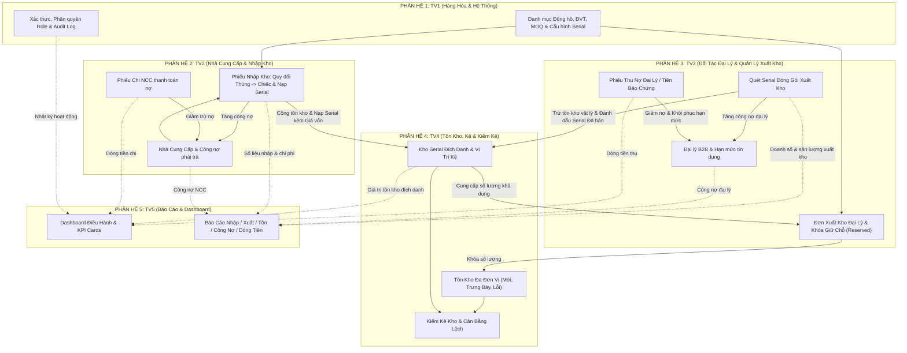

# TỔNG QUAN ĐỀ TÀI & ĐẶC TẢ CHỨC NĂNG HỆ THỐNG QUẢN LÝ KHO ĐỒNG HỒ
## CHRONO VAULT B2B • HOROLOGY WAREHOUSE MANAGEMENT SYSTEM

---

## 1. TỔNG QUAN VỀ ĐỀ TÀI

### 1.1 Tên đề tài
**Hệ thống Quản lý Kho Hàng Hóa Cửa Hàng Đồng Hồ (ChronoVault B2B Wholesale WMS)**

### 1.2 Bối cảnh & Phạm vi nghiệp vụ
Hệ thống được thiết kế chuyên biệt cho mô hình **B2B Wholesale Distribution** (Phân phối xuất kho đại lý cho đại lý, chuỗi cửa hàng bán lẻ đồng hồ cao cấp và các đối tác thương mại), không phục vụ mô hình bán lẻ nhỏ giọt B2C/POS. 

Kho đồng hồ cao cấp là ngành hàng đặc thù có giá trị tài sản rất lớn, yêu cầu bảo hành chính hãng nghiêm ngặt và tiêu chuẩn bảo quản cao. Do đó, hệ thống được xây dựng dựa trên **4 nguyên lý quản trị cốt lõi bắt buộc**:

1. **Quản lý định danh Serial / IMEI đích danh 100%:**
   - Mỗi chiếc đồng hồ lưu hành trong hệ thống đều được quản lý bằng một mã Serial duy nhất do nhà sản xuất phát hành.
   - Truy vết xuyên suốt toàn bộ vòng đời sản phẩm: *Thời điểm nhập -> Lô hàng NCC -> Vị trí ngăn kệ vật lý -> Đơn hàng xuất kho đại lý -> Đại lý sở hữu -> Lịch sử bảo hành / đổi trả*.

2. **Quản lý Đơn vị tính (ĐVT) đa cấp & Quy cách đóng gói xuất kho:**
   - Cho phép nhập và xuất theo quy cách xuất kho đại lý: **Thùng / Kiện / Lô** và quy đổi chính xác ra **Cái / Chiếc lẻ** theo hệ số chuẩn (Ví dụ: 1 Thùng = 10 Chiếc).
   - Kiểm soát số lượng đặt hàng tối thiểu (**MOQ - Minimum Order Quantity**) và chính sách giá phân phối đại lý phân cấp theo cấp bậc đại lý (VIP, Bạc, Đồng).

3. **Cơ chế tính Giá vốn Đích danh (Specific Identification Method):**
   - Không áp dụng phương pháp bình quân giản đơn cho đồng hồ có giá trị cao. Mỗi mã Serial khi nhập kho mang một giá vốn đích danh riêng biệt, được cộng dồn các chi phí phân bổ thực tế (phí vận chuyển quốc tế, thuế hải quan, phí bảo hiểm lô hàng).
   - Đảm bảo tính toán chính xác tuyệt đối giá trị tồn kho và lợi nhuận gộp từng giao dịch.

4. **Chu trình Quản lý Công nợ B2B khép kín & Đối soát dòng tiền:**
   - Tích hợp đầy đủ quy trình tài chính: **Phiếu Chi** thanh toán tiền hàng cho Nhà cung cấp và **Phiếu Thu** thu hồi công nợ đại lý / tiền cọc từ Đại lý.
   - Tự động đối soát và kiểm soát hạn mức tín dụng công nợ (Credit Limit) của từng đại lý trước khi duyệt xuất kho.

---

## 2. PHÂN CÔNG TRÁCH NHIỆM 5 THÀNH VIÊN

Hệ thống được chia thành 5 phân hệ chuyên sâu, tương ứng với 5 thành viên phụ trách:

| STT | Phân hệ / Thành viên | Nhóm chức năng chính | Phạm vi nghiệp vụ phụ trách |
| :---: | :--- | :--- | :--- |
| **1** | **Phân Hệ 1 (TV1)** | **Quản lý Hàng hóa & Quản trị Hệ thống** | Danh mục đồng hồ, Thương hiệu, Bộ sưu tập, Tra cứu vòng đời Serial, Tài khoản người dùng, Ma trận phân quyền Role-Permission & Nhật ký Audit Log. |
| **2** | **Phân Hệ 2 (TV2)** | **Đối tác NCC & Quản lý Nhập kho** | Hồ sơ Nhà cung cấp, Xuất trả hàng lỗi cho NCC, Lập & Duyệt phiếu nhập kho, Quy đổi ĐVT đóng gói/lẻ, Phân bổ chi phí nhập hàng & Phiếu chi NCC. |
| **3** | **Phân Hệ 3 (TV3)** | **Đối tác đại lý & Xuất kho đại lý - Xuất hàng** | Hồ sơ Đại lý B2B, Hạn mức tín dụng, Nhận trả hàng đại lý, Lệnh xuất kho đại lý, Khóa hàng giữ chỗ (Reserved), Phiếu xuất kho đại lý quét Serial, Xuất bảo hành/Hủy & Phiếu thu sỉ. |
| **4** | **Phân Hệ 4 (TV4)** | **Tồn kho, Vị trí Kệ & Kiểm kê** | Tồn kho đa đơn vị (Thùng + Chiếc), Phân loại chất lượng (Kho Mới, Trưng Bày, Hàng Lỗi), Sơ đồ kệ vật lý, Kiểm kê đối soát chênh lệch & Sổ Thẻ kho. |
| **5** | **Phân Hệ 5 (TV5)** | **Báo cáo & Dashboard Điều hành** | Dashboard chỉ số KPI thời gian thực, Biểu đồ doanh thu/chi phí Canvas, Báo cáo chuyên sâu 4 phân hệ, Sổ chi tiết công nợ B2B & Báo cáo dòng tiền thực tế. |

### Tác nhân nghiệp vụ và vai trò người dùng
Hệ thống chuẩn hóa 5 tác nhân (actor) nội bộ, được phân quyền theo nguyên tắc tách biệt quản trị hệ thống, giám sát điều hành, kiểm soát vật lý, tác nghiệp kho và kiểm soát tài chính:

| Tác nhân (Actor) | Trách nhiệm chính | Giới hạn quyền |
| --- | --- | --- |
| **Quản trị hệ thống** | Quản lý tài khoản, vai trò, cấu hình hệ thống và nhật ký Audit Log. | Không thay thế Chủ cửa hàng phê duyệt ngoại lệ nghiệp vụ; không mặc định xử lý phiếu nhập/xuất hoặc thu/chi. |
| **Chủ cửa hàng** | Theo dõi Dashboard và báo cáo doanh thu, tồn kho, công nợ, dòng tiền; phê duyệt ngoại lệ vượt ngưỡng về chi phí, tín dụng hoặc cân bằng kiểm kê. | Không quản trị tài khoản/phân quyền và không xử lý nghiệp vụ nhập/xuất thường ngày. |
| **Thủ kho (quản lý điều hành)** | Quản lý điều hành hoạt động kho, chịu trách nhiệm bảo quản hàng hóa, vị trí kệ, kiểm đếm thực tế, xác nhận giao nhận vật lý và kiểm kê/cân bằng kho theo thẩm quyền. | Không lập chứng từ tài chính, không quản trị tài khoản và không tự duyệt ngoại lệ vượt ngưỡng. |
| **Nhân viên nhập - xuất kho** | Lập phiếu nhập, tiếp nhận và quét Serial; lập lệnh xuất kho đại lý nháp theo yêu cầu đại lý, soạn/đóng gói và ghi nhận xuất kho, xử lý luồng bảo hành/đổi trả theo quy trình. | Không duyệt khoản thu/chi, không tự phê duyệt hạn mức tín dụng hoặc chênh lệch kiểm kê vượt ngưỡng. |
| **Kế toán** | Phân bổ chi phí nhập, theo dõi công nợ NCC/đại lý, lập phiếu thu/chi, đối soát chứng từ và báo cáo tài chính. | Không thay thế xác nhận giao nhận vật lý của Thủ kho (quản lý điều hành); ngoại lệ vượt ngưỡng chuyển Chủ cửa hàng duyệt. |

Nhà cung cấp và đại lý B2B là đối tác giao dịch bên ngoài, không phải vai trò nhân viên nội bộ của hệ thống.

---

## 3. CHI TIẾT CÁC CHỨC NĂNG LỚN VÀ CHỨC NĂNG CON (MỨC NGUYÊN TỬ)

### PHÂN HỆ 1: THÀNH VIÊN 1 - QUẢN LÝ HÀNG HÓA & QUẢN TRỊ HỆ THỐNG

#### Chức Năng Lớn 1.1: Quản Lý Hàng Hóa (Đồng Hồ, Thương Hiệu, Serial/IMEI)
* **1.1.1. Xem danh sách đồng hồ:** Hiển thị danh sách sản phẩm với đầy đủ hình ảnh, mã SKU, Barcode, thương hiệu, giá vốn, giá phân phối đại lý, tồn kho thực tế; hỗ trợ phân trang và sắp xếp.
* **1.1.2. Xem chi tiết thông số kỹ thuật:** Xem thông tin kỹ thuật chuyên sâu của đồng hồ: Loại máy (Automatic / Quartz / Eco-Drive Solar), chất liệu kính (Sapphire chống lóa / Hardlex), chất liệu dây (Thép Oystersteel 904L / Dây da / Cao su), kích thước mặt số (Dial size), độ chịu nước (Water resistance), thời hạn bảo hành hãng.
* **1.1.3. Thêm mới đồng hồ:** Form nhập liệu khai báo mã SKU, Barcode, tên mẫu đồng hồ, danh mục, hãng sản xuất, giá vốn chuẩn, giá phân phối đại lý theo từng hạng đại lý, hình ảnh minh họa, định mức Min/Max tồn kho và cờ kích hoạt quản lý Serial.
* **1.1.4. Chỉnh sửa thông tin & Cấu hình đóng gói xuất kho:** Cập nhật thông số đồng hồ, thiết lập ĐVT cơ bản (Chiếc/Cái), ĐVT đóng gói xuất kho (Thùng/Kiện/Lô), hệ số quy đổi đóng gói (ví dụ: 1 Thùng = 10 Chiếc), phương pháp tính giá vốn Đích danh và số lượng đặt hàng tối thiểu (MOQ).
* **1.1.5. Xóa / Tạm ngừng kinh doanh sản phẩm:** Cho phép chuyển trạng thái sản phẩm sang Ngừng kinh doanh hoặc xóa sản phẩm khỏi danh mục hiển thị khi không còn tồn kho.
* **1.1.6. Quản lý Danh mục, Thương hiệu & Bộ sưu tập:** Thêm, sửa, xóa các thương hiệu đồng hồ (Rolex, Omega, Tissot, Seiko, Casio, Citizen...) và các bộ sưu tập kinh doanh.
* **1.1.7. Tìm kiếm & Lọc nâng cao:** Tìm kiếm nhanh theo từ khóa SKU, Barcode, tên đồng hồ; lọc nhanh theo thương hiệu, khoảng giá phân phối đại lý, loại bộ máy.
* **1.1.8. Truy vết vòng đời Serial (Serial Lifecycle Timeline Lookup):** Tra cứu chuyên sâu một mã Serial bất kỳ để theo dõi toàn bộ dòng thời gian: Ngày nhập kho, NCC phân phối, vị trí kệ lưu trữ, trạng thái hàng, đơn xuất kho đại lý, đại lý tiếp nhận và lịch sử bảo hành.
* **1.1.9. Xuất dữ liệu danh mục:** Xuất danh sách sản phẩm đồng hồ kèm thông số kỹ thuật ra định dạng file CSV / Excel.

#### Chức Năng Lớn 1.2: Quản Trị Hệ Thống (Tài Khoản, Phân Quyền, Nhật Ký)
* **1.2.1. Xem danh sách tài khoản:** Hiển thị toàn bộ người dùng trong hệ thống kèm họ tên, email, vai trò (Role), ngày tạo và trạng thái hoạt động.
* **1.2.2. Cấp mới tài khoản:** Khởi tạo tài khoản nhân viên mới, gán vai trò ban đầu và thiết lập mật khẩu mặc định.
* **1.2.3. Khóa / Mở khóa tài khoản:** Thay đổi trạng thái tài khoản nhân viên (Active / Inactive / Suspended) nhằm kiểm soát an toàn truy cập.
* **1.2.4. Cấu hình vai trò người dùng (Roles):** Quản lý 5 vai trò: Quản trị hệ thống (Admin), Thủ kho, Nhân viên nhập - xuất kho, Kế toán và Chủ cửa hàng (Owner).
* **1.2.5. Thiết lập ma trận phân quyền (Role - Permission Matrix):** Phân chia chi tiết quyền hạn theo từng phân hệ: Xem, Thêm mới, Chỉnh sửa, Xóa dữ liệu, Phê duyệt chứng từ và Xuất báo cáo.
* **1.2.6. Đổi mật khẩu cá nhân:** Kiểm tra tính hợp lệ và độ mạnh của mật khẩu; cho phép người dùng chủ động cập nhật mật khẩu định kỳ.
* **1.2.7. Quản lý phiên đăng nhập (Session Management):** Theo dõi phiên đăng nhập hiện hành, tự động đăng xuất an toàn khi hết phiên.
* **1.2.8. Ghi nhận & Truy xuất Nhật ký hệ thống (Audit Log Viewer):** Ghi vết tự động mọi hành vi trong hệ thống (Người thực hiện, hành động Tạo/Sửa/Xóa/Duyệt, chứng từ tác động, mốc thời gian chính xác, địa chỉ IP) nhằm phục vụ công tác thanh tra đối soát.

---

### PHÂN HỆ 2: THÀNH VIÊN 2 - ĐỐI TÁC NHÀ CUNG CẤP & QUẢN LÝ NHẬP HÀNG

#### Chức Năng Lớn 2.1: Quản Lý Nhà Cung Cấp & Xuất Trả Hàng Lỗi
* **2.1.1. Xem danh bạ Nhà cung cấp:** Tra cứu danh sách các hãng và đơn vị phân phối đồng hồ chính hãng; tìm kiếm nhanh theo mã NCC, tên công ty, số điện thoại, mã số thuế.
* **2.1.2. Thêm mới & Cập nhật thông tin NCC:** Quản lý thông tin pháp lý, địa chỉ văn phòng đại diện, người phụ trách liên hệ, email giao dịch và số điện thoại hotline.
* **2.1.3. Cấu hình tài khoản ngân hàng NCC:** Lưu thông tin tài khoản thụ hưởng của Nhà cung cấp (Tên ngân hàng, số tài khoản, chi nhánh) phục vụ việc ủy nhiệm chi.
* **2.1.4. Theo dõi công nợ phải trả NCC:** Quản lý số dư nợ phải trả theo từng NCC; đối soát các khoản nợ phát sinh từ các lô hàng nhập.
* **2.1.5. Lập phiếu Chi thanh toán công nợ NCC:** Khởi tạo phiếu chi tiền (Chuyển khoản / Tiền mặt) thanh toán tiền hàng hoặc ứng trước cho NCC; tự động trừ số dư nợ phải trả của NCC.
* **2.1.6. Lập phiếu xuất trả hàng lỗi cho NCC:** Lựa chọn NCC, nhập/quét mã Serial đồng hồ bị lỗi kỹ thuật từ kho lỗi, ghi nhận nguyên nhân (Lỗi máy không chạy, hấp hơi nước mặt kính, xước xát vỏ/kim từ nhà máy).
* **2.1.7. Phê duyệt phiếu trả hàng NCC:** Giảm trừ trực tiếp số tiền tương ứng vào công nợ phải trả NCC và gửi lệnh sang Phân hệ Kho (TV4) xuất trừ các mã Serial lỗi khỏi kho vật lý.
* **2.1.8. Quản lý trạng thái hợp tác NCC:** Đánh giá độ tin cậy của NCC, tạm dừng hoặc mở lại hoạt động giao dịch nhập hàng.

#### Chức Năng Lớn 2.2: Quản Lý Nhập Kho & Phân Bổ Chi Phí
* **2.2.1. Khởi tạo phiếu nhập kho:** Tạo mới phiếu nhập chính hãng, chọn Nhà cung cấp và nhập thông tin chứng từ vận chuyển / invoice quốc tế.
* **2.2.2. Thêm sản phẩm & Chọn ĐVT nhập:** Thêm sản phẩm đồng hồ bằng cách quét Barcode hoặc chọn mã SKU; lựa chọn ĐVT nhập là **Thùng / Kiện** hoặc **Chiếc lẻ**.
* **2.2.3. Quy đổi số lượng tự động:** Hệ thống tự động nhân hệ số quy đổi từ Thùng ra tổng số lượng Chiếc lẻ cần nạp Serial (Ví dụ: Nhập 2 Thùng -> Hệ thống yêu cầu đủ 20 Chiếc).
* **2.2.4. Nạp & Quét danh sách mã Serial:** Quét barcode camera ZXing từng mã Serial hoặc dán hàng loạt dải Serial từ hãng; bắt buộc số lượng Serial phải khớp đúng 100% với số lượng chiếc quy đổi.
* **2.2.5. Đối soát kiểm tra trùng lặp Serial:** Tự động kiểm tra trong kho và cảnh báo tức thì nếu có bất kỳ mã Serial nào đã tồn tại trong hệ thống.
* **2.2.6. Phân bổ chi phí nhập hàng:** Nhập các chi phí phát sinh cho lô hàng (Chi phí vận chuyển quốc tế, thuế phí hải quan, bảo hiểm hàng giá trị cao); hệ thống tự động phân bổ đều vào giá vốn từng chiếc đồng hồ để tính ra **Giá vốn Đích danh**.
* **2.2.7. Tính toán tổng giá trị phiếu nhập:** Tự động tính tiền hàng trước thuế, chiết khấu thương mại, thuế VAT và tổng tiền thanh toán.
* **2.2.8. Lưu tạm (Draft) phiếu nhập:** Lưu trữ phiếu nhập ở trạng thái nháp để kiểm đếm số lượng thực tế trước khi chốt.
* **2.2.9. Phê duyệt & Chốt nhập kho vật lý:** Chốt phiếu nhập, ghi nhận tăng tồn kho vật lý tại Phân hệ Kho (TV4), nạp danh sách Serial vào kho với giá vốn đích danh và tăng công nợ phải trả NCC.
* **2.2.10. Hủy phiếu nhập:** Hủy bỏ phiếu nhập nháp khi phát hiện sai sót trước khi duyệt.
* **2.2.11. In phiếu nhập kho & Xuất PDF:** Hỗ trợ xem trước và in phiếu nhập kho chuẩn A4 hoặc xuất file PDF lưu trữ chứng từ kế toán.

---

### PHÂN HỆ 3: THÀNH VIÊN 3 - ĐỐI TÁC ĐẠI LÝ & QUẢN LÝ XUẤT KHO

#### Chức Năng Lớn 3.1: Quản Lý Đại Lý B2B & Tiếp Nhận Trả Hàng
* **3.1.1. Xem danh sách đại lý B2B:** Quản lý danh mục 100% đối tác là pháp nhân/cửa hàng/chuỗi đại lý phân phối; phân hạng đại lý (Hạng VIP, Hạng Bạc, Hạng Đồng).
* **3.1.2. Thêm mới & Cập nhật hồ sơ đại lý:** Quản lý thông tin pháp lý, tên thương hiệu shop, mã số thuế, người đại diện hợp đồng, số điện thoại, địa chỉ kho nhận hàng và chính sách phân phối cam kết.
* **3.1.3. Cấu hình chính sách thương mại & Chiết khấu:** Thiết lập tỷ lệ chiết khấu hợp đồng và hạn mức tín dụng nợ tối đa (Credit Limit) cho từng đại lý.
* **3.1.4. Giám sát hạn mức công nợ khả dụng:** Tự động theo dõi số dư nợ hiện tại, hạn mức nợ còn lại có thể mua hàng và lịch sử thanh toán công nợ.
* **3.1.5. Lập phiếu Thu hồi công nợ đại lý / Thu nợ đại lý:** Khởi tạo phiếu thu tiền (Chuyển khoản ngân hàng / Tiền mặt) ghi nhận tiền cọc hợp đồng hoặc thu hồi nợ đại lý; tự động trừ số dư nợ và khôi phục hạn mức mua hàng khả dụng cho đại lý.
* **3.1.6. Tiếp nhận yêu cầu nhận trả hàng đại lý:** Quét mã Serial sản phẩm đại lý gửi trả để đối soát xác minh nguồn gốc xuất bán đúng từ hệ thống.
* **3.1.7. Phân loại sản phẩm đổi trả:** Đánh giá chất lượng hàng đổi trả: Đưa vào **Kho Hàng Mới** (đại lý đổi mẫu mã kinh doanh, nguyên seal) hoặc chuyển vào **Kho Hàng Lỗi** (phát sinh lỗi kỹ thuật, trầy xước chờ bảo hành).
* **3.1.8. Phê duyệt phiếu nhận trả hàng đại lý:** Tự động cấn trừ giá trị hàng đổi trả vào số dư nợ của đại lý và cập nhật tăng tồn kho tương ứng tại Phân hệ Kho (TV4).
* **3.1.9. Quản lý trạng thái đại lý:** Tạm khóa tài khoản nhập hàng đại lý hoặc ngưng hợp tác đối với các đại lý nợ quá hạn hoặc vi phạm cam kết hợp đồng.

#### Chức Năng Lớn 3.2: Quản Lý Xuất Kho Đại Lý & Điều Chuyển (Lệnh Xuất Đại Lý, Xuất Kho, Xuất Bảo Hành/Hủy)
* **3.2.1. Khởi tạo lệnh xuất kho đại lý:** Tạo đơn đặt hàng mới cho đại lý đối tác được chỉ định.
* **3.2.2. Chọn sản phẩm theo Thùng hoặc Chiếc lẻ:** Cho phép lên đơn theo ĐVT đóng gói (**Thùng / Kiện**) hoặc **Chiếc lẻ**; hệ thống tự động quy đổi ra chiếc lẻ và kiểm tra điều kiện số lượng đặt hàng tối thiểu (MOQ).
* **3.2.3. Kiểm tra tồn kho khả dụng thời gian thực:** Tra cứu tức thì số lượng tồn khả dụng (In-Stock trừ đi số lượng đang Giữ chỗ - Reserved) từ Phân hệ Kho (TV4).
* **3.2.4. Áp giá đại lý tự động theo cấp bậc:** Áp dụng đơn giá phân phối đại lý chuẩn theo đúng hạng đại lý (VIP / Bạc / Đồng) và tính chiết khấu hợp đồng thương mại.
* **3.2.5. Quản lý tiền cọc & Hạn thanh toán:** Thiết lập số tiền đặt cọc bắt buộc, thời hạn thanh toán công nợ theo hợp đồng (Net 15 / Net 30 / Net 45 ngày).
* **3.2.6. Phê duyệt lệnh xuất đại lý & Khóa hàng Giữ chỗ (Reserved):** Đối soát điều kiện đặt cọc và hạn mức nợ khả dụng của đại lý; sau khi duyệt thành công, chuyển số lượng sản phẩm sang trạng thái **"Giữ chỗ (Reserved)"** để không bị bán trùng lặp cho đơn khác.
* **3.2.7. Hủy lệnh xuất kho đại lý:** Hủy bỏ đơn hàng khi đại lý không hoàn tất cọc hoặc vi phạm hợp đồng; tự động giải phóng số lượng giữ chỗ trả lại cho tồn kho khả dụng.
* **3.2.8. Khởi tạo phiếu xuất kho xuất kho đại lý:** Tạo phiếu xuất kho phục vụ công tác đóng gói và xuất giao hàng cho đại lý dựa trên đơn hàng đã duyệt.
* **3.2.9. Đóng gói & Quét Serial xuất kho thực tế:** Thủ kho sử dụng camera / máy quét mã vạch quét đích danh từng mã Serial lấy từ trên kệ đóng vào kiện hàng xuất đi; hệ thống kiểm tra đối chiếu mã Serial có thuộc danh mục giữ chỗ hay không.
* **3.2.10. Xác nhận hoàn tất xuất kho:** Gửi lệnh sang Phân hệ Kho (TV4) trừ tồn kho thực tế, chuyển trạng thái các mã Serial sang **"ĐÃ BÁN (SOLD)"** và cập nhật tăng nợ đại lý tương ứng.
* **3.2.11. Lập phiếu xuất khác (Bảo hành / Tiêu hủy):** Khởi tạo phiếu xuất kho phục vụ mục đích phi thương mại: Xuất chuyển về Trung tâm bảo hành của hãng hoặc Xuất tiêu hủy đối với hàng hóa hỏng hóc nghiêm trọng không thể phục hồi.
* **3.2.12. Ghi nhận chi phí vận chuyển & Logistics:** Nhập chi phí đóng gói chống sốc và cước vận chuyển bảo đảm giá trị cao; chỉ định bên chịu phí (Kho tổng chịu hoặc Đại lý chịu).
* **3.2.13. In biên bản bàn giao kiêm phiếu xuất kho B2B:** In chứng từ xuất kho chính thức khổ A4 có đầy đủ chữ ký các bên, bảng kê chi tiết toàn bộ các mã Serial xuất giao và điều khoản cam kết bảo hành.

---

### PHÂN HỆ 4: THÀNH VIÊN 4 - TỒN KHO, VỊ TRÍ KỆ & KIỂM KÊ

#### Chức Năng Lớn 4.1: Theo Dõi Tồn Kho Đa Đơn Vị & Phân Loại Chất Lượng
* **4.1.1. Theo dõi tồn kho tổng hợp đa đơn vị:** Hiển thị số lượng tồn kho theo cả 2 đơn vị: Đơn vị sỉ (**Thùng / Kiện**) và Đơn vị lẻ (**Chiếc**), phân tách rõ ràng 3 chỉ số: **Tồn thực tế, Tồn giữ chỗ (Reserved)** và **Tồn khả dụng xuất kho đại lý**.
* **4.1.2. Quản lý 3 trạng thái phân loại chất lượng kho:**
  - **Kho Hàng Mới (New Stock):** Hàng nguyên đai nguyên kiện, đủ điều kiện xuất kho đại lý cho đại lý.
  - **Kho Hàng Trưng Bày (Display Stock):** Đồng hồ phục vụ mở hộp mẫu trưng bày cho đại lý xem mẫu.
  - **Kho Hàng Lỗi (Defect Stock):** Hàng phát sinh lỗi kỹ thuật, chờ trả hãng hoặc chờ bảo hành.
* **4.1.3. Truy vấn danh mục Serial lưu kho:** Tra cứu, lọc danh sách chi tiết từng mã Serial kèm theo vị trí ngăn kệ, ngày nhập và trạng thái chất lượng tương ứng.
* **4.1.4. Tính toán giá trị tồn kho theo Giá vốn Đích danh:** Tự động tính toán tổng tài sản tồn kho bằng cách cộng dồn giá vốn thực tế của từng mã Serial đang có mặt trong kho; không làm tròn hay bình quân sai lệch.
* **4.1.5. Cảnh báo định mức tồn kho (Min / Max Alert):** Tự động phát tín hiệu cảnh báo màu vàng khi tồn kho chạm ngưỡng tối thiểu (Min stock) để lập đề xuất nhập hàng; cảnh báo đỏ khi vượt ngưỡng tối đa (Max stock) tránh ứ đọng vốn.
* **4.1.6. Cảnh báo hết hàng:** Tự động đánh dấu hết hàng đối với sản phẩm có tồn khả dụng bằng 0, kích hoạt cờ tạm khóa nhận lệnh xuất đại lý.

#### Chức Năng Lớn 4.2: Sơ Đồ Vị Trí Kệ Hàng & Quản Lý Định Vị
* **4.2.1. Quản lý sơ đồ vị trí kệ kho vật lý:** Thiết lập mã định danh vị trí kho theo cấu trúc chuẩn: **[Khu vực - Dãy kệ - Tầng kệ - Ngăn chứa]** (Ví dụ: `Khu A - Dãy A-01 - Tầng 2 - Ngăn Đồng hồ Thụy Sỹ`).
* **4.2.2. Phân bổ và sắp xếp sản phẩm vào kệ:** Gán vị trí lưu kho cố định cho từng mã sản phẩm đồng hồ để thủ kho dễ dàng lấy hàng (Picking) khi đóng gói đơn hàng xuất đại lý.
* **4.2.3. Hiển thị sức chứa & Tải trọng kệ:** Trực quan hóa số lượng đồng hồ hiện có trên từng ngăn kệ và tỷ lệ lấp đầy của các dãy kệ.

#### Chức Năng Lớn 4.3: Kiểm Kê Kho & Sổ Thẻ Kho
* **4.3.1. Khởi tạo đợt kiểm kê:** Lập phiếu kiểm kê định kỳ (tháng/quý) hoặc đột xuất theo từng dãy kệ cụ thể hoặc toàn bộ kho.
* **4.3.2. Quét kiểm đếm thực tế:** Hỗ trợ quét mã vạch / camera ZXing từng mã Serial thực tế hiện diện trên kệ để ghi nhận số lượng thực tế đếm được.
* **4.3.3. Tự động đối soát & Tính toán chênh lệch:** Hệ thống tự động so sánh số lượng đếm thực tế với số liệu sổ sách hệ thống để xác định số lượng chênh lệch (Thừa hoặc Thiếu).
* **4.3.4. Lập phiếu cân bằng kho:** Sau khi đợt kiểm kê được phê duyệt, tự động sinh phiếu điều chỉnh cân bằng kho, cập nhật số liệu sổ sách khớp với thực tế và ghi vết lý do vào Audit Log.
* **4.3.5. Truy xuất Sổ Thẻ kho điện tử:** Xem nhật ký chi tiết dòng thời gian biến động của từng mã sản phẩm: Ngày phát sinh, loại chứng từ (Phiếu nhập, Phiếu xuất kho đại lý, Phiếu đổi trả, Cân bằng kiểm kê), số lượng biến động (+/-) và danh sách mã Serial liên quan.

---

### PHÂN HỆ 5: THÀNH VIÊN 5 - BÁO CÁO & DASHBOARD ĐIỀU HÀNH

#### Chức Năng Lớn 5.1: Dashboard Trung Tâm Điều Hành (Executive Dashboard)
* **5.1.1. Thẻ chỉ số hiệu suất trọng yếu (KPI Cards):**
  - **Tổng giá trị tồn kho đích danh:** Cộng dồn 100% giá vốn đích danh từng mã Serial đang có mặt trong kho.
  - **Doanh thu phân phối đại lý:** Doanh số tích lũy từ các đơn hàng xuất bán cho đại lý đối tác.
  - **Số lượng đơn hàng xuất đại lý:** Tổng số đơn đặt hàng đại lý trong kỳ.
  - **Tồn kho khả dụng:** Tổng số chiếc đồng hồ sẵn sàng cung ứng cho kênh xuất kho đại lý.
  - **Tỷ lệ tiếp nhận trả hàng đại lý:** Phần trăm số lượng hàng trả lại trên tổng số xuất bán (ngưỡng an toàn < 2.0%).
* **5.1.2. Biểu đồ trực quan doanh số phân phối đại lý (Canvas Chart):** Biểu diễn xu hướng doanh số xuất kho đại lý theo 6 tháng gần nhất kèm tỷ lệ tăng trưởng.
* **5.1.3. Bảng xếp hạng Top sản phẩm xuất kho đại lý:** Thống kê danh sách các mẫu đồng hồ được các đại lý nhập nhiều nhất (xếp theo sản lượng bán ra và tổng doanh số phân phối).
* **5.1.4. Dòng thời gian hoạt động gần đây (Audit Activity Stream):** Theo dõi tức thời các thao tác trọng yếu phát sinh trong hệ thống (Nhập kho mới, duyệt lệnh xuất đại lý, thu tiền nợ đại lý, kiểm kê kệ...).

#### Chức Năng Lớn 5.2: Hệ Thống Báo Cáo Chuyên Sâu Đa Phân Hệ
* **5.2.1. Báo cáo chuyên sâu Nhập hàng (Inbound Report):** Thống kê tổng số lượng và giá trị nhập hàng theo từng Nhà cung cấp, phân tích cơ cấu chi phí nhập kho phát sinh.
* **5.2.2. Báo cáo chuyên sâu Phân phối Đại lý (Wholesale Outbound Report):** Báo cáo doanh số xuất kho đại lý theo từng đại lý, tỷ lệ hoàn tất đơn hàng và tỷ lệ hủy đơn.
* **5.2.3. Báo cáo Cơ cấu xuất hàng:** Thống kê tỷ trọng xuất kho theo các mục đích nghiệp vụ: Xuất kho đại lý thương mại, Xuất gửi bảo hành chính hãng, Xuất tiêu hủy hàng hỏng.
* **5.2.4. Báo cáo Đổi trả & Chất lượng sản phẩm:** Phân tích tỷ lệ sản phẩm lỗi phân theo từng hãng sản xuất và theo dòng bộ máy (Automatic / Pin Quartz / Solar) để phục vụ đàm phán hợp đồng với NCC.
* **5.2.5. Báo cáo Tồn kho & Cảnh báo hàng chậm luân chuyển:** Báo cáo thời gian lưu kho của từng dòng sản phẩm, nhận diện hàng tồn kho lâu ngày (Dead Stock) để có chính sách khuyến mãi thanh lý sỉ.
* **5.2.6. Báo cáo Tài chính & Lợi nhuận gộp B2B:** Tổng hợp Doanh số xuất kho đại lý trừ đi Giá vốn hàng bán đích danh và Chi phí logistics phân bổ để xác định Lợi nhuận gộp thực tế của kênh phân phối.
* **5.2.7. Sổ chi tiết công nợ B2B (Đại lý & Nhà cung cấp):** Bảng đối soát chi tiết tình hình công nợ: Số dư nợ đầu kỳ, Phát sinh nợ trong kỳ (do nhập/xuất hàng), Phát sinh có trong kỳ (từ Phiếu thu/Phiếu chi tiền) và Số dư nợ cuối kỳ.
* **5.2.8. Báo cáo Dòng tiền Thu / Chi thực tế (Cashflow Report):** Tổng hợp dòng tiền mặt / ngân hàng thực tế thu vào (tiền cọc đơn xuất kho, tiền trả nợ đại lý) và chi ra (thanh toán NCC, phí vận chuyển) theo mốc thời gian.
* **5.2.9. Xuất báo cáo đa định dạng:** Hỗ trợ trích xuất toàn bộ dữ liệu báo cáo ra định dạng file Excel / CSV hoặc in PDF.

---

## 4. MA TRẬN LUỒNG DỮ LIỆU LIÊN PHÂN HỆ (DATA FLOW)

Các phân hệ trong hệ thống tương tác và trao đổi dữ liệu chặt chẽ theo sơ đồ chu trình nghiệp vụ khép kín:

---

## 5. CẤU TRÚC MÃ NGUỒN & ÁNH XẠ FILE TRONG DỰ ÁN

Hệ thống được tổ chức hoàn chỉnh thành 2 hình thức trải nghiệm: **Trang tổng hợp tích hợp toàn diện (Mobile-First Luxury Simulator / Fullscreen)** và **Các trang chuyên trang độc lập của từng thành viên phục vụ demo và đánh giá báo cáo**:

| Đường dẫn tệp tin | Phân hệ / Vai trò | Chức năng chi tiết trong dự án |
| :--- | :---: | :--- |
| `index.html` | **Cổng Trung Tâm** | Ứng dụng tích hợp hoàn chỉnh 5 phân hệ trong một giao diện duy nhất, hỗ trợ chế độ Mobile App giả lập iPhone Dynamic Island và chế độ Toàn màn hình PC/Tablet. |
| `tv1_hang_hoa.html` | **Phân Hệ 1 (TV1)** | Trang nghiệp vụ độc lập: Danh mục đồng hồ, lọc thương hiệu, thông số kỹ thuật, form thêm mới và tra cứu vòng đời Serial (Serial Lookup). |
| `tv1_he_thong.html` | **Phân Hệ 1 (TV1)** | Trang nghiệp vụ độc lập: Danh sách người dùng, ma trận phân quyền Role-Permission Matrix và xem nhật ký Audit Log. |
| `tv2_nhap_kho.html` | **Phân Hệ 2 (TV2)** | Trang nghiệp vụ độc lập: Quản lý đối tác NCC, sổ nợ NCC, lập phiếu chi thanh toán và lập phiếu nhập kho quy đổi ĐVT. |
| `tv3_xuat_kho.html` | **Phân Hệ 3 (TV3)** | Trang nghiệp vụ độc lập: Quản lý đại lý B2B, hạn mức tín dụng, lập phiếu thu nợ đại lý, khởi tạo lệnh xuất đại lý và quét xuất Serial. |
| `tv4_ton_kho.html` | **Phân Hệ 4 (TV4)** | Trang nghiệp vụ độc lập: Bảng tồn kho đa đơn vị, chuyển tab 3 kho chất lượng (Mới/Trưng bày/Lỗi), sơ đồ vị trí kệ và kiểm kê kho. |
| `tv5_bao_cao.html` | **Phân Hệ 5 (TV5)** | Trang nghiệp vụ độc lập: Dashboard điều hành, Canvas biểu đồ doanh số 6 tháng, sổ chi tiết công nợ B2B và dòng tiền thu/chi. |
| `css/style.css` | **Hệ thống Giao diện** | Thiết kế phong cách **Horology Luxury** (Dark Mode nền đen Onyx `#0B0F17`, vàng Gold hoàng gia `#D4AF37`, xanh biển `#1E293B`, viền tinh xảo). |
| `js/data.js` | **Data Storage Engine** | Khởi tạo và quản lý toàn bộ dữ liệu mẫu (Seed Data) và LocalStorage cho 18 bảng thực thể nghiệp vụ. |
| `js/scanner.js` | **Camera Scanner** | Tích hợp thư viện quét mã vạch / mã QR / Serial Camera ZXing thời gian thực và nạp mã mẫu thử nghiệm. |
| `js/tv1_products.js` | **Logic TV1 (Hàng hóa)** | Xử lý danh mục, lọc thương hiệu, render sản phẩm, thêm đồng hồ mới, tra cứu vòng đời Serial và xuất file CSV. |
| `js/tv1_system.js` | **Logic TV1 (Hệ thống)** | Xử lý người dùng, chuyển đổi trạng thái tài khoản, cấu hình ma trận quyền và ghi nhận/hiển thị Audit Log. |
| `js/tv2_inbound.js` | **Logic TV2 (Nhập kho)** | Xử lý nhà cung cấp, lập phiếu chi, tính toán quy đổi Thùng -> Chiếc, nạp dải Serial và phân bổ chi phí lô hàng. |
| `js/tv3_outbound.js` | **Logic TV3 (Xuất kho đại lý)** | Xử lý đại lý, lập phiếu thu sỉ, tính chiết khấu theo cấp bậc đại lý, duyệt đơn khóa giữ chỗ và quét đóng gói xuất hàng. |
| `js/tv4_warehouse.js`| **Logic TV4 (Tồn kho)** | Xử lý lọc kho theo 3 chất lượng, trực quan hóa sơ đồ kệ vật lý, đối soát số liệu kiểm kê thực tế và cân bằng kho. |
| `js/tv5_reports.js`  | **Logic TV5 (Báo cáo)** | Xử lý tính toán KPI, vẽ biểu đồ doanh số bằng HTML5 Canvas, mở modal sổ chi tiết công nợ và dòng tiền thu chi. |
| `js/app.js`          | **Core Controller** | Điều hướng tab, chuyển đổi chế độ Mobile/Fullscreen, quản lý Drawer menu, mở/đóng Modal và thông báo Toast. |

---

## 6. KẾT LUẬN & ĐIỂM NỔI BẬT CỦA HỆ THỐNG

1. **Chuẩn hóa nghiệp vụ B2B chuyên nghiệp:** Không lai tạp với mô hình bán lẻ thông thường, phản ánh đúng bài toán kinh doanh phân phối đại lý đồng hồ cao cấp.
2. **Khép kín 100% dòng thông tin và tài chính:** Đảm bảo tính nhất quán giữa số lượng vật lý (mã Serial), vị trí lưu kho (kệ hàng) và dòng tiền thanh toán (công nợ, phiếu thu, phiếu chi).
3. **Trải nghiệm giao diện cao cấp (Horology Luxury Aesthetic):** Được thiết kế trau chuốt với bảng màu sang trọng đặc trưng của ngành đồng hồ cao cấp Thụy Sỹ, mang lại cảm giác chuyên nghiệp và hiện đại.
4. **Sẵn sàng triển khai:** Kiến trúc mã nguồn được phân tách module rõ ràng, độc lập cho từng thành viên nộp bài đồng thời tích hợp mượt mà trong giao diện trung tâm.
